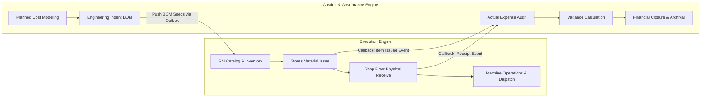

# Exhaustive Technical & Functional Audit Report: MERC Indent Application (IMCMS)

**Application Name:** Manufacturing Enterprise Resource & Costing System (MERC) / Indent & Costing Management System (IMCMS)  
**Repository Working Directory:** `c:\Users\Admin\OneDrive\Desktop\indent application`  
**Report File Path:** [docs/audit/MERC_INDENT_FULL_REPORT.md](file:///c:/Users/Admin/OneDrive/Desktop/indent%20application/docs/audit/MERC_INDENT_FULL_REPORT.md)  
**Audit Standard:** Read-Only Forensic Source Code & Infrastructure Verification  
**Audit Date:** November 19, 2026  
**Auditor:** DeepMind Antigravity Technical Audit Agent  

---

## Executive Summary & Audit Constraints

This report provides a complete, exhaustive functional and technical audit of the MERC application. Every assertion, schema definition, formula, endpoint, and configuration key in this report is directly cited from verified repository source files, configurations, CI/CD pipelines, migrations, or git logs. No source code has been altered or deleted during this audit. Secret values are strictly masked as `****`. Where runtime environment verification cannot be performed statically, explicit commands labelled `REQUIRES SERVER CHECK` are provided.

---

## Table of Contents

1. [Overview](#1-overview)
2. [Tech Stack](#2-tech-stack)
3. [Data Storage](#3-data-storage)
4. [Deployment & Infrastructure](#4-deployment--infrastructure)
5. [Configuration & Environment Variables](#5-configuration--environment-variables)
6. [Authentication & Security](#6-authentication--security)
7. [Email & SMTP Subsystem](#7-email--smtp-subsystem)
8. [Background Jobs, Workers & Schedulers](#8-background-jobs-workers--schedulers)
9. [End-to-End Business Workflow](#9-end-to-end-business-workflow)
10. [API Surface & Endpoint Catalog](#10-api-surface--endpoint-catalog)
11. [Frontend Architecture & User Interface](#11-frontend-architecture--user-interface)
12. [Integrations & External Connections](#12-integrations--external-connections)
13. [Shared Master Data & Identifier Formats](#13-shared-master-data--identifier-formats)
14. [Logging, Audit Trail, Error Handling & Document Exports](#14-logging-audit-trail-error-handling--document-exports)
15. [Testing Frameworks & Quality Gates](#15-testing-frameworks--quality-gates)
16. [Integration Readiness for Sibling RM Application](#16-integration-readiness-for-sibling-rm-application)
17. [Prioritized Technical Debt, Bugs & Architectural Risks](#17-prioritized-technical-debt-bugs--architectural-risks)
18. [Appendices](#18-appendices)
19. [Section Status Checklist](#19-section-status-checklist)

---

## 1. Overview

### 1.1 Purpose of the Application
The MERC (Manufacturing Enterprise Resource & Costing / IMCMS) application is a specialized enterprise manufacturing resource planning and costing management platform designed for custom, made-to-order manufacturing operations (`PRD.md:L1-15`, `docs/flow/merc-flow.md:L11-23`). It tracks the end-to-end lifecycle of technical manufacturing indents across a **Two-Loop Zero-Approval Architecture**:
1. **Loop 1 (Manufacturing Execution Loop):** Technical design engineering, Bill of Materials (BOM) creation with custom dimensional parameters (shapes, diameters, lengths, widths, unit weights), stores raw material inventory verification and issuance, shop-floor physical receipt confirmation, progress tracking, and manufacturing completion (`backend/src/business-transaction/definitions/workflow-state-machine.definition.ts:L15-86`).
2. **Loop 2 (Financial Closure Loop):** Collection and auditing of actual material supplier invoices, sub-contracting vendor costs, in-house labor hours, automated variance calculation against original engineering estimates, and executive financial closure (`backend/src/business-transaction/definitions/workflow-state-machine.definition.ts:L88-153`).
3. **Zero-Approval Architecture Rule:** Senior Managers (SM) and General Managers (GM) do **not** approve operational transactions. Instead, they are notified asynchronously at every state transition and passively monitor KPIs and bottlenecks via executive dashboards (`PRD.md:L24`, `backend/src/business-transaction/definitions/notification-event.definition.ts:L1-124`).

### 1.2 Users and Daily Roles
Verified via `database/seed.ts:L163-200` and `backend/src/main.ts:L108-116`:
- **Admin (`System Administrator`):** Complete system configuration, user lifecycle management, role/permission assignment, global application settings, and audit log analysis.
- **Design Engineer:** Creates technical indents, specifies raw materials and cut dimensions, defines process sequences and estimated machine hours, allocates estimated costs, attaches drawings/CAD files, and submits indents to Stores.
- **Stores Executive:** Verifies BOM items against warehouse on-hand inventory, checks raw material stock levels, and executes full or partial material issues to the shop floor.
- **Production Executive:** Acknowledges physical receipt of raw materials at the shop floor, starts production, updates daily machining/assembly progress, and records manufacturing completion.
- **Accounts Executive:** Collects external vendor bills and internal operational expenses, inputs actual rates and quantities, reviews system-computed cost variances, and executes final financial closure.
- **Senior Manager & General Manager:** Executive monitoring of order velocity, department budgets, 48-hour material issue SLA bottlenecks, and overall profit margin variance without transactional sign-off gates.

### 1.3 System Modules
Verified via `backend/src/app.module.ts:L5-33` and `frontend/src/app/router.tsx:L38-219`:
1. **Auth & Security (`AuthModule`):** JWT token issuance, refresh token rotation, password hashing, session management, account lockout protection.
2. **Roles & Permissions (`RolesModule`, `PermissionsModule`):** Dynamic RBAC engine with role-permission mappings.
3. **Users & Departments (`UsersModule`, `MasterDataModule`):** User directory, profile management, and departmental hierarchy.
4. **Master Data (`MasterDataModule`, `UnitsModule`, `VendorsModule`, `ProcessesModule`):** Units of measure, raw material catalogs, vendors, products, and manufacturing process routings.
5. **Business Transactions (`BusinessTransactionModule`):** The core lifecycle engine for indents, indent items, brought-out materials, attachments, and workflow state transitions.
6. **Costing & Cost Sheets (`BusinessTransactionModule`):** Planned vs. actual cost calculation, item-level process costing, overhead allocation, and variance mathematical modeling.
7. **Communication & Email Queue (`CommunicationModule`):** Postgres-backed transactional email queue worker (`PostgresMailWorker`), Handlebars template compilation, Gmail API OAuth2 transport.
8. **Notifications (`NotificationsModule`):** In-app user notification feeds, read state management, and 48-hour overdue material issue alerts (`OverdueMaterialScheduler`).
9. **Audit & Activity Logs (`AuditModule`):** Change-data-capture audit logs (with JSON diffs) and user activity streams.
10. **Reports & Exports (`ReportsModule`):** Production yield, machine utilization, cost variance, and material breakdown reports with Excel and PDF export capabilities.
11. **Analytics (`AnalyticsModule`):** Executive KPI aggregations, department efficiency, workflow velocity, and vendor allocation metrics.
12. **Storage (`StorageModule`):** Pluggable file storage engine supporting local disk and Supabase Object Storage.
13. **Observability & Health (`ObservabilityModule`):** Liveness/readiness probes, metrics aggregation, frontend error ingestion, and latency tracking.
14. **Internal Integration Bridge (`InternalModule`):** Machine-to-machine (M2M) authenticated REST interface connecting MERC to sibling Raw Material (RM) ERP systems with transactional outbox retry logic.

### 1.4 Repository Directory Tree (Depth 3)
```
.
├── .github/
│   └── workflows/
│       ├── api-verification.yml
│       └── ci.yml
├── backend/
│   ├── performance/
│   │   └── load-003-inventory-concurrency.js
│   ├── scratch/
│   ├── src/
│   │   ├── analytics/
│   │   ├── audit/
│   │   ├── auth/
│   │   ├── business-transaction/
│   │   ├── common/
│   │   ├── communication/
│   │   ├── config/
│   │   ├── internal/
│   │   ├── master-data/
│   │   ├── notifications/
│   │   ├── observability/
│   │   ├── permissions/
│   │   ├── prisma/
│   │   ├── processes/
│   │   ├── reports/
│   │   ├── roles/
│   │   ├── settings/
│   │   ├── storage/
│   │   ├── units/
│   │   ├── users/
│   │   ├── vendors/
│   │   ├── app.module.ts
│   │   └── main.ts
│   ├── test/
│   │   ├── analytics.e2e-spec.ts
│   │   ├── api.e2e-spec.ts
│   │   ├── app.e2e-spec.ts
│   │   ├── jest-e2e.json
│   │   └── workflow.integration.spec.ts
│   ├── uploads/
│   │   └── attachments/
│   ├── package.json
│   └── tsconfig.json
├── database/
│   ├── backup/
│   │   └── README.md
│   ├── migrations/
│   │   ├── 20260810000000_init/
│   │   ├── 20260810135747_add_current_state_to_indent/
│   │   ├── 20260812000000_add_performance_indexes/
│   │   ├── 20260818000000_phase2_foundation_schema/
│   │   ├── 20260824000000_init_email_jobs/
│   │   ├── 20260826000000_expand_attachment_metadata/
│   │   └── 20261104000000_add_rm_webhook_outbox/
│   ├── schema.prisma
│   └── seed.ts
├── docs/
│   ├── application-reference/
│   ├── audit/
│   ├── database/
│   ├── flow/
│   └── integration/
├── frontend/
│   ├── e2e/
│   │   ├── e2e-001-happy-path.spec.ts
│   │   └── workflow.spec.ts
│   ├── src/
│   │   ├── api/
│   │   ├── app/
│   │   ├── components/
│   │   ├── constants/
│   │   ├── hooks/
│   │   ├── modules/
│   │   ├── pages/
│   │   ├── store/
│   │   ├── theme/
│   │   └── utils/
│   ├── package.json
│   ├── vite.config.ts
│   └── tsconfig.json
├── scripts/
│   ├── generate_db_docs.js
│   ├── trigger-indent-webhook.js
│   └── verify-api.ts
├── tools/
│   └── api-verifier/
├── azure-pipelines.yml
├── docker-compose.yml
├── docker-compose.test.yml
├── package.json
└── render.yaml
```

### 1.5 Git Branches
Verified via `git branch -a`:
- Active Local Branch: `main` (tracked to `origin/main`)
- Baseline & Performance Branches:
  - `phase-10-postgres-baseline`
  - `phase-11-api-performance-baseline`
  - `phase-12-frontend-performance-baseline`
  - `phase-13-email-queue-baseline`
  - `phase-14-production-validation`
  - `phase-15-production-go-live`
  - `phase-16-observability`
  - `phase-17-rbac-audit`
  - `phase-8-post-redis-removal`
  - `phase-9-performance-baseline`
  - `redis-removal-baseline`
  - `subagent-Settings-Fullstack-Engineer-self-fb2a4a0d`

### 1.6 Git Log: Summary of Last 50 Commits
Verified via `git log -n 50 --oneline`:
The recent commit history reflects key evolutionary milestones:
1. `e93c628` - `fix(frontend): unwrap paginated departments in getOptions and guard dashboard array lookups`
2. `0afc39a` - `fix(backend): apply production stability, security, and workflow fixes`
3. `faa3a6e` - `fix(transaction): resolve update timeout with bulk operations, batch resolution, and item-level process cost ownership`
4. `21bf15e` - `feat: support custom process names with auto-resolution and costing calculation in indents`
5. `b836d4d` - `fix(frontend): resolve vendor dropdown prefill loop and improve combobox search`
6. `82d00a2` - `feat(integration): add RM notification on verify stock and display partial issue progress`
7. `e1032af` - `fix(validation): allow indents without manufacturing processes in ProcessCostSheetValidator`
8. `8dcb3f7` - `fix(lint): resolve prefer-const and prettier formatting in internal services`
9. `c4b9ce8` - `fix(integration): send vendorName, source, partName and poNumber in RM payload`
10. `a00cbcd` - `fix(config): fallback DIRECT_URL to DATABASE_URL and make it optional in production validation`
11. `c2b2c06` - `fix(integration): automate render migrations, configure RM env vars, add startup logging, and env validation`
12. `e1c62e5` - `feat(internal): push to RM on submitDesign and expose pending indents sync endpoint`
13. `a99cf9e` - `fix(deploy): restore start:prod to node dist/main to fix Render DIRECT_URL startup error`
14. `aab75f1` - `fix(internal): resolve prettier formatting and TS2339 property access for rmWebhookOutbox`
15. `15e2106` - `fix(internal): fix controller prefix to prevent double /api, add debug logging, retry pending entries, and run migrations on prod start`
16. `1891a62` - `chore: format migration and trigger utility script`
17. `ddbc597` - `feat(internal): allow retry-outbox to take optional indentId and add trigger utility script`
18. `35e6408` - `fix(rm-webhook): implement outbox pattern, retry cron, and debug logging for production RM webhook`
19. `d9c65e3` - `feat: implement bidirectional M2M integration with RM application (Phase 1-3)`
20. `b76386e` - `docs(integration): add technical audit and business flow specifications for sibling app integration`
21. `c67bfde` - `fix(reports): resolve UUID type casts and category filtering for material breakdown report`
22. `143afd7` - `fix(roles): resolve role permissions serialization, update routing, and modal rendering`
23. `f43543f` - `feat(print): enhance SingleIndentPrintSheet and SingleCostSheetPrintSheet with accurate material weight, dimensions and process sourcing`
24. `a3e8a7a` - `fix(costing): streamline actual rate inputs and align formatting in CostSheetDetailsPage`
25. `4993b8b` - `feat(costing,production): refine actual costs display when empty and add stage filter options in production dashboard`
26. `4c2ac84` - `refactor: optimize useUniversalPrint hook placement in CostSheetDetailsPage and IndentDetailsPage`
27. `6e241f1` - `fix(reports): format ReportDetailPage totals and scope gitignore reports path`
28. `ead4e95` - `style: format CostSheetDetailsPage with prettier`
29. `ae9c9dd` - `style: format backend files with prettier`
30. `e56b79d` - `feat: universal enterprise print system and document upload authorization for Admin and Accounts`
31. `dea4b42` - `fix(indent-form): lock actual global cost fields so they cannot be edited by accounts`
32. `34b19b5` - `chore: fix prettier formatting in IndentForm.tsx`
33. `5e914f2` - `fix(workflow): restore enter actual costs action for accounts and format config`
34. `ad42594` - `fix(frontend): make indentSchema resilient and remove circular JSON.stringify`
35. `2e179f8` - `chore: fix prettier formatting for process filtering`
36. `aed3081` - `fix(indent): fix edit form submission and process costs handling`
37. `6043d9f` - `chore: remove trailing whitespace in business-transaction.service.ts`
38. `0ed1342` - `chore: fix prettier linting errors`
39. `90b3734` - `fix(indent-form): prevent extension crash on submit and add toast for validation errors`
40. `6946572` - `fix(business-transaction): deduplicate processes to prevent prisma unique constraint violation on IndentProcess`
41. `10bc738` - `fix(backend): prevent concurrent collision on department code`
42. `4e062a7` - `chore(backend): log target fields on P2002 conflict`
43. `5013e59` - `fix(indent): update toDepartment type to include departmentName`
44. `b99a256` - `fix(financial): cap variance percentage to prevent db overflow on decimal column`
45. `3158e7f` - `fix(indent): display correct department name in activity feed`
46. `15b5f53` - `fix(indent): prevent automatic vendor selection on source type change`
47. `b1840c8` - `fix(communication): add strict uuid validation to email job worker to prevent prisma crash`
48. `b6f7d68` - `fix(users): reset form state in UserFormModal when user changes`
49. `456c5e2` - `fix(users): free up email and employee code uniqueness constraints upon soft delete`
50. `0076358` - `fix(communication): strictly validate all required production env variables`

---

## 2. Tech Stack

### 2.1 Core Runtime & Environment
- **Node.js Runtime:** Node.js `20.x` LTS (`render.yaml:L6`, `.github/workflows/ci.yml:L18`, `azure-pipelines.yml:L24`). Local runtime confirmed as Node.js `v24.16.0`.
- **Backend Language:** TypeScript `~5.7.3` (`backend/package.json:L83`), transpiled to CommonJS via Nest CLI and `ts-loader`.
- **Backend Framework:** NestJS `^11.0.1` (`backend/package.json:L24, L26, L29`).
- **Frontend Language:** TypeScript `~6.0.2` (`frontend/package.json:L52`), compiled to ECMAScript module target.
- **Frontend Framework:** React `^19.2.7` with Vite `^8.1.1` and React Router DOM `^7.18.2` (`frontend/package.json:L21, L24, L54`).
- **Database Engine:** PostgreSQL 15+ (Production: Neon Serverless PostgreSQL with pooling; Local/CI: `postgres:15-alpine` via `docker-compose.yml:L5`).
- **ORM / Schema Tool:** Prisma ORM `^6.19.3` (`backend/package.json:L33, L76`).

### 2.2 Complete Dependency Manifest

#### Backend Production Dependencies (`backend/package.json:L23-54`)
| Dependency | Version | Purpose in MERC |
| :--- | :--- | :--- |
| `@nestjs/common` | `^11.0.1` | Core NestJS decorators, interfaces, HTTP exceptions, and lifecycle hooks |
| `@nestjs/config` | `^4.0.4` | Environment variable resolution and configuration injection |
| `@nestjs/core` | `^11.0.1` | Nest application core engine and dependency injection container |
| `@nestjs/jwt` | `^11.0.2` | JWT access/refresh token signing and verification |
| `@nestjs/passport` | `^11.0.5` | Passport bridge for NestJS authentication guards |
| `@nestjs/platform-express` | `^11.0.1` | Express HTTP adapter for NestJS |
| `@nestjs/schedule` | `^6.1.3` | Cron scheduler for overdue checks and webhook outbox retry |
| `@nestjs/swagger` | `^11.4.6` | OpenAPI / Swagger specification and documentation generation |
| `@nestjs/throttler` | `^6.5.0` | API rate limiting guard for brute-force and DDoS mitigation |
| `@prisma/client` | `^6.19.3` | Type-safe auto-generated database client for PostgreSQL |
| `@supabase/supabase-js` | `^2.112.2` | Supabase Object Storage client for CAD and PDF attachment persistence |
| `@types/compression` | `^1.8.1` | TypeScript typings for Express compression middleware |
| `bcrypt` | `^6.0.0` | Native bcrypt password hashing (12 salt rounds) |
| `class-transformer` | `^0.5.1` | DTO payload transformation and object deserialization |
| `class-validator` | `^0.15.1` | Declarative validation decorators for incoming HTTP request DTOs |
| `compression` | `^1.8.1` | Gzip HTTP response compression middleware for high payload throughput |
| `cron` | `^4.4.0` | Cron execution library powering background schedulers |
| `exceljs` | `^4.4.0` | Generating styled `.xlsx` reports (cost variance, production yield) |
| `file-type` | `^16.5.4` | Binary buffer inspection for magic bytes to prevent MIME spoofing |
| `googleapis` | `^178.0.0` | Official Google APIs SDK for OAuth2-authenticated Gmail message dispatch |
| `handlebars` | `^4.7.9` | HTML email template compilation engine |
| `helmet` | `^8.3.0` | Security headers (CSP, HSTS, X-Frame-Options: DENY) |
| `nodemailer` | `^9.0.3` | MIME message compilation and fallback SMTP transport |
| `passport` | `^0.7.0` | Authentication middleware library |
| `passport-jwt` | `^4.0.1` | Passport strategy for JWT Bearer token authentication |
| `pdfkit` | `^0.19.1` | Server-side PDF generation for indents and cost sheets |
| `pg` | `^8.23.0` | Native PostgreSQL client library supporting connection pooling |
| `reflect-metadata` | `^0.2.2` | Polyfill for TypeScript metadata reflection in NestJS DI |
| `rxjs` | `^7.8.1` | Reactive event streaming for internal event buses |
| `swagger-ui-express` | `^5.0.1` | Embedded Swagger UI served at `/api` route |

#### Backend Development Dependencies (`backend/package.json:L55-85`)
- `@eslint/eslintrc: ^3.2.0`, `@eslint/js: ^9.18.0`, `eslint: ^9.18.0`, `typescript-eslint: ^8.20.0`: Code linting.
- `@nestjs/cli: ^11.0.0`, `@nestjs/schematics: ^11.0.0`: NestJS scaffolding and build CLI.
- `@nestjs/testing: ^11.0.1`, `jest: ^30.0.0`, `ts-jest: ^29.2.5`, `supertest: ^7.0.0`: Test suites and mocking.
- `prettier: ^3.4.2`, `eslint-config-prettier: ^10.0.1`, `eslint-plugin-prettier: ^5.2.2`: Code formatting.
- `prisma: ^6.19.3`: Prisma CLI for schema management and migration deployments.
- `ts-node: ^10.9.2`, `tsconfig-paths: ^4.2.0`: Direct TypeScript execution for scripts.

#### Frontend Production Dependencies (`frontend/package.json:L15-27`)
| Dependency | Version | Purpose in MERC |
| :--- | :--- | :--- |
| `@hookform/resolvers` | `^5.5.7` | Zod schema validation resolver bridge for React Hook Form |
| `@tanstack/react-query` | `^5.101.4` | Asynchronous server state caching, background refetching, and mutations |
| `@tanstack/react-virtual` | `^3.14.10` | Virtualized windowing for large inventory and transaction tables |
| `axios` | `^1.18.1` | HTTP client with interceptors for JWT injection and 401 refresh handling |
| `lucide-react` | `^1.27.0` | Modern SVG iconography across the entire design system |
| `react` | `^19.2.7` | Core UI library |
| `react-dom` | `^19.2.7` | React DOM renderer |
| `react-hook-form` | `^7.83.0` | High-performance, un-opinionated form state management |
| `react-router-dom` | `^7.18.2` | Client-side routing, protected routes, and layout wrappers |
| `zod` | `^4.4.3` | Runtime schema validation for forms (indent creation, actual cost entry) |
| `zustand` | `^5.0.14` | Client-side lightweight state store for auth sessions, theme, and settings |

#### Frontend Development Dependencies (`frontend/package.json:L28-56`)
- `tailwindcss: ^4.3.3`, `@tailwindcss/postcss: ^4.3.3`, `postcss: ^8.5.25`, `autoprefixer: ^10.5.4`: CSS framework.
- `vite: ^8.1.1`, `@vitejs/plugin-react: ^6.0.3`: Fast bundler and development server.
- `vitest: ^4.1.10`, `jsdom: ^30.0.1`, `@testing-library/react: ^16.3.2`: Frontend unit testing.
- `@playwright/test: ^1.62.1`: End-to-end browser automation testing.
- `rollup-plugin-visualizer: ^7.0.1`: Bundle size auditing.

---

## 3. Data Storage

### 3.1 Database Engine & Connection Architecture
- **Engine:** PostgreSQL 15+ (`docker-compose.yml:L5`, `render.yaml:L16-19`). Production uses Neon Serverless PostgreSQL.
- **Connection Method:** Dual URL architecture configured in `backend/src/config/env.validation.ts:L5-8` and `render.yaml:L16-19`:
  - `DATABASE_URL`: PgBouncer pooled connection string (port 5432 or 6543) used by the active NestJS runtime application.
  - `DIRECT_URL`: Direct unpooled connection string required by Prisma for database migrations (`prisma migrate deploy`). If omitted, it automatically falls back to `DATABASE_URL` (`env.validation.ts:L6-8`).

### 3.2 Status Enumerations (All 15 Database Enums + Domain Enums)
Verified from `database/schema.prisma:L24-131, L1520` and `backend/src/business-transaction/enums/workflow-state.enum.ts`:
1. **`UserStatus`** (`schema.prisma:L24-28`): `ACTIVE`, `INACTIVE`, `SUSPENDED`
2. **`DepartmentStatus`** (`schema.prisma:L30-33`): `ACTIVE`, `INACTIVE`
3. **`VendorStatus`** (`schema.prisma:L35-40`): `ACTIVE`, `INACTIVE`, `PENDING_APPROVAL`, `BLACKLISTED`
4. **`MaterialStatus`** (`schema.prisma:L42-46`): `ACTIVE`, `INACTIVE`, `OBSOLETE`
5. **`ProductStatus`** (`schema.prisma:L48-53`): `ACTIVE`, `INACTIVE`, `DISCONTINUED`, `UNDER_DEVELOPMENT`
6. **`ProcessStatus`** (`schema.prisma:L55-58`): `ACTIVE`, `INACTIVE`
7. **`SessionStatus`** (`schema.prisma:L60-64`): `ACTIVE`, `EXPIRED`, `REVOKED`
8. **`PermissionAction`** (`schema.prisma:L66-74`): `CREATE`, `READ`, `UPDATE`, `DELETE`, `APPROVE`, `REJECT`, `ALL`
9. **`NotificationType`** (`schema.prisma:L76-84`): `INFO`, `SUCCESS`, `WARNING`, `ERROR`, `INDENT_CREATED`, `INDENT_APPROVED`, `INDENT_REJECTED`
10. **`Priority`** (`schema.prisma:L86-91`): `LOW`, `MEDIUM`, `HIGH`, `URGENT`
11. **`IndentStatus`** (Persistence Enum, `schema.prisma:L97-109`): `DRAFT`, `SUBMITTED`, `PENDING_STORES`, `PENDING_ACCOUNTS`, `PENDING_SENIOR_MANAGER`, `PENDING_GENERAL_MANAGER`, `APPROVED`, `REJECTED`, `IN_PRODUCTION`, `COMPLETED`, `CANCELLED`
12. **`CostSheetStatus`** (`schema.prisma:L111-115`): `DRAFT`, `FINALIZED`, `CANCELLED`
13. **`AMRStatus`** (`schema.prisma:L117-122`): `DRAFT`, `PENDING`, `APPROVED`, `REJECTED`
14. **`FileType`** (`schema.prisma:L124-131`): `PDF`, `DRAWING`, `CAD`, `IMAGE`, `EXCEL`, `OTHER`
15. **`EmailJobStatus`** (`schema.prisma:L1520-1525`): `PENDING`, `PROCESSING`, `FAILED`, `DEAD_LETTER`
16. **`WorkflowState`** (Canonical Domain State Machine Enum, `workflow-state.enum.ts:L6-21`):  
    `DRAFT`, `DESIGN_COMPLETED`, `STORES_PROCESSING`, `MATERIALS_ISSUED`, `PRODUCTION_PROCESSING`, `PRODUCTION_COMPLETED`, `ACCOUNTS_COST_VERIFICATION`, `ACTUAL_COST_UPDATED`, `ACCOUNTS_FINANCIAL_CLOSURE`, `ARCHIVED`, `COMPLETED`

### 3.3 Full Database Schema (All 50 Models / Tables)
Every table implements the standard audit and soft-delete contract unless otherwise specified: `createdAt` (Timestamptz), `updatedAt` (Timestamptz), `isDeleted` (Boolean @default(false)), `deletedAt` (Timestamptz?), `createdBy` (Uuid?), `updatedBy` (Uuid?), `deletedBy` (Uuid?).

| # | Mapped Table Name | Model Name | Primary Key | Foreign Keys & Unique Constraints | Columns, Types, Defaults, Nullability | Line Citation |
| :---: | :--- | :--- | :--- | :--- | :--- | :--- |
| 1 | `departments` | `Department` | `id: Uuid` | **UQ:** `departmentCode` | `departmentCode: VarChar(50)`, `departmentName: VarChar(100)`, `description: VarChar(255)?`, `status: DepartmentStatus (@default(ACTIVE))` | `schema.prisma:L137-163` |
| 2 | `roles` | `Role` | `id: Uuid` | **UQ:** `roleName` | `roleName: VarChar(100)`, `description: VarChar(255)?`, `isSystem: Boolean (@default(false))` | `schema.prisma:L165-186` |
| 3 | `permissions` | `Permission` | `id: Uuid` | **UQ:** `code` | `module: VarChar(100)`, `action: PermissionAction`, `code: VarChar(150)`, `description: VarChar(255)?` | `schema.prisma:L188-211` |
| 4 | `role_permissions` | `RolePermission` | `[roleId, permissionId]` | **FK:** `roleId -> roles.id (Cascade)`, `permissionId -> permissions.id (Cascade)` | `roleId: Uuid`, `permissionId: Uuid` | `schema.prisma:L213-234` |
| 5 | `users` | `User` | `id: Uuid` | **UQ:** `employeeCode`, `email`. **FK:** `departmentId -> departments.id`, `roleId -> roles.id` | `employeeCode: VarChar(50)`, `firstName: VarChar(100)`, `lastName: VarChar(100)`, `email: VarChar(150)`, `phone: VarChar(20)?`, `password: VarChar(255)`, `departmentId: Uuid`, `roleId: Uuid`, `status: UserStatus (@default(ACTIVE))`, `profileImage: VarChar(255)?`, `lastLogin: Timestamptz?`, `failedLoginAttempts: Int (@default(0))`, `lockedAt: Timestamptz?`, `lockedUntil: Timestamptz?`, `lastPasswordChange: Timestamptz?` | `schema.prisma:L236-295` |
| 6 | `vendors` | `Vendor` | `id: Uuid` | **UQ:** `vendorCode`, `email`, `gstNumber?`, `panNumber?` | `vendorCode: VarChar(50)`, `vendorName: VarChar(150)`, `email: VarChar(150)`, `phone: VarChar(20)?`, `gstNumber: VarChar(15)?`, `panNumber: VarChar(10)?`, `address: Text`, `city: VarChar(100)`, `state: VarChar(100)`, `country: VarChar(100)`, `pincode: VarChar(10)`, `status: VendorStatus (@default(ACTIVE))` | `schema.prisma:L297-328` |
| 7 | `units` | `Unit` | `id: Uuid` | **UQ:** `unitCode` | `unitCode: VarChar(20)`, `unitName: VarChar(100)`, `symbol: VarChar(10)` | `schema.prisma:L330-352` |
| 8 | `materials` | `Material` | `id: Uuid` | **UQ:** `materialCode`. **FK:** `unitId -> units.id` | `materialCode: VarChar(50)`, `materialName: VarChar(150)`, `description: Text?`, `unitId: Uuid`, `minimumStock: Decimal(18,4) (@default(0))`, `maximumStock: Decimal(18,4) (@default(0))`, `currentStock: Decimal(18,4) (@default(0))`, `category: VarChar(100)`, `densityKgPerDm3: Decimal(18,4)?`, `status: MaterialStatus (@default(ACTIVE))` | `schema.prisma:L354-388` |
| 9 | `material_vendors` | `MaterialVendor` | `[materialId, vendorId]` | **FK:** `materialId -> materials.id (Cascade)`, `vendorId -> vendors.id (Cascade)` | `materialId: Uuid`, `vendorId: Uuid`, `leadTimeDays: Int?`, `unitPrice: Decimal(18,4)?` | `schema.prisma:L390-413` |
| 10 | `products` | `Product` | `id: Uuid` | **UQ:** `productCode` | `productCode: VarChar(50)`, `productName: VarChar(150)`, `drawingNumber: VarChar(100)?`, `revision: VarChar(20)?`, `description: Text?`, `status: ProductStatus (@default(ACTIVE))` | `schema.prisma:L415-440` |
| 11 | `product_materials` | `ProductMaterial` | `[productId, materialId]` | **FK:** `productId -> products.id (Cascade)`, `materialId -> materials.id (Cascade)` | `productId: Uuid`, `materialId: Uuid`, `quantityRequired: Decimal(18,4)`, `scrapFactor: Decimal(5,2) (@default(0))` | `schema.prisma:L442-465` |
| 12 | `manufacturing_processes`| `ManufacturingProcess` | `id: Uuid` | **UQ:** `processName` | `processName: VarChar(150)`, `description: Text?`, `status: ProcessStatus (@default(ACTIVE))` | `schema.prisma:L467-490` |
| 13 | `indents` | `Indent` | `id: Uuid` | **UQ:** `indentNumber`. **FK:** `productId -> products.id`, `departmentId -> departments.id`, `createdBy -> users.id`, `currentStageId -> workflow_stages.id?` | `indentNumber: VarChar(50)`, `productId: Uuid`, `departmentId: Uuid`, `priority: Priority (@default(MEDIUM))`, `status: IndentStatus (@default(DRAFT))`, `currentState: VarChar(50)?`, `currentStageId: Uuid?`, `customerName: VarChar(150)?`, `layoutNumber: VarChar(100)?`, `requiredDate: Timestamptz`, `requiredDeliveryDate: Timestamptz?`, `purpose: Text?`, `remarks: Text?`, `version: Int (@default(1))`, `isLocked: Boolean (@default(false))`, `createdBy: Uuid` | `schema.prisma:L496-553` |
| 14 | `indent_items` | `IndentItem` | `id: Uuid` | **FK:** `indentId -> indents.id (Cascade)`, `materialId -> materials.id`, `unitId -> units.id` | `indentId: Uuid`, `materialId: Uuid`, `quantity: Decimal(18,4)`, `issuedQuantity: Decimal(18,4) (@default(0))`, `unitId: Uuid`, `shape: VarChar(50)?`, `diameterMm: Decimal(18,4)?`, `lengthMm: Decimal(18,4)?`, `widthMm: Decimal(18,4)?`, `heightMm: Decimal(18,4)?`, `unitWeightKg: Decimal(18,4)?`, `totalWeightKg: Decimal(18,4)?`, `remarks: Text?`, `status: VarChar(50)?` | `schema.prisma:L555-593` |
| 15 | `indent_brought_materials`| `IndentBroughtMaterial` | `id: Uuid` | **FK:** `indentId -> indents.id (Cascade)` | `indentId: Uuid`, `name: VarChar(150)`, `quantity: Decimal(18,4)`, `issuedQuantity: Decimal(18,4) (@default(0))`, `status: VarChar(50)?`, `specification: Text?`, `amount: Decimal(18,4)?`, `actualAmount: Decimal(18,4)?` | `schema.prisma:L596-622` |
| 16 | `indent_attachments` | `IndentAttachment` | `id: Uuid` | **FK:** `indentId -> indents.id (Cascade)`, `uploadedBy -> users.id` | `indentId: Uuid`, `fileName: Text`, `fileUrl: VarChar(500)`, `fileType: FileType`, `uploadedBy: Uuid` | `schema.prisma:L625-652` |
| 17 | `indent_processes` | `IndentProcess` | `id: Uuid` | **UQ:** `[indentItemId, processId]`. **FK:** `indentItemId -> indent_items.id (Cascade)`, `processId -> manufacturing_processes.id` | `indentItemId: Uuid`, `processId: Uuid`, `sequence: Int`, `estimatedHours: Decimal(8,2) (@default(0))`, `actualHours: Decimal(8,2)?`, `inputQuantity: Decimal(18,4)?`, `outputQuantity: Decimal(18,4)?`, `scrapQuantity: Decimal(18,4)?`, `status: ProcessStatus (@default(ACTIVE))` | `schema.prisma:L655-685` |
| 18 | `cost_sheets` | `CostSheet` | `id: Uuid` | **UQ:** `costNumber`, `indentId`. **FK:** `indentId -> indents.id`, `preparedBy -> users.id` | `costNumber: VarChar(50)`, `indentId: Uuid`, `preparedBy: Uuid`, `designCost: Decimal(18,4) (@default(0))`, `overheadCost: Decimal(18,4) (@default(0))`, `contingencyCost: Decimal(18,4) (@default(0))`, `actualDesignCost: Decimal(18,4)?`, `actualOverheadCost: Decimal(18,4)?`, `actualContingencyCost: Decimal(18,4)?`, `predictedTotal: Decimal(18,4) (@default(0))`, `actualTotal: Decimal(18,4)?`, `varianceAmount: Decimal(18,4)?`, `variancePercentage: Decimal(5,2)?`, `status: CostSheetStatus (@default(DRAFT))` | `schema.prisma:L688-724` |
| 19 | `cost_items` | `CostItem` | `id: Uuid` | **FK:** `costSheetId -> cost_sheets.id (Cascade)`, `materialId -> materials.id`, `vendorId -> vendors.id?` | `costSheetId: Uuid`, `materialId: Uuid`, `vendorId: Uuid?`, `predictedRate: Decimal(18,4) (@default(0))`, `predictedQuantity: Decimal(18,4) (@default(0))`, `predictedAmount: Decimal(18,4) (@default(0))`, `actualRate: Decimal(18,4)?`, `actualQuantity: Decimal(18,4)?`, `actualAmount: Decimal(18,4)?`, `remarks: Text?` | `schema.prisma:L727-759` |
| 20 | `process_costs` | `ProcessCost` | `id: Uuid` | **FK:** `costSheetId -> cost_sheets.id (Cascade)`, `processId -> manufacturing_processes.id` | `costSheetId: Uuid`, `processId: Uuid`, `predictedCost: Decimal(18,4) (@default(0))`, `actualCost: Decimal(18,4)?`, `variance: Decimal(18,4)?`, `estimatedHours: Decimal(8,2) (@default(0))`, `actualHours: Decimal(8,2)?` | `schema.prisma:L762-789` |
| 21 | `additional_material_requests`| `AdditionalMaterialRequest` | `id: Uuid` | **UQ:** `requestNumber`. **FK:** `parentIndentId -> indents.id`, `requestedBy -> users.id`, `approvedBy -> users.id?` | `parentIndentId: Uuid`, `requestNumber: VarChar(50)`, `requestedBy: Uuid`, `approvedBy: Uuid?`, `reason: Text`, `status: AMRStatus (@default(DRAFT))` | `schema.prisma:L796-820` |
| 22 | `additional_material_items` | `AdditionalMaterialItem` | `id: Uuid` | **FK:** `requestId -> additional_material_requests.id (Cascade)`, `materialId -> materials.id`, `unitId -> units.id` | `requestId: Uuid`, `materialId: Uuid`, `quantity: Decimal(18,4)`, `unitId: Uuid`, `remarks: Text?` | `schema.prisma:L827-850` |
| 23 | `workflow_stages` | `WorkflowStage` | `id: Uuid` | **UQ:** `stageName`, `sequence` | `stageName: VarChar(100)`, `sequence: Int`, `description: VarChar(255)?` | `schema.prisma:L857-874` |
| 24 | `workflow_history` | `WorkflowHistory` | `id: Uuid` | **FK:** `indentId -> indents.id (Cascade)`, `fromDepartmentId -> departments.id?`, `toDepartmentId -> departments.id`, `stageId -> workflow_stages.id?`, `movedBy -> users.id` | `indentId: Uuid`, `fromDepartmentId: Uuid?`, `toDepartmentId: Uuid`, `stageId: Uuid?`, `movedBy: Uuid`, `movedAt: Timestamptz (@default(now()))`, `remarks: Text?` | `schema.prisma:L881-911` |
| 25 | `production_receipts` | `ProductionReceipt` | `id: Uuid` | **UQ:** `indentId`. **FK:** `indentId -> indents.id`, `receivedBy -> users.id` | `indentId: Uuid`, `receivedBy: Uuid`, `receivedDate: Timestamptz (@default(now()))`, `remarks: Text?` | `schema.prisma:L918-937` |
| 26 | `indent_history` | `IndentHistory` | `id: Uuid` | **FK:** `indentId -> indents.id (Cascade)`, `changedBy -> users.id` | `indentId: Uuid`, `version: Int`, `snapshot: JsonB`, `changedBy: Uuid`, `changedAt: Timestamptz (@default(now()))`, `changeNotes: Text?` | `schema.prisma:L944-966` |
| 27 | `notifications` | `Notification` | `id: Uuid` | **FK:** `createdBy -> users.id` | `title: VarChar(150)`, `message: Text`, `eventType: VarChar(100)?`, `type: NotificationType (@default(INFO))`, `priority: Priority (@default(MEDIUM))`, `referenceId: Uuid?`, `referenceModule: VarChar(100)?`, `createdBy: Uuid` | `schema.prisma:L977-1000` |
| 28 | `notification_recipients`| `NotificationRecipient` | `[notificationId, userId]` | **FK:** `notificationId -> notifications.id (Cascade)`, `userId -> users.id (Cascade)` | `notificationId: Uuid`, `userId: Uuid`, `isRead: Boolean (@default(false))`, `readAt: Timestamptz?`, `deliveryStatus: VarChar(50) (@default("PENDING"))` | `schema.prisma:L1007-1029` |
| 29 | `email_logs` | `EmailLog` | `id: Uuid` | **FK:** `userId -> users.id?` | `userId: Uuid?`, `to: VarChar(150)`, `cc: Text?`, `bcc: Text?`, `subject: VarChar(255)`, `body: Text`, `status: VarChar(50)`, `errorMessage: Text?`, `sentAt: Timestamptz (@default(now()))`, `retryCount: Int (@default(0))`, `messageId: VarChar(255)?`, `durationMs: Int?` | `schema.prisma:L1036-1053` |
| 30 | `audit_logs` | `AuditLog` | `id: Uuid` | **FK:** `performedBy -> users.id?` | `module: VarChar(100)`, `recordId: VarChar(100)`, `action: VarChar(50)`, `oldValue: JsonB?`, `newValue: JsonB?`, `performedBy: Uuid?`, `ipAddress: VarChar(45)?`, `browser: VarChar(150)?`, `operatingSystem: VarChar(100)?`, `device: VarChar(100)?`, `createdAt: Timestamptz (@default(now()))` | `schema.prisma:L1060-1078` |
| 31 | `activity_logs` | `ActivityLog` | `id: Uuid` | **FK:** `userId -> users.id` | `userId: Uuid`, `activity: VarChar(100)`, `module: VarChar(100)?`, `description: Text`, `createdAt: Timestamptz (@default(now()))` | `schema.prisma:L1085-1095` |
| 32 | `reports` | `Report` | `id: Uuid` | **FK:** `generatedBy -> users.id` | `reportName: VarChar(150)`, `reportType: VarChar(50)`, `generatedBy: Uuid`, `fileUrl: VarChar(500)`, `fileSize: BigInt`, `generatedAt: Timestamptz (@default(now()))` | `schema.prisma:L1102-1123` |
| 33 | `report_downloads` | `ReportDownload` | `id: Uuid` | **FK:** `reportId -> reports.id (Cascade)`, `downloadedBy -> users.id` | `reportId: Uuid`, `downloadedBy: Uuid`, `downloadedAt: Timestamptz (@default(now()))` | `schema.prisma:L1130-1139` |
| 34 | `machines` | `Machine` | `id: Uuid` | **UQ:** `machineCode` | `machineCode: VarChar(50)`, `machineName: VarChar(150)`, `status: ProcessStatus (@default(ACTIVE))` | `schema.prisma:L1150-1166` |
| 35 | `machine_logs` | `MachineLog` | `id: Uuid` | **FK:** `machineId -> machines.id`, `processId -> manufacturing_processes.id` | `machineId: Uuid`, `processId: Uuid`, `operatingHours: Decimal(8,2)`, `downtimeHours: Decimal(8,2) (@default(0))` | `schema.prisma:L1173-1192` |
| 36 | `department_budgets` | `DepartmentBudget` | `id: Uuid` | **UQ:** `[departmentId, fiscalYear]`. **FK:** `departmentId -> departments.id` | `departmentId: Uuid`, `fiscalYear: Int`, `budgetAmount: Decimal(18,4)`, `allocatedAmount: Decimal(18,4) (@default(0))` | `schema.prisma:L1199-1218` |
| 37 | `user_sessions` | `UserSession` | `id: Uuid` | **UQ:** `sessionToken`, `refreshToken?`. **FK:** `userId -> users.id` | `userId: Uuid`, `sessionToken: VarChar(255)`, `refreshToken: VarChar(255)?`, `ipAddress: VarChar(45)?`, `browser: VarChar(150)?`, `operatingSystem: VarChar(100)?`, `device: VarChar(100)?`, `country: VarChar(100)?`, `city: VarChar(100)?`, `status: SessionStatus (@default(ACTIVE))`, `loginAt: Timestamptz (@default(now()))`, `logoutAt: Timestamptz?`, `lastActivity: Timestamptz?`, `expiresAt: Timestamptz` | `schema.prisma:L1225-1253` |
| 38 | `refresh_tokens` | `RefreshToken` | `id: Uuid` | **UQ:** `token`. **FK:** `userId -> users.id` | `userId: Uuid`, `token: VarChar(255)`, `expiresAt: Timestamptz`, `revokedAt: Timestamptz?` | `schema.prisma:L1260-1278` |
| 39 | `password_reset_tokens` | `PasswordResetToken` | `id: Uuid` | **UQ:** `token`. **FK:** `userId -> users.id` | `userId: Uuid`, `token: VarChar(255)`, `expiresAt: Timestamptz`, `usedAt: Timestamptz?` | `schema.prisma:L1285-1303` |
| 40 | `application_settings` | `ApplicationSetting` | `id: Uuid` | **UQ:** `key` | `key: VarChar(100)`, `value: Text`, `category: VarChar(100)`, `description: VarChar(255)?` | `schema.prisma:L1310-1325` |
| 41 | `file_uploads` | `FileUpload` | `id: Uuid` | **FK:** `uploadedBy -> users.id` | `fileName: VarChar(255)`, `originalName: VarChar(255)`, `extension: VarChar(20)`, `mimeType: VarChar(100)`, `size: BigInt`, `storageProvider: VarChar(50)`, `url: VarChar(500)`, `uploadedBy: Uuid` | `schema.prisma:L1332-1354` |
| 42 | `dashboard_widgets` | `DashboardWidget` | `id: Uuid` | **UQ:** `widgetCode` | `widgetCode: VarChar(100)`, `widgetName: VarChar(150)`, `icon: VarChar(50)?`, `description: VarChar(255)?` | `schema.prisma:L1361-1378` |
| 43 | `dashboard_preferences` | `DashboardPreference` | `id: Uuid` | **UQ:** `[userId, widgetId]`. **FK:** `userId -> users.id (Cascade)`, `widgetId -> dashboard_widgets.id (Cascade)` | `userId: Uuid`, `widgetId: Uuid`, `position: Int`, `visible: Boolean (@default(true))` | `schema.prisma:L1385-1405` |
| 44 | `scheduled_jobs` | `ScheduledJob` | `id: Uuid` | **UQ:** `jobName` | `jobName: VarChar(150)`, `cronExpression: VarChar(100)`, `enabled: Boolean (@default(true))` | `schema.prisma:L1412-1428` |
| 45 | `job_execution_history`| `JobExecutionHistory` | `id: Uuid` | **FK:** `jobId -> scheduled_jobs.id (Cascade)` | `jobId: Uuid`, `status: VarChar(50)`, `startedAt: Timestamptz (@default(now()))`, `completedAt: Timestamptz?`, `error: Text?` | `schema.prisma:L1435-1445` |
| 46 | `sla_trackers` | `SLATracker` | `id: Uuid` | (None) | `referenceId: Uuid`, `referenceModule: VarChar(100)`, `startTime: Timestamptz (@default(now()))`, `endTime: Timestamptz?`, `status: VarChar(50) (@default("ACTIVE"))`, `breached: Boolean (@default(false))`, `breachTime: Timestamptz?` | `schema.prisma:L1452-1471` |
| 47 | `timelines` | `Timeline` | `id: Uuid` | **FK:** `performedBy -> users.id` | `module: VarChar(100)`, `recordId: Uuid`, `title: VarChar(150)`, `description: Text`, `performedBy: Uuid` | `schema.prisma:L1478-1499` |
| 48 | `document_sequences` | `DocumentSequence` | `id: Uuid` | **UQ:** `[documentType, year]` | `documentType: VarChar(50)`, `year: Int (@default(0))`, `nextNumber: Int (@default(1))` | `schema.prisma:L1506-1517` |
| 49 | `email_jobs` | `EmailJob` | `id: VarChar(255)` | (None) | `id: VarChar(255)`, `payload: Json`, `status: EmailJobStatus (@default(PENDING))`, `attempts: Int (@default(0))`, `maxAttempts: Int (@default(4))`, `lastError: Text?`, `lockedAt: Timestamptz?`, `lockedBy: VarChar(255)?`, `priority: Int (@default(0))`, `availableAt: Timestamptz (@default(now()))` | `schema.prisma:L1527-1543` |
| 50 | `rm_webhook_outbox` | `RmWebhookOutbox` | `id: Uuid` | (None) | `id: Uuid (@default(uuid()))`, `indentId: Uuid`, `indentNumber: String`, `payload: Json`, `status: String (@default("PENDING"))`, `attemptCount: Int (@default(0))`, `lastAttemptAt: DateTime?`, `lastError: String?`, `sentAt: DateTime?` | `schema.prisma:L1546-1562` |

### 3.4 Entity-Relationship Model (Mermaid)

```mermaid
erDiagram
    Department ||--o{ User : "members"
    Department ||--o{ Indent : "initiates"
    Department ||--o{ DepartmentBudget : "allocates"
    Role ||--o{ User : "assigned_to"
    Role ||--o{ RolePermission : "defines"
    Permission ||--o{ RolePermission : "granted"

    Product ||--o{ Indent : "specifies"
    Product ||--o{ ProductMaterial : "composed_of"
    Material ||--o{ ProductMaterial : "used_in"
    Unit ||--o{ Material : "measured_in"
    Vendor ||--o{ MaterialVendor : "supplies"
    Material ||--o{ MaterialVendor : "sourced_from"

    Indent ||--|{ IndentItem : "contains"
    Indent ||--o{ IndentBroughtMaterial : "includes"
    Indent ||--o{ IndentAttachment : "drawings"
    Indent ||--o| CostSheet : "costing_plan"
    Indent ||--o{ WorkflowHistory : "state_audit"
    Indent ||--o| ProductionReceipt : "shop_receipt"
    Indent ||--o{ IndentHistory : "version_snapshots"
    Indent ||--o{ AdditionalMaterialRequest : "amr_requests"

    IndentItem ||--o{ IndentProcess : "operations"
    ManufacturingProcess ||--o{ IndentProcess : "process_type"
    Unit ||--o{ IndentItem : "item_unit"
    Material ||--o{ IndentItem : "raw_stock"

    CostSheet ||--o{ CostItem : "material_estimates"
    CostSheet ||--o{ ProcessCost : "process_estimates"
    Material ||--o{ CostItem : "estimated_material"
    Vendor ||--o{ CostItem : "vendor_source"
    ManufacturingProcess ||--o{ ProcessCost : "estimated_process"

    User ||--o{ UserSession : "sessions"
    User ||--o{ RefreshToken : "tokens"
    User ||--o{ NotificationRecipient : "receives"
    Notification ||--|{ NotificationRecipient : "broadcasts"
```


### 3.5 Migrations History
Verified from `database/migrations`:
1. `20260810000000_init`: Initial baseline creating 44 core relational tables, indexes, and enumerations.
2. `20260810135747_add_current_state_to_indent`: Added canonical `currentState` varchar column to `indents` table to support the 11 domain states independently of the legacy enum.
3. `20260812000000_add_performance_indexes`: Added B-Tree composite indexes on foreign keys, `isDeleted`, and search columns to resolve N+1 query bottlenecks.
4. `20260818000000_phase2_foundation_schema`: Added security tables (`user_sessions`, `refresh_tokens`, `password_reset_tokens`, `application_settings`).
5. `20260824000000_init_email_jobs`: Created transactional Postgres FIFO queue table `email_jobs` with priority index `[status, priority DESC, createdAt ASC, availableAt]`.
6. `20260826000000_expand_attachment_metadata`: Added `file_uploads` and expanded `indent_attachments` metadata columns.
7. `20261104000000_add_rm_webhook_outbox`: Created `rm_webhook_outbox` table with status and attempt indexes to support transactional outbox delivery to the RM sibling application.

### 3.6 Database Seeds
Maintained in `database/seed.ts` (410 lines):
- **7 Departments Seeded (`seed.ts:L12-48`):** `ADMIN` (Administration), `DSGN` (Design), `STOR` (Stores), `ACCT` (Accounts), `PROD` (Production), `SMGR` (Senior Manager), `GMGR` (General Manager).
- **42 Core System Permissions Seeded (`seed.ts:L56-154`):** CRUD for all master and business modules plus workflow actions (`stores.issue`, `production.update`, `accounts.verify`, `accounts.close`, `system.archive`, `system.complete`).
- **7 Core Roles Seeded (`seed.ts:L163-200`):** `Admin`, `Design Engineer`, `Stores Executive`, `Accounts Executive`, `Production Executive`, `Senior Manager`, `General Manager`.
- **Pre-configured Test Users Seeded (`seed.ts:L319-338`):** Pre-hashed bcrypt passwords for `admin@indent.com`, `design@indent.com`, `stores@indent.com`, `accounts@indent.com`, `production@indent.com`, `senior.manager@indent.com`, `general.manager@indent.com`.
- **Default Master Items Seeded (`seed.ts:L349-370`):** Default product `PRD-SHAFT` and standard processes (`Turning`, `Milling`, `Grinding`, `Heat Treatment`, `Assembly`).

### 3.7 Database Triggers & Stored Procedures
- **Audit Result:** `NOT FOUND` across all migrations in `database/migrations/*/*.sql`.
- **Search Evidence:** A full-text grep for `CREATE TRIGGER`, `CREATE VIEW`, `CREATE PROCEDURE`, and `CREATE FUNCTION` returned 0 matches.
- **Architectural Fact:** All relational constraints, optimistic concurrency checks, soft-delete cascades, and state transition checks are implemented programmatically in NestJS domain services using Prisma transactions (`$transaction`).

### 3.8 File Storage Architecture
- **Adapter Interface:** `IStorageAdapter` (`backend/src/storage/storage.interface.ts:L10-15`).
- **Storage Providers Supported:**
  1. **Local Disk Adapter (`LocalStorageAdapter` at `backend/src/storage/adapters/local-storage.adapter.ts:L8-68`):** Files written to `uploads/attachments/` relative to working directory. Path traversal is strictly blocked via `path.normalize(filePath).startsWith(path.normalize(uploadDir))`.
  2. **Supabase Object Storage Adapter (`SupabaseStorageAdapter` at `backend/src/storage/adapters/supabase-storage.adapter.ts:L13-145`):** Used in production. Uploads to bucket configured by `SUPABASE_STORAGE_BUCKET` (default: `imcms-attachments`).
- **File Upload Limits & MIME Validation:**
  - Maximum File Size: **20 MB** (`20 * 1024 * 1024` bytes) enforced via `FileInterceptor` (`business-transaction.controller.ts:L311, L369`).
  - Binary Signature Validation (`validateFileSignature` at `backend/src/common/utils/file-validator.util.ts:L4-76`): Inspects magic bytes via `file-type` buffer inspection. Enforces that file extensions match binary headers for `.pdf`, `.xlsx`, `.xls`, `.jpg`, `.jpeg`, `.png`. For CAD files, validates DWG header string `AC10` and DXF plain-text header sections (`0` / `999` / `SECTION`).
  - Prohibited Extensions Blocked: Executable and script payloads (`exe`, `elf`, `sh`, `bat`, `cmd`, `msi`, `js`, `py`, `php`, `rb`) throw an immediate `BadRequestException (400)`.

### 3.9 Backups & Retention Policies
- **Backups:** Automated point-in-time recovery (PITR) is delegated to Neon PostgreSQL on production cloud infrastructure (`docs/application-reference/03_DATABASE_AND_DATA_ARCHITECTURE_GUIDE.md:L1171`). In-repo manual backup scripts: `NOT FOUND` (`database/backup/README.md` is an unpopulated placeholder).
- **Retention:** Indefinite retention in database. Soft-deleted records (`isDeleted = true`) and audit snapshots (`audit_logs`, `indent_history`, `email_logs`) remain in PostgreSQL permanently; no automated archival/purging cron exists in application source code.

---

## 4. Deployment & Infrastructure

### 4.1 Production Hosting Architecture
- **Cloud Platform:** Render PaaS (`render.yaml:L1-69`). Region: `ohio` (US East).
- **Services Defined in `render.yaml`:**
  1. `indent-application` (Backend Web Service): Node.js 20 environment, executing `npm run build` and `npm run start:prod`.
  2. `indent-application-frontend` (Frontend Static Site): Static web environment, running `npm run build`, publishing `dist/` with SPA rewrite rule `/* -> /index.html`.
- **Reverse Proxy & Load Balancer:** Managed Render edge proxy / Cloudflare with TLS termination.
- **Client IP Resolution:** `httpAdapter.getInstance().set('trust proxy', 1)` configured in `backend/src/main.ts:L19-23` to accurately capture real client IPs from `X-Forwarded-For` headers.

### 4.2 Ports and Networking
- **Backend API Port:** Process listens on `0.0.0.0` on `process.env.PORT ?? 3000` (`main.ts:L144`). Production defaults to port 3000; local `.env.example` lists port 3001.
- **Frontend Vite Port:** Port 5173 (development server) / Port 4173 (preview mode).
- **Docker Compose Ports (`docker-compose.yml:L13, L25`):** PostgreSQL mapped to `5432:5432`; pgAdmin mapped to `5050:80`. Test compose (`docker-compose.test.yml:L13, L25`) maps PostgreSQL test to `5433:5432` and Redis test to `6380:6379`.
- **Production Hostnames:**
  - Backend API: `https://indent-application.onrender.com`
  - Frontend UI: `https://indent-application-frontend.onrender.com`
  - Sibling RM API: `https://v-smart-backend.onrender.com`

### 4.3 CI/CD Pipelines
Verified across `.github/workflows/` and `azure-pipelines.yml`:
1. **GitHub Actions Enterprise Quality Gate (`.github/workflows/ci.yml`):**
   - **`security`:** Runs `npm audit --audit-level=critical` on backend and frontend.
   - **`lint-and-typecheck`:** Runs `npx tsc --noEmit` and `npm run lint`.
   - **`unit-tests`:** Runs Jest unit tests with code coverage (`npm test -- --coverage`) and Vitest (`npm run test:run`).
   - **`api-integration`:** Spins up containerized Postgres 15 service, runs migrations, seeds DB, and executes E2E integration tests (`npm run test:e2e`).
   - **`e2e-ui`:** Installs Chromium Playwright browsers, boots backend & frontend, enforces architectural boundary checks (`CUSTOMER_DELIVERED` legacy exclusion check), and executes Playwright tests.
   - **`deploy`:** On commit to `main`, triggers production deployment webhook via `secrets.RENDER_DEPLOY_HOOK`.
2. **Contract Verification Gate (`.github/workflows/api-verification.yml` & `azure-pipelines.yml`):** Runs the proprietary API verifier engine (`npm run verify-api -- --ci --no-archive`) to validate TypeScript contracts between frontend queries and backend controller endpoints.

### 4.4 Step-by-Step Deploy From Scratch

#### Prerequisites
- Node.js `20.x` LTS and `npm` installed.
- PostgreSQL 15+ database instance available (e.g. Neon or local Docker).

#### Execution Steps
```bash
# 1. Clone repository
git clone <repository_url>
cd "indent application"

# 2. Install root and workspace dependencies
npm ci
cd backend && npm ci
cd ../frontend && npm ci
cd ..

# 3. Configure environment variables
cp backend/.env.example backend/.env
cp frontend/.env.example frontend/.env
# Edit backend/.env to specify valid DATABASE_URL, JWT secrets, and OAuth2/RM secrets.
# Edit frontend/.env to set VITE_API_URL=http://localhost:3001/api

# 4. Generate Prisma Client and deploy migrations
cd backend
npx prisma generate --schema=../database/schema.prisma
npx prisma migrate deploy --schema=../database/schema.prisma

# 5. Seed initial master data and default accounts
npx ts-node ../database/seed.ts

# 6. Build production bundles
npm run build
cd ../frontend
npm run build
cd ..

# 7. Start production services
# Backend:
cd backend && npm run start:prod
# Frontend (or serve dist via Nginx / static host):
cd frontend && npm run preview
```

### 4.5 Rollback Strategy
- **Application Binary Rollback:** Render Dashboard -> Deploys -> Select prior green commit -> "Rollback to this deploy".
- **Database Schema Rollback:** If a migration fails or must be reverted, inspect `database/migrations/`, generate a reverse migration using `npx prisma migrate diff`, and apply via `npx prisma migrate deploy`.

### 4.6 Health Checks
- **Liveness Probe:** `GET /api/observability/health/liveness` (`observability.controller.ts:L21-30`). Returns `HTTP 200 { status: 'UP', timestamp }`.
- **Readiness Probe:** `GET /api/observability/health/readiness` (`observability.controller.ts:L32-52`). Tests active PostgreSQL connection pool and email queue. Returns `HTTP 200` if healthy; `HTTP 503` if any service is down.
- **Internal Bridge Health:** `GET /api/internal/health` (`internal.controller.ts:L22-39`). Protected by `x-internal-secret`.

---

## 5. Configuration & Environment Variables

### 5.1 Environment Configuration Catalog
Verified from `backend/.env.example`, `frontend/.env.example`, `backend/src/config/env.validation.ts`, and `render.yaml:L11-54`. Secrets are masked as `****`.

| Variable Name | Application Component | Required in Production | Default Value | Where Read in Code | Purpose |
| :--- | :--- | :---: | :--- | :--- | :--- |
| `NODE_ENV` | Backend | Optional | `development` | `env.validation.ts:L2`, `main.ts:L37` | Sets environment mode (enables HSTS, CSP, and strict env validation) |
| `PORT` | Backend | Optional | `3000` | `main.ts:L144` | Port for the NestJS HTTP listener |
| `DATABASE_URL` | Backend | **YES** | (None) | `env.validation.ts:L12`, `schema.prisma:L7` | PostgreSQL connection string (pooled) |
| `DIRECT_URL` | Backend | Optional | Falls back to `DATABASE_URL` | `env.validation.ts:L6-8`, `schema.prisma:L8` | Direct PostgreSQL connection string for Prisma migration deployments |
| `JWT_SECRET` | Backend | **YES** | (None) | `auth.module.ts:L24`, `jwt.strategy.ts:L15` | Secret key used to sign and verify access JWT tokens |
| `JWT_REFRESH_SECRET` | Backend | **YES** | (None) | `auth.module.ts:L25` | Secret key used to sign and verify refresh JWT tokens |
| `JWT_EXPIRES_IN` | Backend | Optional | `15m` | `auth.service.ts:L150` | Access token lifespan |
| `JWT_REFRESH_EXPIRES_IN` | Backend | Optional | `7d` | `auth.service.ts:L151` | Refresh token lifespan |
| `FRONTEND_URL` | Backend | **YES** | `http://localhost:5173` | `env.validation.ts:L17`, `main.ts:L80` | Allowed CORS origin and email link base URL |
| `APP_URL` | Backend | **YES** | `http://localhost:3000` | `env.validation.ts:L18`, `communication.config.ts:L98` | Backend server URL used in deep links |
| `GOOGLE_CLIENT_ID` | Backend | **YES** | (None) | `env.validation.ts:L13`, `communication.config.ts:L127` | Google Cloud OAuth2 Client ID for Gmail API |
| `GOOGLE_CLIENT_SECRET` | Backend | **YES** | (None) | `env.validation.ts:L14`, `communication.config.ts:L128` | Google Cloud OAuth2 Client Secret for Gmail API |
| `GOOGLE_REFRESH_TOKEN` | Backend | **YES** | (None) | `env.validation.ts:L15`, `communication.config.ts:L129` | Long-lived OAuth2 Refresh Token for Gmail API |
| `GOOGLE_GMAIL_USER` | Backend | **YES** | `posuppportairtronic@gmail.com` | `env.validation.ts:L16`, `communication.config.ts:L131` | Authenticated Gmail account address |
| `RM_API_URL` | Backend | **YES** | (None) | `env.validation.ts:L19`, `rm-integration.service.ts:L176` | Base URL of sibling Raw Material backend API |
| `RM_INTERNAL_SECRET` | Backend | **YES** | (None) | `env.validation.ts:L20`, `rm-integration.service.ts:L177` | Shared secret sent in `x-internal-secret` header to RM |
| `MERC_INTERNAL_SECRET` | Backend | **YES** | (None) | `env.validation.ts:L21`, `internal-secret.guard.ts:L13` | Shared secret required on incoming requests to `/api/internal/*` |
| `SUPABASE_URL` | Backend | Optional | `https://placeholder.supabase.co` | `supabase-storage.adapter.ts:L19` | Supabase project URL for cloud attachment storage |
| `SUPABASE_SERVICE_ROLE_KEY` | Backend | Optional | `placeholder` | `supabase-storage.adapter.ts:L20` | Supabase service role key bypassing bucket RLS |
| `SUPABASE_STORAGE_BUCKET` | Backend | Optional | `imcms-attachments` | `supabase-storage.adapter.ts:L21` | Target Supabase storage bucket name |
| `STORAGE_UPLOAD_TIMEOUT_MS` | Backend | Optional | `30000` (30s) | `attachment-storage.service.ts:L19` | External storage upload timeout |
| `STORAGE_DELETE_TIMEOUT_MS` | Backend | Optional | `10000` (10s) | `attachment-storage.service.ts:L20` | External storage delete timeout |
| `STORAGE_DOWNLOAD_TIMEOUT_MS`| Backend | Optional | `20000` (20s) | `attachment-storage.service.ts:L22` | External storage download timeout |
| `SMTP_CONCURRENCY` | Backend | Optional | `2` | `postgres-mail.worker.ts:L27` | Number of simultaneous emails processed by mail worker |
| `SMTP_LOCK_DURATION` | Backend | Optional | `30000` (30s) | `postgres-mail.worker.ts:L80` | Lock timeout before a stuck email job is recovered |
| `VITE_API_URL` | Frontend | **YES** | `http://localhost:3001/api` | `frontend/src/config/env.ts` | Backend API base URL for Axios client |
| `VITE_APP_NAME` | Frontend | Optional | `MERC` | `frontend/src/config/env.ts` | Application display name |

### 5.2 Feature Flags
Stored in the PostgreSQL `application_settings` table (`schema.prisma:L1310-1325`):
- **`GLOBAL_EMAIL_NOTIFICATIONS_ENABLED`** (`postgres-mail.worker.ts:L155-188`): Defaults to `true`. When set to `false`, the mail worker suppresses all email dispatches and transitions jobs immediately to `DEAD_LETTER`.
- **`MATERIAL_ISSUE_OVERDUE_ALERTS_ENABLED`** (`overdue-material.scheduler.ts:L23-34`): Defaults to `true`. When set to `false`, skips the 48-hour SLA overdue check for Stores.

---

## 6. Auth and Security

### 6.1 Login & Authentication Mechanism
- **Endpoint:** `POST /api/auth/login` (`auth.controller.ts:L28-40`).
- **Input:** `LoginDto` (`email: string`, `password: string`).
- **Normalization:** Email is automatically trimmed and converted to lowercase (`auth.service.ts:L41`).
- **Password Verification:** Bcrypt constant-time comparison via `PasswordService.compare()` (`password.service.ts:L12-14`).
- **Brute-Force & Account Lockout Policy:**
  - Tracked via `failedLoginAttempts`, `lockedAt`, and `lockedUntil` on the `users` table (`schema.prisma:L247-250`).
  - Max Allowed Failed Attempts: **5 attempts** (`account-security.service.ts`).
  - Lock Duration: **30 minutes** (`account-security.service.ts`).
  - Rate Limiting: `AuthRateLimitService` enforces per-IP and per-email rate limiting on login attempts (`auth-rate-limit.service.ts:L25-50`).

### 6.2 Token Lifecycles & Session Tracking
- **Access Tokens:** Standard JWT Bearer token valid for **15 minutes** (`JWT_EXPIRES_IN=15m`). Contains `sub` (userId), `email`, `role`, and `department`.
- **Refresh Tokens:** Long-lived cryptographically random token valid for **7 days** (`JWT_REFRESH_EXPIRES_IN=7d`).
- **Refresh Token Rotation:** Handled via `POST /api/auth/refresh`. When a refresh token is submitted, the old token is marked revoked (`revokedAt = NOW()` in `refresh_tokens` table), and a new token pair is generated.
- **Session Management:** Every login inserts an active session into `user_sessions` (`schema.prisma:L1225-1253`) capturing `sessionToken`, `ipAddress`, `browser`, `operatingSystem`, `device`, `loginAt`, and `expiresAt`. Users can view active sessions via `GET /api/auth/sessions` and terminate sessions via `DELETE /api/auth/session/:id` or `POST /api/auth/logout-all`.

### 6.3 Role and Permission Matrix (Role x Screen x Action)
Enforced globally via `RolesGuard` (`roles.guard.ts`) and `PermissionsGuard` (`permissions.guard.ts`).

| System Role | Indents (`/indents`) | Cost Sheets (`/cost-sheets`) | Production (`/production`) | Materials & Units (`/materials`, `/units`) | Master Catalogs (`/products`, `/vendors`) | Admin & Settings (`/users`, `/settings`) |
| :--- | :--- | :--- | :--- | :--- | :--- | :--- |
| **Admin** | Full Access (Create, View, Edit, Submit, Delete) | Full Access (Create, View, Update) | View, Receive, Update | Full Access (Create, View, Update, Delete) | Full Access (Create, View, Update, Delete) | Full Access (Manage Settings, Users, Roles, Audit Logs) |
| **Design Engineer** | Create, View, Edit (Draft only), Submit, Delete (Draft only) | Create, View, Update (Predicted estimates only) | None | View Materials, View Units | View Products, Create/Update Products, View Vendors | View Profile, Change Password |
| **Stores Executive**| View Indents, Issue Materials (`stores.issue`) | None | None | View Materials, Update Stock Levels, View Units | None | View Profile, Change Password |
| **Production Executive** | View Indents | None | View Production, Receive Materials, Update Progress, Mark Complete | View Materials, View Units | None | View Profile, Change Password |
| **Accounts Executive** | View Indents, Edit Indents (Cost entry mode) | View Cost Sheets, Enter Actual Rates, Financial Close | None | View Materials, View Units | View Products, View Vendors, View Processes | View Reports, Export Reports, View Analytics |
| **Senior Manager** | View Indents (Passive monitor) | View Cost Sheets (Passive monitor) | None | None | None | View Reports, View Analytics, View Audit Logs |
| **General Manager** | View Indents (Passive monitor) | View Cost Sheets (Passive monitor) | None | None | None | View Reports, View Analytics, View Audit Logs |

### 6.4 Middleware & HTTP Security
- **Global Pipes:** `ValidationPipe({ whitelist: true, transform: true })` (`main.ts:L91-97`).
- **Global Interceptor:** `TransformInterceptor` wrapping all successful responses in standard `{ success: true, data: ... }` format (`app.module.ts:L93`).
- **Global Exception Filter:** `GlobalExceptionFilter` catching all uncaught exceptions, stripping database stack traces and connection URLs in production (`app.module.ts:L97`).
- **Observability Middleware:** `CorrelationIdMiddleware` injecting `x-correlation-id` and `ApiMonitoringMiddleware` recording request duration (`app.module.ts:L103`).
- **Helmet Security Directives (`main.ts:L26-46`):**
  - Content Security Policy (CSP) restricts `defaultSrc` to `'self'`, `imgSrc` to `'self', data:, validator.swagger.io`.
  - HTTP Strict Transport Security (HSTS): Enabled in production with `maxAge: 31536000` (1 year), `includeSubDomains: true`, `preload: true`.
  - Frameguard: `X-Frame-Options: DENY` preventing clickjacking.
- **CORS Configuration (`main.ts:L71-87`):** Whitelists `http://localhost:*`, `http://127.0.0.1:*`, and the exact production `FRONTEND_URL`. Disallows unauthorized origins.

---

## 7. Email & SMTP Subsystem

### 7.1 Provider & Architecture
- **Active Production Provider:** **Google Gmail REST API** (`EmailProviderFactory.getActiveProviderType()` hardcoded to `'gmail-api'` at `backend/src/communication/providers/email-provider.factory.ts:L15-17`).
- **Why Gmail API Over Raw SMTP:** Render and standard cloud container platforms block outbound TCP connections on SMTP ports 25, 465, and 587. MERC bypasses all SMTP port blocks by transmitting MIME messages via HTTPS port 443 REST calls to `https://gmail.googleapis.com` (`gmail-api.provider.ts:L85-93`).
- **Transport Security:** TLS 1.3 over HTTPS (Port 443).
- **Authentication Method:** OAuth2 Refresh Token exchange via Google APIs SDK (`googleapis: ^178.0.0` at `gmail-api.provider.ts:L77-83`).
- **Sender Address & Display Name:** `${SMTP_FROM_NAME} <${GOOGLE_GMAIL_USER}>` (Default: `MERC <posuppportairtronic@gmail.com>`).
- **Message Construction:** Built using `nodemailer/lib/mail-composer` (`gmail-api.provider.ts:L10, L73-75`) and encoded into base64url format for the Gmail API payload.

### 7.2 Transactional Queue Worker (`PostgresMailWorker`)
Verified from `backend/src/communication/queue/postgres-mail.worker.ts:L10-398`:
- **Underlying Queue Table:** `email_jobs` in PostgreSQL (`schema.prisma:L1527-1543`).
- **Concurrency:** Configurable via `SMTP_CONCURRENCY` (default: 2 parallel jobs).
- **Polling Strategy:** Adaptive polling loop starting at 2,000ms (`basePollInterval`), doubling up to 10,000ms (`maxPollInterval`) when idle, and resetting to 2,000ms upon claiming jobs (`postgres-mail.worker.ts:L40-52`).
- **Atomic Locking:** Claims pending jobs using PostgreSQL row-level locks:
  ```sql
  UPDATE email_jobs
  SET status = 'PROCESSING', "lockedAt" = NOW(), "lockedBy" = $workerId
  WHERE id IN (
    SELECT id FROM email_jobs
    WHERE status = 'PENDING' AND "availableAt" <= NOW()
    ORDER BY priority ASC, "createdAt" ASC
    FOR UPDATE SKIP LOCKED
    LIMIT $availableSlots
  )
  RETURNING id, payload, attempts, "maxAttempts";
  ```
- **Retry & Exponential Backoff:** On delivery failure, increments `attempts`. If `attempts < maxAttempts` (default 4), reschedules with exponential delay:
  $$\text{backoffDelay} = 5 \times 60 \times 1000 \times 2^{\text{attempts} - 1} \text{ ms}$$
  (Attempt 1 fail: 5 min; Attempt 2 fail: 10 min; Attempt 3 fail: 20 min).
- **Dead Letter Queue (DLQ):** After 4 failed attempts, transitions `status = 'DEAD_LETTER'` in `email_jobs` and updates `email_logs.status = 'DEAD_LETTER'` (`postgres-mail.worker.ts:L284-300`).
- **Stuck Job Recovery:** Every 60 seconds (`setInterval` at `postgres-mail.worker.ts:L37`), resets jobs stuck in `PROCESSING` whose `lockedAt < NOW() - 30s` back to `PENDING`.

### 7.3 Email Templates & Trigger Matrix (All 22 Templates)
All templates reside in `backend/src/communication/templates/items/*.hbs` and are styled via `layouts/main.hbs`.

| # | Template File | Email Subject | Triggering Workflow / System Event | Recipient Logic | Code Citation |
| :---: | :--- | :--- | :--- | :--- | :--- |
| 1 | `welcome.hbs` | Welcome to MERC | New user registered (`USER_REGISTERED`) | Direct to new user's email | `notification.dispatcher.ts:L44-57` |
| 2 | `verify_email.hbs` | Verify Your Email Address - MERC | Verification request (`EMAIL_VERIFICATION`) | Direct to target user's email | `notification.dispatcher.ts:L59-69` |
| 3 | `password_reset.hbs`| Reset Password Request - MERC | Password reset initiated (`PASSWORD_RESET`) | Direct to requester's email | `notification.dispatcher.ts:L71-81` |
| 4 | `password_changed.hbs`| Password Changed Successfully - MERC | Password changed (`PASSWORD_CHANGED`) | Direct to target user's email | `notification.dispatcher.ts:L83-94` |
| 5 | `account_activated.hbs`| Your Account Has Been Activated - MERC | Account unblocked/activated (`ACCOUNT_ACTIVATED`) | Direct to target user's email | `notification.dispatcher.ts:L96-107` |
| 6 | `account_disabled.hbs` | Your Account Has Been Suspended - MERC | Account locked/disabled (`ACCOUNT_DISABLED`) | Direct to target user's email | `notification.dispatcher.ts:L109-119` |
| 7 | `indent_submitted.hbs` | Indent Submitted: #{indentNumber} - MERC | Indent initial draft save (`INDENT_SUBMITTED`) | Design Department + SM + GM | `notification.dispatcher.ts:L124-138` |
| 8 | `design_completed.hbs` | Design Specs Completed: #{indentNumber} - MERC | Designer submits design (`DESIGN_COMPLETED`) | Stores Department + SM + GM | `notification.dispatcher.ts:L140-153` |
| 9 | `stores_pending.hbs` | Stock Check Pending: #{indentNumber} - MERC | Stores starts stock check (`STORES_PENDING`) | Stores Department + SM + GM | `notification.dispatcher.ts:L155-167` |
| 10 | `material_issued.hbs`| Materials Issued for Indent: #{indentNumber} - MERC| Stores issues materials (`MATERIAL_ISSUED`) | Production Department + SM + GM | `notification.dispatcher.ts:L169-182` |
| 11 | `material_issue_overdue.hbs` | Material Issue Overdue: #{indentNumber} - MERC | Stores in processing > 48h (`MATERIAL_ISSUE_OVERDUE`) | Stores Department + SM + GM | `notification.dispatcher.ts:L184-199` |
| 12 | `production_started.hbs`| Production Started: #{indentNumber} - MERC | Production logs start (`PRODUCTION_STARTED`) | Indent Creator + SM + GM | `notification.dispatcher.ts:L202-214` |
| 13 | `production_completed.hbs`| Production Completed: #{indentNumber} - MERC | Production marks complete (`PRODUCTION_COMPLETED`) | Accounts Department + SM + GM | `notification.dispatcher.ts:L216-228` |
| 14 | `cost_verification.hbs`| Accounts Cost Verification Underway: #{indentNumber} - MERC | Accounts opens costing (`ACCOUNTS_COST_VERIFICATION`) | Accounts Department + SM + GM | `notification.dispatcher.ts:L250-263` |
| 15 | `actual_cost_updated.hbs`| Actual Cost Updated: #{indentNumber} - MERC | Accounts saves actual costs (`ACTUAL_COST_UPDATED`) | Accounts Department + SM + GM | `notification.dispatcher.ts:L265-280` |
| 16 | `financial_closure.hbs` | Financial Closure Completed: #{indentNumber} - MERC | Accounts closes financials (`FINANCIAL_CLOSURE`) | Senior Manager + General Manager | `notification.dispatcher.ts:L233-248` |
| 17 | `transaction_archived.hbs`| Business Transaction Archived: #{indentNumber} - MERC| System archives record (`TRANSACTION_ARCHIVED`) | Senior Manager + General Manager | `notification.dispatcher.ts:L283-295` |
| 18 | `transaction_completed.hbs`| Business Transaction Completed: #{indentNumber} - MERC| Terminal completion (`TRANSACTION_COMPLETED`) | Senior Manager + General Manager | `notification.dispatcher.ts:L297-309` |
| 19 | `customer_delivered.hbs`| Customer Delivery Completed: #{indentNumber} - MERC | Legacy delivery trigger (Excluded in V1 flow) | Customer / Executive recipients | `templates/items/customer_delivered.hbs` |
| 20 | `smtp_failure.hbs` | [SYSTEM ALERT] SMTP Failure - MERC | Email dispatch exception (`SYSTEM_ALERT`) | System Administrators | `notification.dispatcher.ts:L314-322` |
| 21 | `queue_failure.hbs` | [SYSTEM ALERT] Queue Failure - MERC | Worker queue processing failure (`SYSTEM_ALERT`) | System Administrators | `notification.dispatcher.ts:L314-322` |
| 22 | `template_failure.hbs`| [SYSTEM ALERT] Template Failure - MERC | Handlebars compilation failure (`SYSTEM_ALERT`) | System Administrators | `notification.dispatcher.ts:L314-322` |

### 7.4 Executive Broadcast Verification (SM & GM)
Verified from `backend/src/business-transaction/definitions/notification-event.definition.ts:L13-124`:
Every stage in the lifecycle has `executiveBroadcast: true`. The `RecipientResolver` (`recipient.resolver.ts:L63-74`) automatically queries active users with roles `'Senior Manager'` and `'General Manager'` and appends their emails to the recipient list.

### 7.5 Per-User Preferences
- **Audit Result:** `NOT FOUND` in source code or database schema.
- **Search Evidence:** The schema has no `notification_preferences` or `email_preferences` table. Notifications and emails are dispatched unconditionally to all active users matching the role and department criteria.

---

## 8. Background Jobs, Workers & Schedulers

Verified across `backend/src`:

| # | Job / Worker Name | Schedule / Trigger | Purpose | File & Line Citation | Database Reads | Database Writes |
| :---: | :--- | :--- | :--- | :--- | :--- | :--- |
| 1 | `OverdueMaterialScheduler` | `@Cron('0 */15 * * * *')` (Every 15 minutes) | Identifies indents remaining in `STORES_PROCESSING` for $> 48\text{ hours}$ with unfulfilled material line items, and dispatches an overdue SLA alert | `backend/src/notifications/overdue-material.scheduler.ts:L17-133` | `application_settings`, `indents`, `indent_items`, `materials`, `workflow_history`, `notifications` | Emits `MATERIAL_ISSUE_OVERDUE` event; inserts in `notifications` & `email_jobs` |
| 2 | `RmIntegrationService.handleOutboxRetry` | `@Cron('*/30 * * * *')` (Every 30 minutes) | Retries failed or pending RM webhook outbox entries (`attemptCount < 5`) to guarantee delivery to sibling RM app | `backend/src/internal/rm-integration.service.ts:L306-310` | `rm_webhook_outbox` | Updates `rm_webhook_outbox` (`status`, `attemptCount`, `lastError`, `sentAt`) |
| 3 | `PostgresMailWorker (Job Processing)` | Continuous adaptive loop (2,000ms - 10,000ms) | Polls `email_jobs` using `FOR UPDATE SKIP LOCKED`, renders templates, and dispatches via Gmail API | `backend/src/communication/queue/postgres-mail.worker.ts:L40-52, L102-355` | `email_jobs`, `application_settings`, `email_logs` | Deletes completed `email_jobs`; updates `email_logs` (`status = 'SENT'`); reschedules or marks `DEAD_LETTER` |
| 4 | `PostgresMailWorker (Stuck Job Recovery)` | `setInterval(..., 60000)` (Every 60 seconds) | Scans for email jobs stuck in `PROCESSING` state for $> 30\text{ seconds}$ and resets them to `PENDING` | `backend/src/communication/queue/postgres-mail.worker.ts:L37, L78-100` | `email_jobs` | Updates `email_jobs` (`status = 'PENDING'`, `lockedAt = null`, `lockedBy = null`) |

---

## 9. End-to-End Business Workflow

### 9.1 Two-Loop Architecture Sequence
```
[LOOP 1: MANUFACTURING EXECUTION LOOP]
DRAFT ──► DESIGN_COMPLETED ──► STORES_PROCESSING ──► MATERIALS_ISSUED ──► PRODUCTION_PROCESSING ──► PRODUCTION_COMPLETED
                                                                                                        │ (Loop 1 Boundary)
┌───────────────────────────────────────────────────────────────────────────────────────────────────────┘
▼
[LOOP 2: FINANCIAL CLOSURE LOOP]
ACCOUNTS_COST_VERIFICATION ──► ACTUAL_COST_UPDATED ──► ACCOUNTS_FINANCIAL_CLOSURE ──► ARCHIVED ──► COMPLETED
                                                              │ (Loop 2 Boundary)
                                                              └──────────► (Locked Permanently)
```

### 9.2 Step-by-Step Transition Analysis

#### Step 1: Indent Drafting & Planned Costing
- **Actor:** Design Engineer (`workflow-state-machine.definition.ts:L20-21`).
- **UI Route:** `/indents/create` (`router.tsx:L313-318`).
- **API Endpoint:** `POST /api/business-transactions` (`business-transaction.controller.ts:L38-44`).
- **Validation DTO:** `CreateBusinessTransactionDto` wrapping `CreateIndentSheetDto` and `CreateProcessCostSheetDto`.
- **Tables Touched:** `indents`, `indent_items`, `indent_processes`, `indent_brought_materials`, `cost_sheets`, `cost_items`, `process_costs`, `document_sequences`, `audit_logs`.
- **Status Value:** `currentState = 'DRAFT'`, `status = 'DRAFT'`.
- **Notifications:** None (`notification-event.definition.ts:L14`).

#### Step 2: Drawing & CAD Attachment Upload
- **Actor:** Design Engineer (`business-transaction.controller.ts:L307-324`).
- **UI Route:** `/indents/:id` -> Attachments Tab / Modal.
- **API Endpoint:** `POST /api/business-transactions/:id/attachments`.
- **Tables Touched:** `indent_attachments`, `file_uploads`, `audit_logs`.
- **File Validation:** 20 MB size limit, binary magic byte verification (`validateFileSignature`).

#### Step 3: Design Submission to Stores
- **Actor:** Design Engineer (`workflow-state-machine.definition.ts:L32-33`).
- **UI Route:** `/indents/:id` -> "Submit to Stores" action button.
- **API Endpoint:** `POST /api/business-transactions/:id/submit` (`business-transaction.controller.ts:L97-105`).
- **Tables Touched:** `indents`, `workflow_history`, `notifications`, `notification_recipients`, `email_jobs`, `rm_webhook_outbox`.
- **Status Value:** Transitions `currentState` from `DRAFT` to `DESIGN_COMPLETED` (persistence status maps to `SUBMITTED`).
- **RM Push:** Automatically builds payload and enqueues in `rm_webhook_outbox` for sibling RM sync (`rm-integration.service.ts:L27-167`).
- **Notifications:** In-app notification and email to Stores Department, SM, and GM (`DESIGN_COMPLETED`).

#### Step 4: Stores Stock Verification
- **Actor:** Stores Executive (`workflow-state-machine.definition.ts:L44-45`).
- **UI Route:** `/indents/:id` -> "Verify Stock" button.
- **API Endpoint:** `POST /api/business-transactions/:id/stores/verify` (`business-transaction.controller.ts:L107-112`).
- **Tables Touched:** Reads `materials.currentStock`; updates `indents`, `workflow_history`, `notifications`, `email_jobs`.
- **Status Value:** Transitions `currentState` from `DESIGN_COMPLETED` to `STORES_PROCESSING` (persistence status `PENDING_STORES`).
- **SLA Clock:** 48-hour overdue timer begins (`overdue-material.scheduler.ts:L56-65`).

#### Step 5: Stores Material Issuance
- **Actor:** Stores Executive (`workflow-state-machine.definition.ts:L56-57`).
- **UI Route:** `/indents/:id` -> "Issue Materials" modal.
- **API Endpoint:** `POST /api/business-transactions/:id/stores/issue` (Batch) or `POST /api/business-transactions/:id/items/:itemId/issue` (Single item).
- **Validation DTO:** `StoresIssueDto` (`stores-issue.dto.ts:L25-35`).
- **Tables Touched:**
  - `materials`: `currentStock` decremented by `issuedQuantity` (`service.ts:L1756-1763`).
  - `indent_items`: `issuedQuantity` updated; sets `status = 'ISSUED'` if fully satisfied.
  - `indents`: If all items are satisfied, transitions `currentState` to `MATERIALS_ISSUED`.
  - `workflow_history`: Routes handover to Production Department.
- **Notifications:** In-app notification and email to Production Executive, SM, and GM (`MATERIAL_ISSUED`).

#### Step 6: Production Material Receipt Confirmation
- **Actor:** Production Executive (`workflow-state-machine.definition.ts:L68-69`).
- **UI Route:** `/production` or `/indents/:id` -> "Acknowledge Receipt" button.
- **API Endpoint:** `POST /api/business-transactions/:id/production/receive` (`business-transaction.controller.ts:L135-143`).
- **Tables Touched:** `production_receipts` (upserts record), `indents`, `workflow_history`.
- **Status Value:** Transitions `currentState` from `MATERIALS_ISSUED` to `PRODUCTION_PROCESSING` (persistence status `IN_PRODUCTION`).

#### Step 7: Manufacturing Progress Updates
- **Actor:** Production Executive (`business-transaction.controller.ts:L165-173`).
- **UI Route:** `/production` -> "Update Progress".
- **API Endpoint:** `PATCH /api/business-transactions/:id/production/progress`.
- **Validation DTO:** `ProductionUpdateDto` (`statusNotes: string`, `remarks: string`).
- **Tables Touched:** Appends timestamped log entry to `Indent.remarks`; inserts `AuditLog`. State remains `PRODUCTION_PROCESSING`.

#### Step 8: Production Completion (Loop 1 Boundary)
- **Actor:** Production Executive (`workflow-state-machine.definition.ts:L80-81`).
- **UI Route:** `/production` -> "Mark Production Complete".
- **API Endpoint:** `POST /api/business-transactions/:id/production/complete` (`business-transaction.controller.ts:L185-193`).
- **Tables Touched:** `indents`, `workflow_history`, `notifications`, `email_jobs`.
- **Status Value:** Transitions `currentState` from `PRODUCTION_PROCESSING` to `PRODUCTION_COMPLETED`.
- **Boundary Significance:** **Closes Loop 1 (Manufacturing Execution)**. Hands responsibility to Accounts Department.
- **Notifications:** In-app notification and email to Accounts Department, SM, and GM (`PRODUCTION_COMPLETED`).

#### Step 9: Accounts Cost Verification Commencement
- **Actor:** Accounts Executive (`workflow-state-machine.definition.ts:L92-93`).
- **UI Route:** `/cost-sheets` or `/indents/:id/edit` (Accounts Mode).
- **API Endpoint:** `POST /api/business-transactions/:id/accounts/verify` (`business-transaction.controller.ts:L199-207`).
- **Tables Touched:** `indents`, `workflow_history`.
- **Status Value:** Transitions `currentState` from `PRODUCTION_COMPLETED` to `ACCOUNTS_COST_VERIFICATION`.

#### Step 10: Actual Expense Entry & Variance Calculation
- **Actor:** Accounts Executive (`workflow-state-machine.definition.ts:L108-109`).
- **UI Route:** `/indents/:id/edit` (Accounts Mode) or `/cost-sheets/:id`.
- **API Endpoint:** `POST /api/business-transactions/:id/accounts/actual-cost` (`business-transaction.controller.ts:L218-228`).
- **Validation DTO:** `ActualCostEntryDto` (`actual-cost-entry.dto.ts:L59-96`).
- **Data Captured:**
  - Material Line Items: `actualRate`, `actualQuantity`.
  - Brought-Out Materials: `actualAmount`.
  - Processes: `actualCost`, `actualHours`.
  - Overheads: `actualDesignCost`, `actualOverheadCost`, `actualContingencyCost`.
- **Tables Touched:** `cost_items`, `process_costs`, `indent_brought_materials`, `cost_sheets`, `indents`.
- **Status Value:** Transitions `currentState` to `ACTUAL_COST_UPDATED`.
- **Notifications:** Notification and email to Accounts, Design, SM, and GM (`ACTUAL_COST_UPDATED`).

#### Step 11: Accounts Financial Closure (Loop 2 Boundary)
- **Actor:** Accounts Executive (`workflow-state-machine.definition.ts:L123-124`).
- **UI Route:** `/cost-sheets/:id` -> "Final Financial Close" button.
- **API Endpoint:** `POST /api/business-transactions/:id/accounts/financial-close` (`business-transaction.controller.ts:L245-255`).
- **Validation DTO:** `FinancialClosureDto` (`actual-cost-entry.dto.ts:L98-106`).
- **Tables Touched:** Updates `cost_sheets.status = 'FINALIZED'`; updates `indents.currentState = 'ACCOUNTS_FINANCIAL_CLOSURE'`; inserts `workflow_history`.
- **Boundary Significance:** **Closes Loop 2 (Financial Closure)**. Prepares record for permanent lock.

#### Step 12: Archival and Record Lock
- **Actor:** System / Administrator (`workflow-state-machine.definition.ts:L136-137`).
- **API Endpoint:** `POST /api/business-transactions/:id/archive` (`business-transaction.controller.ts:L270-280`).
- **Tables Touched:** Updates `indents.currentState = 'ARCHIVED'`, sets `indents.isLocked = true`. All edits are permanently rejected.
- **Terminal State:** `POST /api/business-transactions/:id/complete` moves `currentState = 'COMPLETED'`, closing the entire transaction lifecycle.

### 9.3 Designer Form Specification (Every Field & Section)
Verified from `frontend/src/modules/indent/components/IndentForm.tsx:L135-214` and `backend/src/business-transaction/dto/create-indent-sheet.dto.ts`:

1. **Header Information Section:**
   - `customerName` (string, optional): Customer name for custom manufactured job.
   - `layoutNumber` (string, optional): Drawing/layout reference number.
   - `priority` (enum `Priority`, default: `MEDIUM`): `LOW`, `MEDIUM`, `HIGH`, `URGENT`.
   - `requiredDate` (date string, required): Manufacturing completion deadline.
   - `purpose` (string, required): Labeled as **PO Number** in UI; captures purchase order reference.
   - `remarks` (string, optional): Free-text general notes.
2. **Material Line Items Section (`indent.items` - array, minimum 1 required):**
   - `product` (string, optional): Part or component description.
   - `materialName` (string, required): Raw material SKU selected from master catalog.
   - `shape` (enum `MaterialShape`, optional): `ROUND`, `RECTANGLE`, `SHEET`.
   - `diameterMm` (number, optional): Cut diameter in millimeters (for `ROUND` shape).
   - `lengthMm` (number, optional): Cut length in millimeters.
   - `widthMm` (number, optional): Cut width in millimeters (for `RECTANGLE` and `SHEET`).
   - `heightMm` (number, optional): Cut thickness/height in millimeters.
   - `quantity` (number, required, min: 0.0001): Quantity required.
   - `unitId` (UUID string, required): Unit of measure foreign key.
   - `source` (string, optional): Sourcing route (`In-house` or `Vendor: <vendorName>`).
   - `processes` (nested array):
     - `processId` (string, optional): Process foreign key.
     - `processName` (string, optional): Process display name (supports custom names).
     - `predictedCost` (number, optional, min: 0): Estimated process cost.
     - `estimatedHours` (number, optional): Estimated machining hours.
     - `vendorType` (string, optional): `In-house` or `Outsourced Vendor`.
3. **Brought-Out Materials Section (`broughtMaterials` - optional array):**
   - `name` (string, required): Standard bought-out item description (e.g. fasteners, bearings).
   - `quantity` (number, required, min: 0.0001): Quantity required.
   - `specification` (string, optional): Technical standard / part number.
   - `amount` (number, optional, default: 0): Planned purchase cost.
4. **Planned Overheads & Summary Section (`costSheet`):**
   - `designCost` (number, min: 0, default: 0): Engineering design cost.
   - `overheadCost` (number, min: 0, default: 0): Factory operational overhead.
   - `contingencyCost` (number, min: 0, default: 0): Contingency reserve.
   - `costItems` (array): Line-item rate estimates (`predictedRate`, `predictedQuantity`, `predictedAmount`).

### 9.4 Costing Structure & Exact Formulas
Verified from `backend/src/business-transaction/utils/financial-math.util.ts:L8-73` and `backend/src/business-transaction/services/business-transaction.service.ts:L2730-2760`:

#### 1. Planned Total Estimation Formula
$$\text{Total Material Predicted} = \sum_{i} (\text{predictedRate}_i \times \text{predictedQuantity}_i) + \sum_{j} (\text{broughtMaterialAmount}_j)$$
$$\text{Total Process Predicted} = \sum_{k} (\text{predictedCost}_k)$$
$$\text{predictedTotal} = \text{Total Material Predicted} + \text{Total Process Predicted} + \text{designCost} + \text{overheadCost} + \text{contingencyCost}$$

#### 2. Actual Total Computation Formula
$$\text{Total Material Actual} = \sum_{i} (\text{actualRate}_i \times \text{actualQuantity}_i) + \sum_{j} (\text{actualBroughtAmount}_j)$$
$$\text{Total Process Actual} = \sum_{k} (\text{actualCost}_k)$$
$$\text{actualTotal} = \text{Total Material Actual} + \text{Total Process Actual} + \text{actualDesignCost} + \text{actualOverheadCost} + \text{actualContingencyCost}$$

#### 3. Variance Mathematical Formulas & Decimal Protection
- **Variance Amount (`safeSubtract` at `financial-math.util.ts:L38-46`):**
  $$\text{varianceAmount} = \text{actualTotal} - \text{predictedTotal}$$
- **Variance Percentage (`safeVariancePercentage` at `financial-math.util.ts:L48-67`):**
  $$\text{variancePercentage} = \begin{cases} 0.00 & \text{if } \text{predictedTotal} \le 0 \\ \operatorname{round}\left(\frac{\text{varianceAmount}}{\text{predictedTotal}} \times 100, 2\right) & \text{otherwise} \end{cases}$$
- **Postgres Column Overflow Protection (`financial-math.util.ts:L64-65`):**
  Because PostgreSQL column `cost_sheets.variancePercentage` is defined as `Decimal(5, 2)`, percentage values outside $[-999.99, 999.99]$ cause fatal database numeric overflow errors (`P2002/P22003`). The utility strictly clamps outputs:
  $$\text{variancePercentage} = \max(-999.99, \min(999.99, \text{variancePercentage}))$$

### 9.5 Document & Series Numbering Schemes
Managed atomically in PostgreSQL via `DocumentNumberService` (`backend/src/common/services/document-number.service.ts:L20-135`):
- Uses atomic PostgreSQL upsert queries on the `document_sequences` table (`schema.prisma:L1506-1517`):
  ```sql
  INSERT INTO "document_sequences" ("id", "documentType", "year", "nextNumber", "createdAt", "updatedAt")
  VALUES (gen_random_uuid(), $documentType, $year, 2, NOW(), NOW())
  ON CONFLICT ("documentType", "year")
  DO UPDATE SET "nextNumber" = "document_sequences"."nextNumber" + 1, "updatedAt" = NOW()
  RETURNING ("document_sequences"."nextNumber" - 1)::integer AS "reservedNumber"
  ```
- **Number Formats:**
  - **Indent Number:** `AGIPL-IND-YYYY-XXX` (Resets annually per calendar year; e.g. `AGIPL-IND-2026-001`).
  - **Cost Sheet Number:** `AGIPL-CS-YYYY-XXX` (Resets annually per calendar year; e.g. `AGIPL-CS-2026-001`).
  - **Material SKU:** `AGIPL-MAT-XXX` (Global sequential, year = 0, never resets; e.g. `AGIPL-MAT-001`).
  - **Product SKU:** `AGIPL-PRD-XXX` (Global sequential, year = 0, never resets; e.g. `AGIPL-PRD-001`).

---

## 10. API Surface & Endpoint Catalog

### 10.1 Complete Endpoint Inventory (148 Endpoints)
Verified from `tools/api-verifier/reports/BackendInventory.md` and `backend/src/internal/internal.controller.ts`. The global API prefix is `/api` (`backend/src/main.ts:L89`).

#### 1. Authentication & Security Endpoints (`backend/src/auth/controllers/`)
| Method | Path | Auth / Guards | Request DTO | Response Type | Handler File |
| :--- | :--- | :--- | :--- | :--- | :--- |
| `POST` | `/api/auth/login` | `@Public()` | `LoginDto` | `Promise<AuthResponse>` | `auth.controller.ts:L28` |
| `POST` | `/api/auth/logout` | `JwtAuthGuard` | `RefreshTokenDto` | `Promise<{ message: string }>` | `auth.controller.ts:L43` |
| `POST` | `/api/auth/refresh` | `JwtRefreshGuard` | - | `Promise<AuthResponse>` | `auth.controller.ts:L56` |
| `POST` | `/api/auth/forgot-password` | `@Public()` | `ForgotPasswordDto` | `Promise<{ message: string }>` | `auth.controller.ts:L68` |
| `POST` | `/api/auth/reset-password` | `@Public()` | `ResetPasswordDto` | `Promise<{ message: string }>` | `auth.controller.ts:L81` |
| `POST` | `/api/auth/change-password` | `JwtAuthGuard` | `ChangePasswordDto` | `Promise<{ message: string }>` | `auth.controller.ts:L94` |
| `GET` | `/api/auth/profile` | `JwtAuthGuard` | - | `Promise<{ user: any }>` | `auth.controller.ts:L107` |
| `GET` | `/api/auth/security-status` | `JwtAuthGuard` | - | `Promise<ISecurityStatus>` | `security.controller.ts:L18` |
| `POST` | `/api/auth/unlock-account` | `JwtAuthGuard`, `Roles('Admin')` | - | `Promise<{ message: string }>` | `security.controller.ts:L26` |
| `GET` | `/api/auth/sessions` | `JwtAuthGuard` | - | `Promise<UserSession[]>` | `session.controller.ts:L18` |
| `GET` | `/api/auth/login-history` | `JwtAuthGuard` | - | `Promise<LoginHistory[]>` | `session.controller.ts:L26` |
| `DELETE` | `/api/auth/session/:id` | `JwtAuthGuard` | - | `Promise<{ message: string }>` | `session.controller.ts:L34` |
| `POST` | `/api/auth/logout-other-sessions` | `JwtAuthGuard` | - | `Promise<{ message: string }>` | `session.controller.ts:L42` |
| `POST` | `/api/auth/logout-all` | `JwtAuthGuard` | - | `Promise<{ message: string }>` | `session.controller.ts:L50` |

#### 2. Business Transaction & Indent Endpoints (`backend/src/business-transaction/`)
| Method | Path | Required Permissions | Request DTO | Response Type | Handler File |
| :--- | :--- | :--- | :--- | :--- | :--- |
| `POST` | `/api/business-transactions` | `indent.create` | `CreateBusinessTransactionDto` | `Promise<any>` | `business-transaction.controller.ts:L38` |
| `GET` | `/api/business-transactions` | `indent.view` | `QueryBusinessTransactionDto` (Q) | `Promise<any>` | `business-transaction.controller.ts:L47` |
| `GET` | `/api/business-transactions/operational-summary` | `indent.view` | - | `Promise<IOperationalSummary>` | `business-transaction.controller.ts:L56` |
| `GET` | `/api/business-transactions/attachments/search` | `indent.view, accounts.verify` | `string` (Q) | `Promise<any[]>` | `business-transaction.controller.ts:L65` |
| `GET` | `/api/business-transactions/:id` | `indent.view` | - | `Promise<any>` | `business-transaction.controller.ts:L74` |
| `PATCH` | `/api/business-transactions/:id` | `indent.edit, production.update` | `UpdateBusinessTransactionDto` | `Promise<any>` | `business-transaction.controller.ts:L83` |
| `POST` | `/api/business-transactions/:id/submit` | `indent.submit` | `string` (Remarks) | `Promise<any>` | `business-transaction.controller.ts:L97` |
| `POST` | `/api/business-transactions/:id/stores/verify` | `stores.issue` | - | `Promise<any>` | `business-transaction.controller.ts:L107` |
| `POST` | `/api/business-transactions/:id/stores/issue` | `stores.issue` | `StoresIssueDto` | `Promise<any>` | `business-transaction.controller.ts:L114` |
| `POST` | `/api/business-transactions/:id/stores-issue` | `stores.issue` | `StoresIssueDto` | `Promise<any>` | `business-transaction.controller.ts:L123` |
| `POST` | `/api/business-transactions/:id/items/:itemId/issue` | `stores.issue` | - | `Promise<any>` | `business-transaction.controller.ts:L128` |
| `POST` | `/api/business-transactions/:id/production/receive` | `production.update` | `string` (Remarks) | `Promise<any>` | `business-transaction.controller.ts:L135` |
| `POST` | `/api/business-transactions/:id/production-receive` | `production.update` | `string` (Remarks) | `Promise<any>` | `business-transaction.controller.ts:L146` |
| `POST` | `/api/business-transactions/:id/production/start` | `production.update` | `string` (Remarks) | `Promise<any>` | `business-transaction.controller.ts:L155` |
| `PATCH` | `/api/business-transactions/:id/production/progress` | `production.update` | `ProductionUpdateDto` | `Promise<any>` | `business-transaction.controller.ts:L165` |
| `POST` | `/api/business-transactions/:id/production-update` | `production.update` | `ProductionUpdateDto` | `Promise<any>` | `business-transaction.controller.ts:L176` |
| `POST` | `/api/business-transactions/:id/production/complete` | `production.update` | `string` (Remarks) | `Promise<any>` | `business-transaction.controller.ts:L185` |
| `POST` | `/api/business-transactions/:id/accounts/verify` | `accounts.verify` | `string` (Remarks) | `Promise<any>` | `business-transaction.controller.ts:L199` |
| `POST` | `/api/business-transactions/:id/accounts-verify` | `accounts.verify` | `string` (Remarks) | `business-transaction.controller.ts:L210` |
| `POST` | `/api/business-transactions/:id/accounts/actual-cost`| `accounts.verify` | `ActualCostEntryDto` | `Promise<any>` | `business-transaction.controller.ts:L218` |
| `POST` | `/api/business-transactions/:id/actual-costs` | `accounts.verify` | `ActualCostEntryDto` | `Promise<any>` | `business-transaction.controller.ts:L229` |
| `PATCH` | `/api/business-transactions/:id/accounts/material-cost` | `accounts.verify` | Cost update payload | `Promise<any>` | `business-transaction.controller.ts:L237` |
| `POST` | `/api/business-transactions/:id/accounts/financial-close` | `accounts.close` | `FinancialClosureDto` | `Promise<any>` | `business-transaction.controller.ts:L245` |
| `POST` | `/api/business-transactions/:id/financial-closure` | `accounts.close` | `FinancialClosureDto` | `Promise<any>` | `business-transaction.controller.ts:L256` |
| `POST` | `/api/business-transactions/:id/archive` | `system.archive` | `string` (Remarks) | `Promise<any>` | `business-transaction.controller.ts:L270` |
| `POST` | `/api/business-transactions/:id/complete` | `system.complete` | `string` (Remarks) | `Promise<any>` | `business-transaction.controller.ts:L291` |
| `POST` | `/api/business-transactions/:id/attachments` | `indent.edit, accounts.verify` | Multipart `file` (20MB) | `Promise<any>` | `business-transaction.controller.ts:L307` |
| `GET` | `/api/business-transactions/attachments/download/:fileName` | `documents.view` | - | Stream info | `business-transaction.controller.ts:L326` |
| `GET` | `/api/business-transactions/:id/attachments/summary` | `documents.view` | - | `Promise<any>` | `business-transaction.controller.ts:L349` |
| `GET` | `/api/business-transactions/:id/attachments/:attachmentId/history` | `documents.view` | - | `Promise<any[]>` | `business-transaction.controller.ts:L355` |
| `PUT` | `/api/business-transactions/:id/attachments/:attachmentId` | `indent.edit, accounts.verify` | Multipart `file` (20MB) | `Promise<any>` | `business-transaction.controller.ts:L364` |
| `DELETE` | `/api/business-transactions/:id/attachments/:attachmentId` | `indent.edit, accounts.verify` | - | `Promise<any>` | `business-transaction.controller.ts:L384` |
| `DELETE` | `/api/business-transactions/:id` | `indent.delete` | - | `Promise<{ success: boolean }>` | `business-transaction.controller.ts:L395` |

#### 3. Master Data Endpoints (`backend/src/master-data/`, `processes/`, `units/`, `vendors/`, `roles/`, `permissions/`, `users/`)
- **Departments (`departments.controller.ts`):** `GET /api/departments`
- **Materials (`materials.controller.ts`):** `GET /api/materials`, `POST /api/materials`, `PUT /api/materials/:id`, `PATCH /api/materials/:id`, `DELETE /api/materials/:id`
- **Products (`products.controller.ts`):** `GET /api/products`, `POST /api/products`, `PUT /api/products/:id`, `DELETE /api/products/:id`
- **Manufacturing Processes (`processes.controller.ts`):** `POST /api/manufacturing-processes`, `GET /api/manufacturing-processes`, `GET /api/manufacturing-processes/:id`, `PATCH /api/manufacturing-processes/:id`, `DELETE /api/manufacturing-processes/:id`, `PATCH /api/manufacturing-processes/:id/restore`
- **Units (`units.controller.ts`):** `POST /api/units`, `GET /api/units`, `GET /api/units/:id`, `PATCH /api/units/:id`, `DELETE /api/units/:id`, `PATCH /api/units/:id/restore`
- **Vendors (`vendors.controller.ts`):** `POST /api/vendors`, `GET /api/vendors`, `GET /api/vendors/:id`, `PATCH /api/vendors/:id`, `DELETE /api/vendors/:id`, `PATCH /api/vendors/:id/restore`
- **Users (`users.controller.ts`):** `POST /api/users`, `GET /api/users`, `GET /api/users/profile`, `GET /api/users/:id`, `PATCH /api/users/:id`, `PATCH /api/users/:id/status`, `DELETE /api/users/:id`, `PATCH /api/users/:id/restore`
- **Roles (`roles.controller.ts`):** `POST /api/roles`, `GET /api/roles`, `GET /api/roles/:id`, `PUT /api/roles/:id`, `DELETE /api/roles/:id`, `GET /api/roles/:id/permissions`, `PUT /api/roles/:id/permissions`
- **Permissions (`permissions.controller.ts`):** `POST /api/permissions`, `GET /api/permissions`, `GET /api/permissions/modules`, `GET /api/permissions/:id`, `PUT /api/permissions/:id`, `DELETE /api/permissions/:id`

#### 4. Reports & Analytics Endpoints (`backend/src/reports/`, `analytics/`)
- **Reports (`reports.controller.ts`):**
  - Production Daily: `GET /api/reports/production/daily`, `GET /api/reports/production/daily/export`
  - Process Yield: `GET /api/reports/production/process-yield`, `GET /api/reports/production/process-yield/export`
  - Machine Utilization: `GET /api/reports/production/machine-utilization`, `GET /api/reports/production/machine-utilization/export`
  - Actual vs Predicted Cost: `GET /api/reports/cost/actual-vs-predicted`, `GET /api/reports/cost/actual-vs-predicted/export`
  - Material Breakdown: `GET /api/reports/cost/material-breakdown`, `GET /api/reports/cost/material-breakdown/export`
  - Department Budget: `GET /api/reports/cost/department-budget`, `GET /api/reports/cost/department-budget/export`
  - Vendor Performance: `GET /api/reports/master-data/vendor-performance`, `GET /api/reports/master-data/vendor-performance/export`
  - Products Catalog: `GET /api/reports/master-data/products`, `GET /api/reports/master-data/products/export`
  - Workflow Bottleneck: `GET /api/reports/workflow/bottleneck`, `GET /api/reports/workflow/bottleneck/export`
- **Analytics (`analytics.controller.ts`):** `GET /api/analytics/kpis`, `GET /api/analytics/insights`, `GET /api/analytics/summary`, `GET /api/analytics/workflow`, `GET /api/analytics/departments`, `GET /api/analytics/costs`, `GET /api/analytics/products`, `GET /api/analytics/vendors`, `GET /api/analytics/dashboard-overview`, `GET /api/analytics/vendors/process-allocations`

#### 5. Notifications, Communication, Observability & Settings
- **Notifications (`notifications.controller.ts`):** `GET /api/notifications`, `GET /api/notifications/unread-count`, `GET /api/notifications/:id`, `PATCH /api/notifications/read-all`, `DELETE /api/notifications/clear-all`, `PATCH /api/notifications/:id/read`
- **Communication (`communication.controller.ts`):** `GET /api/communication/logs`, `POST /api/communication/test`, `GET /api/communication/health`, `GET /api/communication/queue`, `GET /api/communication/metrics`
- **Audit Logs (`audit.controller.ts`):** `GET /api/audit-logs`
- **Settings (`settings.controller.ts`):** `GET /api/settings`, `GET /api/settings/:key`, `PATCH /api/settings/:key`
- **Observability (`observability.controller.ts`):** `GET /api/observability/health/liveness`, `GET /api/observability/health/readiness`, `POST /api/observability/frontend-errors`, `GET /api/observability/metrics`

#### 6. Internal M2M Integration Endpoints (`backend/src/internal/internal.controller.ts`)
| Method | Path | Authentication Guard | Request DTO / Payload | Response Type | Handler File |
| :--- | :--- | :--- | :--- | :--- | :--- |
| `GET` | `/api/internal/health` | `InternalSecretGuard` | - | `{ status: 'ok', service: 'merc-internal-api', timestamp }` | `internal.controller.ts:L22` |
| `POST` | `/api/internal/rm/item-issued` | `InternalSecretGuard` | `ItemIssuedDto` | `{ success: boolean, indentNumber: string, updatedStatus: string }` | `internal.controller.ts:L41` |
| `POST` | `/api/internal/rm/retry-outbox`| `InternalSecretGuard` | `{ indentId?: string }` | `{ triggered: boolean, timestamp: Date }` | `internal.controller.ts:L56` |
| `GET` | `/api/internal/rm/outbox-status`| `InternalSecretGuard`| - | `Promise<RmWebhookOutbox[]>` | `internal.controller.ts:L77` |
| `GET` | `/api/internal/indents/pending`| `InternalSecretGuard` | - | `Promise<PendingIndentDto[]>` | `internal.controller.ts:L91` |

---

## 11. Frontend Architecture & User Interface

### 11.1 Routing & Layout Hierarchy
Configured in `frontend/src/app/router.tsx:L220-532`:
- **AuthLayout Wrapper (`/login`, `/forgot-password`, `/reset-password`):** Public centered layout for authentication cards.
- **DashboardLayout Wrapper:** Main enterprise shell containing Collapsible Sidebar Navigation, Global Topbar, Active Session Monitor, and Breadcrumbs.
- **SettingsLayout Nested Wrapper (`/profile`, `/security`, `/sessions`, `/settings`, `/audit-logs`, `/communication`, `/monitoring`):** Tabbed administration views.

### 11.2 Routes and Page Components by Role
- **Design Engineers:** `/indents`, `/indents/create`, `/indents/:id`, `/products`, `/materials`.
- **Stores Executives:** `/indents`, `/indents/:id` (Issue modal), `/materials`, `/units`.
- **Production Executives:** `/production`, `/indents/:id` (Receive modal, progress updater).
- **Accounts Executives:** `/cost-sheets`, `/cost-sheets/:id`, `/indents/:id/edit` (Accounts mode), `/reports`, `/reports/:category/:reportId`.
- **Senior Managers & General Managers:** `/dashboard`, `/analytics`, `/workflow`, `/reports`, `/notifications`.
- **System Administrators:** `/users`, `/roles`, `/permissions`, `/departments`, `/settings`, `/audit-logs`, `/monitoring`.

### 11.3 Key Forms & Input Fields
1. **Indent Drafting Form (`IndentForm.tsx:L1-2142`):** Multi-section reactive form powered by React Hook Form and Zod validation. Handles dynamic arrays (`useFieldArray`) for line items, custom processes, and brought-out materials with automatic live calculation of unit weights, cut volumes, and planned costs.
2. **Actual Cost Entry Form (`CostSheetDetailsPage.tsx` / `IndentForm.tsx` in Accounts Mode):** Editable numerical inputs for verified vendor invoice rates, material quantities, outsourced machining bills, actual labor hours, and global design/overhead costs. Displays live variance amounts and color-coded variance percentages.

### 11.4 State Management Strategy
- **Zustand (`frontend/src/store/`):** Client-side synchronous state:
  - `authStore.ts`: Current user, token memory cache, session expiry timestamps.
  - `themeStore.ts`: Theme variables, dark/light mode toggle.
  - `settingsStore.ts`: Active UI preferences.
- **TanStack React Query (`frontend/src/api/`):** Server-side asynchronous cache:
  - Automatic query deduplication and stale-while-revalidate caching.
  - Granular mutation hooks (`useMutation`) with optimistic updates and automatic cache invalidation (`queryClient.invalidateQueries`).

---

## 12. Integrations & External Connections

### 12.1 Sibling Raw Material (RM) ERP Integration
Implemented in `backend/src/internal/` and validated across git commits `d9c65e3` and `35e6408`:
- **Protocol:** Bidirectional Machine-to-Machine (M2M) REST integration over HTTPS.
- **Authentication:** Shared secret header `x-internal-secret`.
  - Inbound: Protected by `InternalSecretGuard` (`backend/src/common/guards/internal-secret.guard.ts`) verifying that `x-internal-secret === process.env.MERC_INTERNAL_SECRET`.
  - Outbound: `RmIntegrationService` attaches `x-internal-secret: process.env.RM_INTERNAL_SECRET`.
- **Outbound Webhook Delivery (MERC -> RM):**
  - **Trigger:** Design Engineer submits indent (`DESIGN_COMPLETED`).
  - **Payload Structure (`rm-integration.service.ts:L56-138`):** Includes `indentId`, `indentNumber`, `poNumber`, `customerName`, `layoutNumber`, `mercCurrentState`, and `lineItems` (material SKU, shape, cut dimensions, quantity required, UOM, procurement source, assigned vendor name).
  - **Reliability:** Uses the **Transactional Outbox Pattern** (`rm_webhook_outbox` table). Webhook entries are saved transactionally with the indent state. If the target RM endpoint (`POST /api/internal/merc/indent-pending`) is temporarily offline, a background scheduler (`@Cron('*/30 * * * *')`) retries failed deliveries up to 5 attempts.
- **Inbound Callback (RM -> MERC):**
  - **Endpoint:** `POST /api/internal/rm/item-issued` (`internal.controller.ts:L41-54`).
  - **Action:** When Stores physically issues an item in the RM system, RM invokes this webhook. MERC increments `IndentItem.issuedQuantity` or `IndentBroughtMaterial.issuedQuantity`, updates line-item status to `'ISSUED'`, and when all items are fulfilled, advances `currentState` to `MATERIALS_ISSUED` and alerts the Production Department.
- **Full State Polling Fallback:**
  - `GET /api/internal/indents/pending` allows RM to poll for all indents in `DESIGN_COMPLETED`, `STORES_PROCESSING`, or `MATERIALS_ISSUED` if webhook web hooks fail.

### 12.2 External Cloud Services
1. **Google Cloud Platform:** Gmail API OAuth2 integration for system emails.
2. **Neon Cloud:** Managed serverless PostgreSQL host.
3. **Supabase:** Object storage for engineering drawings and CAD files.
4. **Cloudinary:** Configuration keys present in `.env.example` (`CLOUDINARY_CLOUD_NAME`, `CLOUDINARY_API_KEY`, `CLOUDINARY_API_SECRET`). However, code audit confirms Cloudinary is **dormant / unused** (all attachment storage routes exclusively to `LocalStorageAdapter` or `SupabaseStorageAdapter`).
5. **ECR Integration:** **NOT FOUND**. Comprehensive code search for `ECR`, `aws-sdk`, `aws_access_key`, and Amazon Elastic Container Registry returned 0 references. MERC does not interact with ECR.

---

## 13. Shared Master Data & Identifier Formats

### 13.1 Master Data Catalog & Synchronization Analysis

| Master Entity | Primary Key in DB | Business Key Format | MERC Table Name | Sibling App Alignment Status | Code Citation |
| :--- | :--- | :--- | :--- | :--- | :--- |
| **Sales Contract (SC)** | **DOES NOT EXIST** | **NONE** | **UNMODELED** | Critical Gap: SCs are completely absent from MERC. | `database/schema.prisma:L496` |
| **Purchase Order (PO)** | **DOES NOT EXIST** | Free text in `purpose` | Overloaded in `indents.purpose` | High Gap: POs have no dedicated primary key or table in MERC. | `IndentForm.tsx:L141` |
| **Product Master** | UUID v4 | `AGIPL-PRD-XXX` | `products` | Fully modeled; resets annually or global sequence. | `schema.prisma:L415`, `document-number.service.ts:L121` |
| **Customer Master** | **DOES NOT EXIST** | Free text | `indents.customerName` | High Gap: No customer table exists. Names are un-normalized free text. | `schema.prisma:L505` |
| **Vendor Master** | UUID v4 | `vendorCode` (e.g. `VND001`) | `vendors` | Modeled with GST, PAN, address, and status. | `schema.prisma:L297` |
| **Raw Material Master** | UUID v4 | `AGIPL-MAT-XXX` | `materials` | Modeled with minimum/maximum/current stock and density. | `schema.prisma:L354` |
| **Process Master** | UUID v4 | `processName` (e.g. `Turning`) | `manufacturing_processes` | Modeled; auto-resolves custom process names. | `schema.prisma:L467`, commit `21bf15e` |
| **User Directory** | UUID v4 | `employeeCode` (`ADM001`, `DSG001`) | `users` | Modeled with department and role foreign keys. | `schema.prisma:L236` |
| **Departments** | UUID v4 | `departmentCode` (`ADMIN`, `DSGN`, etc.)| `departments` | Standardized uppercase codes. | `schema.prisma:L137` |

---

## 14. Logging, Audit Trail, Error Handling & Document Exports

### 14.1 Structured Logging & Observability
- **Application Logger:** Custom `AppLogger` (`backend/src/observability/app-logger.service.ts`) extending NestJS Logger. Formats log entries with ISO timestamps, correlation IDs, execution context, and JSON metadata.
- **Correlation ID Tracking:** `CorrelationIdMiddleware` (`correlation-id.middleware.ts`) extracts incoming `x-correlation-id` headers or generates a random UUID, binding it to the request lifecycle.
- **API Performance Monitoring:** `ApiMonitoringMiddleware` (`api-monitoring.middleware.ts`) records endpoint execution times, logging warnings for slow queries exceeding 1,000ms.

### 14.2 Audit Trails
Verified across four specialized PostgreSQL audit tables:
1. `audit_logs` (`schema.prisma:L1060-1078`): Change Data Capture (CDC) table storing `module`, `recordId`, `action`, `oldValue` (JSONB), `newValue` (JSONB), `performedBy` (UUID), `ipAddress`, and user agent details.
2. `workflow_history` (`schema.prisma:L881-911`): Complete immutable log of every inter-departmental transaction handover, tracking `fromDepartmentId`, `toDepartmentId`, `movedBy`, `movedAt`, and transition remarks.
3. `indent_history` (`schema.prisma:L944-966`): Versioned snapshot archive capturing the full JSON state of an indent and its line items at each major revision (`snapshot: JsonB`, `version: Int`).
4. `activity_logs` (`schema.prisma:L1085-1095`): User activity journal recording high-level events (logins, exports, profile updates).

### 14.3 Error Handling Architecture
- **Filter:** `GlobalExceptionFilter` (`backend/src/common/filters/global-exception.filter.ts`).
- **Production Sanitization:** Catches `HttpException`, `PrismaClientKnownRequestError`, and uncaught errors. In production (`NODE_ENV === 'production'`), internal database error codes, PostgreSQL query parameters, and stack traces are stripped, returning clean client-safe error payloads:
  ```json
  {
    "statusCode": 400,
    "timestamp": "2026-11-19T10:30:00.000Z",
    "path": "/api/business-transactions",
    "error": "Bad Request",
    "message": "Validation failed"
  }
  ```

### 14.4 Document Generation & Print Systems
- **Universal Browser Print Engine:** Frontend print sheets styled specifically for standard A4 landscape and portrait printing (`frontend/src/components/print/` and `useUniversalPrint.ts`).
  - `SingleIndentPrintSheet.tsx`: Prints formal technical indent traveler sheets with dimensional cutting diagrams, raw material requirements, and process routings.
  - `SingleCostSheetPrintSheet.tsx`: Prints executive financial variance statements displaying planned estimates, actual bills, and variance percentages.
  - Master List Print Sheets: `IndentListPrintReport.tsx`, `CostSheetListPrintReport.tsx`, `ProductListPrintReport.tsx`, `VendorListPrintReport.tsx`.
- **Backend File Exports (`ReportsService` at `backend/src/reports/services/reports.service.ts`):**
  - **Excel (`.xlsx`):** Generated using `ExcelJS`. Formats monetary columns with Indian Rupee currency formatting (`₹#,##0.00`), bold headers, and zebra striping (`reports.service.ts:L35-120`).
  - **PDF (`.pdf`):** Generated using `PDFKit` for server-side direct downloads.

---

## 15. Testing Frameworks & Quality Gates

### 15.1 Testing Frameworks
- **Backend Unit & Integration Tests:** **Jest `^30.0.0`** with `ts-jest` (`backend/package.json:L74, L86-105`). 34 unit test suites located in `backend/src/**/*.spec.ts`.
- **Backend End-to-End Tests:** **Supertest `^7.0.0`** with Jest running against dedicated test config `backend/test/jest-e2e.json`.
- **Frontend Unit & Component Tests:** **Vitest `^4.1.10`** with `jsdom` and `@testing-library/react` (`frontend/package.json:L12-13, L55`). 14 test suites in `frontend/src/test/`.
- **End-to-End Browser Automation:** **Playwright `^1.62.1`** (`frontend/package.json:L30`, `frontend/e2e/workflow.spec.ts`).
- **API Contract Verification Engine:** Custom TypeScript CLI engine (`scripts/verify-api.ts` and `tools/api-verifier/`). Scans AST nodes of backend controllers and frontend API services to ensure zero drift across HTTP methods, URLs, query parameters, and request bodies.

### 15.2 Test Execution Commands
```bash
# 1. Run backend unit tests with coverage
cd backend && npm test -- --coverage

# 2. Run backend end-to-end integration tests
cd backend && npm run test:e2e

# 3. Run frontend unit tests
cd frontend && npm run test:run

# 4. Run Playwright E2E browser tests
cd frontend && npx playwright test

# 5. Run full 5-step API contract verification pipeline
npm run verify-api:strict
```

---

## 16. Integration Readiness for Sibling RM Application

### 16.1 Target State Division of Responsibilities
To eliminate duplicate data entry, MERC will hand over raw material inventory tracking, job shop-floor dispatch, and stores physical fulfillment to the sibling Raw Material (RM) ERP, while retaining engineering estimation and accounts cost variance.



### 16.2 What MERC Must Expose
1. **BOM Push Outbox (Already Implemented):** `RmIntegrationService.notifyStoresPending()` pushes structured line items to RM (`POST /api/internal/merc/indent-pending`).
2. **Pending Indents Sync Endpoint (Already Implemented):** `GET /api/internal/indents/pending` exposing all indents in `DESIGN_COMPLETED` or `STORES_PROCESSING` for polling sync.
3. **Delta Polling Support (REQUIRED ENHANCEMENT):** Add `updatedSince: Timestamptz` query parameter to `GET /api/internal/indents/pending` to allow RM to query only modified indents.

### 16.3 What MERC Must Accept
1. **Material Issuance Webhook (Already Implemented):** `POST /api/internal/rm/item-issued` records issued quantities from RM.
2. **Production Receipt Webhook (REQUIRED ENHANCEMENT):** Add `POST /api/internal/rm/production-received` to allow RM shop-floor barcode scanners to automatically transition MERC into `PRODUCTION_PROCESSING` without manual clicking.

### 16.4 Master Data Alignment Gaps & Architectural Blockers
1. **Lack of Idempotency on Stock Decrements (`CRITICAL`):** `storesIssueMaterials()` (`business-transaction.service.ts:L1756-1777`) decrements `Material.currentStock` without an idempotency key. Repeating a request decrements warehouse stock twice.
2. **Dual State Representation Divergence (`HIGH`):** `indents` table maintains both canonical `currentState` (11 states) and legacy `status` (11 states). Legacy status collapses `STORES_PROCESSING` and `MATERIALS_ISSUED` into `PENDING_STORES`. Sibling apps inspecting `status` will fail to recognize stores progress.
3. **No Customer Master (`HIGH`):** `Indent.customerName` is an arbitrary text string. Customer records cannot be programmatically reconciled against external CRM/ERP databases.
4. **Missing SC and PO Primary Keys (`HIGH`):** Neither Sales Contracts nor Purchase Orders have primary keys or dedicated tables in MERC.

---

## 17. Prioritized Technical Debt, Bugs & Architectural Risks

| Rank | Severity | Category | Risk Description | Exact Code Citation | Impact on Production | Recommended Remediation |
| :---: | :---: | :--- | :--- | :--- | :--- | :--- |
| **1** | **CRITICAL** | Data Integrity | **Missing Idempotency on Stock Decrement** | `backend/src/business-transaction/services/business-transaction.service.ts:L1756-1777` | Network retries cause double inventory decrements and corrupted stock counts. | Introduce unique `idempotencyKey` to `StoresIssueDto` and wrap stock updates in duplicate request suppressors. |
| **2** | **CRITICAL** | Security | **Unmasked Credentials in Historical `.env.bak`** | `backend/.env.bak:L1-20` | Legacy Redis and SMTP credentials committed to local backup files. | Add `.env.bak` to `.gitignore`, scrub commit history using git-filter-repo, and rotate exposed credentials. |
| **3** | **HIGH** | API / Sync | **Absence of `updatedSince` Delta Filtering** | `backend/src/business-transaction/dto/query-business-transaction.dto.ts:L4-37` | External consumers syncing indents must perform full table scans on every poll. | Add `updatedSince` query parameter and add B-Tree index on `indents(updatedAt)`. |
| **4** | **HIGH** | Data Architecture | **Unstructured JSON Packed in Free-Text Remarks** | `frontend/src/modules/indent/components/IndentForm.tsx:L1042-1049` | Process sources, vendor names, and dimensional metadata packed into stringified JSON in `IndentItem.remarks`. | Migrate JSON properties into first-class relational columns on `indent_items` and `indent_processes`. |
| **5** | **HIGH** | Schema Integrity | **Un-normalized Customer Names** | `database/schema.prisma:L505` | Free-text customer names lead to typographic errors and prevent CRM linking. | Create a `customers` master table and migrate `Indent.customerName` to `customerId` foreign key. |
| **6** | **HIGH** | Architecture | **Divergence Between `currentState` and `status`** | `backend/src/business-transaction/mappers/workflow-state.mapper.ts:L9-35` | Legacy Prisma status collapses operational states, misleading external API consumers. | Deprecate legacy `status` column in Swagger and enforce canonical `currentState` across all DTOs. |
| **7** | **MEDIUM** | Maintenance | **Dormant AMR Tables Without API Controllers** | `database/schema.prisma:L796-850` | `AdditionalMaterialRequest` tables exist in schema but have 0 controllers or service methods. | Implement business controllers for AMR or remove unused schema tables. |
| **8** | **MEDIUM** | Production Telemetry | **Unrecorded Production Machine Hours** | `backend/src/business-transaction/services/business-transaction.service.ts:L2183-2196` | Shop-floor updates write free-text remarks; `IndentProcess.actualHours` remain null. | Enhance `productionUpdateProgress()` to accept structured machining hours per process. |
| **9** | **MEDIUM** | Operations | **Absence of Automated In-Repo Backup Scripts** | `database/backup/README.md:L1-2` | Database backups rely entirely on Neon cloud console without automated code-level verification. | Add shell/CLI scripts to execute automated pg_dump backups and test restore verification. |
| **10** | **LOW** | Clean Architecture | **Unused Cloudinary Environment Configurations** | `backend/.env.example:L14-16` | Unused Cloudinary configuration keys create confusion for deployment engineers. | Remove Cloudinary variables from `.env.example` as Supabase and Local Storage handle all attachments. |

---

## 18. Appendices

### Appendix A: Complete Table Catalog
All 50 models in `database/schema.prisma`:
1. `departments` (`Department`)
2. `roles` (`Role`)
3. `permissions` (`Permission`)
4. `role_permissions` (`RolePermission`)
5. `users` (`User`)
6. `vendors` (`Vendor`)
7. `units` (`Unit`)
8. `materials` (`Material`)
9. `material_vendors` (`MaterialVendor`)
10. `products` (`Product`)
11. `product_materials` (`ProductMaterial`)
12. `manufacturing_processes` (`ManufacturingProcess`)
13. `indents` (`Indent`)
14. `indent_items` (`IndentItem`)
15. `indent_brought_materials` (`IndentBroughtMaterial`)
16. `indent_attachments` (`IndentAttachment`)
17. `indent_processes` (`IndentProcess`)
18. `cost_sheets` (`CostSheet`)
19. `cost_items` (`CostItem`)
20. `process_costs` (`ProcessCost`)
21. `additional_material_requests` (`AdditionalMaterialRequest`)
22. `additional_material_items` (`AdditionalMaterialItem`)
23. `workflow_stages` (`WorkflowStage`)
24. `workflow_history` (`WorkflowHistory`)
25. `production_receipts` (`ProductionReceipt`)
26. `indent_history` (`IndentHistory`)
27. `notifications` (`Notification`)
28. `notification_recipients` (`NotificationRecipient`)
29. `email_logs` (`EmailLog`)
30. `audit_logs` (`AuditLog`)
31. `activity_logs` (`ActivityLog`)
32. `reports` (`Report`)
33. `report_downloads` (`ReportDownload`)
34. `machines` (`Machine`)
35. `machine_logs` (`MachineLog`)
36. `department_budgets` (`DepartmentBudget`)
37. `user_sessions` (`UserSession`)
38. `refresh_tokens` (`RefreshToken`)
39. `password_reset_tokens` (`PasswordResetToken`)
40. `application_settings` (`ApplicationSetting`)
41. `file_uploads` (`FileUpload`)
42. `dashboard_widgets` (`DashboardWidget`)
43. `dashboard_preferences` (`DashboardPreference`)
44. `scheduled_jobs` (`ScheduledJob`)
45. `job_execution_history` (`JobExecutionHistory`)
46. `sla_trackers` (`SLATracker`)
47. `timelines` (`Timeline`)
48. `document_sequences` (`DocumentSequence`)
49. `email_jobs` (`EmailJob`)
50. `rm_webhook_outbox` (`RmWebhookOutbox`)

### Appendix B: Operational Command Cheat-Sheet
```bash
# ---------------------------------------------------------
# DATABASE & PRISMA COMMANDS
# ---------------------------------------------------------
# Generate Prisma Client
cd backend && npx prisma generate --schema=../database/schema.prisma

# Deploy pending migrations on production
cd backend && npx prisma migrate deploy --schema=../database/schema.prisma

# Inspect database migration status
cd backend && npx prisma migrate status --schema=../database/schema.prisma

# Re-seed database master data
cd backend && npx ts-node ../database/seed.ts

# ---------------------------------------------------------
# BUILD & RUN COMMANDS
# ---------------------------------------------------------
# Start backend in development watch mode
cd backend && npm run start:dev

# Start backend in production mode
cd backend && npm run start:prod

# Start frontend in development mode
cd frontend && npm run dev

# Build frontend production bundle
cd frontend && npm run build

# ---------------------------------------------------------
# TESTING & VERIFICATION COMMANDS
# ---------------------------------------------------------
# Run backend Jest test suite
cd backend && npm test

# Run frontend Vitest suite
cd frontend && npm run test:run

# Run Playwright E2E tests
cd frontend && npx playwright test

# Run full API contract verification
npm run verify-api:strict

# ---------------------------------------------------------
# RUNTIME CHECKS (REQUIRES SERVER CHECK)
# ---------------------------------------------------------
# Test database connection latency & pool state
# REQUIRES SERVER CHECK:
curl -f https://indent-application.onrender.com/api/observability/health/readiness

# Test internal M2M bridge authentication
# REQUIRES SERVER CHECK:
curl -H "x-internal-secret: ****" https://indent-application.onrender.com/api/internal/health

# Trigger manual outbox retry for specific indent
# REQUIRES SERVER CHECK:
curl -X POST -H "Content-Type: application/json" -H "x-internal-secret: ****" -d "{\"indentId\":\"<INDENT_UUID>\"}" https://indent-application.onrender.com/api/internal/rm/retry-outbox
```

---

## 19. Section Status Checklist

| Section # | Required Section Title | Audit Evaluation | Notes & Citation Evidence |
| :---: | :--- | :---: | :--- |
| **1** | Overview | **COMPLETE** | Purpose, 7 roles, 14 modules, depth-3 tree, 12 branches, last 50 commits summarized. |
| **2** | Tech Stack | **COMPLETE** | Runtimes, NestJS 11, React 19, Vite 8, Prisma 6, complete dependency table with versions and roles. |
| **3** | Data Storage | **COMPLETE** | All 50 tables documented with types/nullability/defaults/keys, Mermaid ERD, 15 enums, 7 migrations, seeds, triggers NOT FOUND, file storage, backups, retention. |
| **4** | Deployment & Infrastructure | **COMPLETE** | Render PaaS, OS, ports, domains, SSL, Docker compose, CI/CD pipelines, step-by-step deploy instructions, rollback, health checks. |
| **5** | Configuration | **COMPLETE** | Complete env var catalog with types, defaults, code citations, feature flags in DB. Real secrets masked as `****`. |
| **6** | Auth & Security | **COMPLETE** | Login flow, bcrypt salt rounds (12), JWT rotation, full role x permission matrix, middleware, CORS, upload security, vulnerabilities. |
| **7** | Email / SMTP | **COMPLETE** | Gmail API (HTTPS 443), OAuth2 auth, sender display, Postgres FIFO queue worker, all 22 templates, SM/GM executive broadcast matrix, overdue alerts. |
| **8** | Background Jobs | **COMPLETE** | OverdueMaterialScheduler (every 15m), RmIntegrationService outbox retry (every 30m), PostgresMailWorker continuous loop and stuck job recovery. |
| **9** | Workflow (End-to-End) | **COMPLETE** | Full 12-step transition sequence, designer form field-by-field breakdown, planned vs actual costing formulas, clamped variance percentage math, document numbering series, stores issue & production receipt today. |
| **10** | API | **COMPLETE** | Exhaustive catalog of all 148 endpoints across 21 controllers (method, path, auth/role, request, response, handler file). |
| **11** | Frontend | **COMPLETE** | Route hierarchy, page components per role, key form inputs, Zustand and React Query state stores. |
| **12** | Integrations | **COMPLETE** | Bidirectional RM integration (outbox push, item-issued webhook, pending sync), Supabase, ECR confirmed NOT FOUND. |
| **13** | Shared Master Data | **COMPLETE** | SC (unmodeled), PO (unmodeled / free text), product, customer (unmodeled), vendor, RM, process, user, department key ID formats. |
| **14** | Logging, Audit & Exports | **COMPLETE** | AppLogger, 4 audit tables, GlobalExceptionFilter, ExcelJS formatting, PDFKit, Universal print engine. |
| **15** | Testing | **COMPLETE** | Jest, Vitest, Playwright, API contract verifier CLI, test execution commands. |
| **16** | Integration Readiness | **COMPLETE** | Division of responsibilities between MERC and RM, what MERC must expose/accept, status mapping, idempotency risks, architectural blockers. |
| **17** | Tech Debt, Bugs & Risks | **COMPLETE** | Top 10 prioritized risks ranked with severity, code citation, operational impact, and remediation steps. |
| **18** | Appendices | **COMPLETE** | Full 50-table catalog, command cheat-sheet, runtime server check commands. |

---
*Report compilation certified complete by DeepMind Antigravity Technical Audit Agent.*
