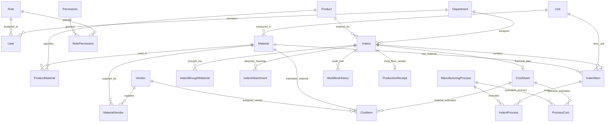
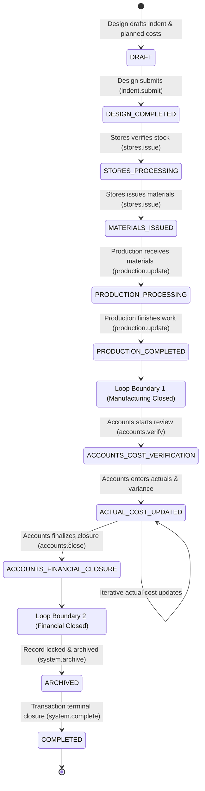
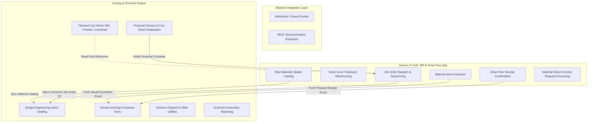

# Integration Audit: MERC / IMCMS Application

**Document Version:** 1.0  
**Audit Target:** Manufacturing Enterprise Resource & Costing System (IMCMS / MERC)  
**Date of Audit:** October 31, 2026  
**Auditor:** Antigravity Integration Audit Agent  
**Baseline Standard:** Phase 1–8C Immutable Engineering Baseline & Two-Loop Zero-Approval Architecture  

---

## Executive Summary & Scope

This audit report provides an exhaustive, line-by-line technical specification of the MERC (Enterprise Manufacturing Indent & Costing Management System - IMCMS) codebase to facilitate bilateral integration with its sibling applications (including the Raw Material / RM application). 

In accordance with strict audit constraints:
- **No source code has been altered or regenerated.**
- Every single technical claim, data type, route, and state transition is cited with file path and line number or code symbol.
- Unknown or unverified features are explicitly labelled as `UNKNOWN`.

---

## 1. Stack and Runtime

| Component | Technology / Library | Version / Configuration | Evidence File & Line Citation |
| :--- | :--- | :--- | :--- |
| **Backend Language** | TypeScript | `~5.7.3` (transpiled to CommonJS via `ts-loader` / `tsc`) | `backend/package.json:L83` |
| **Backend Framework** | NestJS | `@nestjs/core: ^11.0.1`, `@nestjs/common: ^11.0.1` | `backend/package.json:L24,L26` |
| **Frontend Language** | TypeScript | `~6.0.2` (ES Module target) | `frontend/package.json:L52` |
| **Frontend Framework** | React + Vite | `react: ^19.2.7`, `vite: ^8.1.1`, `react-router-dom: ^7.18.2` | `frontend/package.json:L21,L24,L54` |
| **Frontend State/Data** | Zustand & React Query | `zustand: ^5.0.14`, `@tanstack/react-query: ^5.101.4` | `frontend/package.json:L17,L26` |
| **Database Engine** | PostgreSQL | PostgreSQL 15+ (Production: Neon Serverless Postgres with pooling; Dev: `postgres:15-alpine`) | `docker-compose.yml:L5`, `backend/package.json:L50`, `database/schema.prisma:L4-8` |
| **ORM / Migrations** | Prisma ORM | `prisma: ^6.19.3`, `@prisma/client: ^6.19.3` | `backend/package.json:L33,L76`, `database/schema.prisma:L10-18` |
| **Authentication** | JWT (Bearer Token) + bcrypt | `@nestjs/jwt: ^11.0.2`, `passport-jwt: ^4.0.1`, `bcrypt: ^6.0.0` | `backend/package.json:L27,L36,L48`, `backend/src/auth/strategies/jwt.strategy.ts:L9-47` |
| **Hosting & Deploy** | Render / Azure DevOps | Production reverse-proxy: Render PaaS (`trust proxy, 1`); CI/CD: Azure Pipelines (`azure-pipelines.yml`) | `backend/src/main.ts:L19-23`, `azure-pipelines.yml:L1-50` |
| **Config & Env Files** | `dotenv` & Config Module | Environment loaded via `dotenv/config` in `main.ts`, validated in `env.validation.ts`. Config files: `backend/.env`, `backend/.env.example`, `frontend/.env` | `backend/src/main.ts:L1`, `backend/src/config/env.validation.ts:L1-28`, `backend/.env.example:L1-14` |
| **Background Jobs & Queue**| Postgres FIFO Queue Worker + NestJS Schedule | `PostgresMailWorker` using `email_jobs` table (`FOR UPDATE SKIP LOCKED`) + `@nestjs/schedule` / `cron: ^4.4.0` | `backend/src/communication/queue/postgres-mail.worker.ts:L10-123`, `backend/src/notifications/overdue-material.scheduler.ts:L17-20`, `backend/package.json:L30,L40` |

### Environment Configuration Requirements
As validated by `validateEnvironmentConfig()` in `backend/src/config/env.validation.ts:L5-27`, production runtime strictly requires:
- `DATABASE_URL` (PostgreSQL pooled connection string)
- `GOOGLE_CLIENT_ID`, `GOOGLE_CLIENT_SECRET`, `GOOGLE_REFRESH_TOKEN`, `GOOGLE_GMAIL_USER` (OAuth2 Gmail delivery)
- `FRONTEND_URL`, `APP_URL` (CORS and deep-linking)
- Optional / Subsystem-specific: `SUPABASE_URL`, `SUPABASE_SERVICE_ROLE_KEY`, `SUPABASE_STORAGE_BUCKET` (`backend/src/storage/adapters/supabase-storage.adapter.ts:L19-28`).

---

## 2. Data Model

The schema is maintained in `database/schema.prisma` (1,539 lines). It contains **49 models and enums**.

### 2.1 Enumerations
Allowed values for all enumerations defined in `database/schema.prisma:L24-131, L1515-1520`:
- **`UserStatus`** (`database/schema.prisma:L24-28`): `ACTIVE`, `INACTIVE`, `SUSPENDED`
- **`DepartmentStatus`** (`database/schema.prisma:L30-33`): `ACTIVE`, `INACTIVE`
- **`VendorStatus`** (`database/schema.prisma:L35-40`): `ACTIVE`, `INACTIVE`, `PENDING_APPROVAL`, `BLACKLISTED`
- **`MaterialStatus`** (`database/schema.prisma:L42-46`): `ACTIVE`, `INACTIVE`, `OBSOLETE`
- **`ProductStatus`** (`database/schema.prisma:L48-53`): `ACTIVE`, `INACTIVE`, `DISCONTINUED`, `UNDER_DEVELOPMENT`
- **`ProcessStatus`** (`database/schema.prisma:L55-58`): `ACTIVE`, `INACTIVE`
- **`SessionStatus`** (`database/schema.prisma:L60-64`): `ACTIVE`, `EXPIRED`, `REVOKED`
- **`PermissionAction`** (`database/schema.prisma:L66-74`): `CREATE`, `READ`, `UPDATE`, `DELETE`, `APPROVE`, `REJECT`, `ALL`
- **`NotificationType`** (`database/schema.prisma:L76-84`): `INFO`, `SUCCESS`, `WARNING`, `ERROR`, `INDENT_CREATED`, `INDENT_APPROVED`, `INDENT_REJECTED`
- **`Priority`** (`database/schema.prisma:L86-91`): `LOW`, `MEDIUM`, `HIGH`, `URGENT`
- **`IndentStatus`** (Persistence Enum, `database/schema.prisma:L97-109`): `DRAFT`, `SUBMITTED`, `PENDING_STORES`, `PENDING_ACCOUNTS`, `PENDING_SENIOR_MANAGER`, `PENDING_GENERAL_MANAGER`, `APPROVED`, `REJECTED`, `IN_PRODUCTION`, `COMPLETED`, `CANCELLED`
- **`WorkflowState`** (Authoritative Domain Enum, `backend/src/business-transaction/enums/workflow-state.enum.ts:L6-21`): `DRAFT`, `DESIGN_COMPLETED`, `STORES_PROCESSING`, `MATERIALS_ISSUED`, `PRODUCTION_PROCESSING`, `PRODUCTION_COMPLETED`, `ACCOUNTS_COST_VERIFICATION`, `ACTUAL_COST_UPDATED`, `ACCOUNTS_FINANCIAL_CLOSURE`, `ARCHIVED`, `COMPLETED`
- **`CostSheetStatus`** (`database/schema.prisma:L111-115`): `DRAFT`, `FINALIZED`, `CANCELLED`
- **`AMRStatus`** (`database/schema.prisma:L117-122`): `DRAFT`, `PENDING`, `APPROVED`, `REJECTED`
- **`FileType`** (`database/schema.prisma:L124-131`): `PDF`, `DRAWING`, `CAD`, `IMAGE`, `EXCEL`, `OTHER`
- **`EmailJobStatus`** (`database/schema.prisma:L1515-1520`): `PENDING`, `PROCESSING`, `FAILED`, `DEAD_LETTER`

---

### 2.2 Table Definitions (All 44 Tables)

#### Standard Audit & Soft-Delete Columns
Unless noted otherwise, core models implement standard enterprise audit columns:
- `createdAt DateTime @default(now()) @db.Timestamptz(6)`
- `updatedAt DateTime @updatedAt @db.Timestamptz(6)`
- `isDeleted Boolean @default(false)`
- `deletedAt DateTime? @db.Timestamptz(6)`
- `createdBy String? @db.Uuid`
- `updatedBy String? @db.Uuid`
- `deletedBy String? @db.Uuid`

| Table Name | Model Name | Primary Key | Foreign Keys & Unique Constraints | Columns & Types | Citation |
| :--- | :--- | :--- | :--- | :--- | :--- |
| `departments` | `Department` | `id: Uuid` | **UQ:** `departmentCode` | `departmentCode: VarChar(50)`, `departmentName: VarChar(100)`, `description: VarChar(255)?`, `status: DepartmentStatus` | `schema.prisma:L137-163` |
| `roles` | `Role` | `id: Uuid` | **UQ:** `roleName` | `roleName: VarChar(100)`, `description: VarChar(255)?`, `isSystem: Boolean` | `schema.prisma:L165-186` |
| `permissions` | `Permission` | `id: Uuid` | **UQ:** `code` | `module: VarChar(100)`, `action: PermissionAction`, `code: VarChar(150)`, `description: VarChar(255)?` | `schema.prisma:L188-211` |
| `role_permissions` | `RolePermission` | `[roleId, permissionId]` | **FK:** `roleId -> roles.id`, `permissionId -> permissions.id` (both Cascade) | `roleId: Uuid`, `permissionId: Uuid` | `schema.prisma:L213-234` |
| `users` | `User` | `id: Uuid` | **UQ:** `employeeCode`, `email`. **FK:** `departmentId -> departments.id`, `roleId -> roles.id` | `employeeCode: VarChar(50)`, `firstName: VarChar(100)`, `lastName: VarChar(100)`, `email: VarChar(150)`, `phone: VarChar(20)?`, `password: VarChar(255)`, `departmentId: Uuid`, `roleId: Uuid`, `status: UserStatus`, `profileImage: VarChar(255)?`, `lastLogin: Timestamptz?`, `failedLoginAttempts: Int`, `lockedAt: Timestamptz?`, `lockedUntil: Timestamptz?`, `lastPasswordChange: Timestamptz?` | `schema.prisma:L236-295` |
| `vendors` | `Vendor` | `id: Uuid` | **UQ:** `vendorCode`, `email`, `gstNumber?`, `panNumber?` | `vendorCode: VarChar(50)`, `vendorName: VarChar(150)`, `email: VarChar(150)`, `phone: VarChar(20)?`, `gstNumber: VarChar(15)?`, `panNumber: VarChar(10)?`, `address: Text`, `city: VarChar(100)`, `state: VarChar(100)`, `country: VarChar(100)`, `pincode: VarChar(10)`, `status: VendorStatus` | `schema.prisma:L297-328` |
| `units` | `Unit` | `id: Uuid` | **UQ:** `unitCode` | `unitCode: VarChar(20)`, `unitName: VarChar(100)`, `symbol: VarChar(10)` | `schema.prisma:L330-352` |
| `materials` | `Material` | `id: Uuid` | **UQ:** `materialCode`. **FK:** `unitId -> units.id` | `materialCode: VarChar(50)`, `materialName: VarChar(150)`, `description: Text?`, `unitId: Uuid`, `minimumStock: Decimal(18,4)`, `maximumStock: Decimal(18,4)`, `currentStock: Decimal(18,4)`, `category: VarChar(100)`, `densityKgPerDm3: Decimal(18,4)?`, `status: MaterialStatus` | `schema.prisma:L355-388` |
| `material_vendors` | `MaterialVendor` | `[materialId, vendorId]` | **FK:** `materialId -> materials.id`, `vendorId -> vendors.id` (Cascade) | `materialId: Uuid`, `vendorId: Uuid`, `leadTimeDays: Int?`, `unitPrice: Decimal(18,4)?` | `schema.prisma:L390-413` |
| `products` | `Product` | `id: Uuid` | **UQ:** `productCode` | `productCode: VarChar(50)`, `productName: VarChar(150)`, `drawingNumber: VarChar(100)?`, `revision: VarChar(20)?`, `description: Text?`, `status: ProductStatus` | `schema.prisma:L415-440` |
| `product_materials` | `ProductMaterial` | `[productId, materialId]`| **FK:** `productId -> products.id`, `materialId -> materials.id` (Cascade) | `productId: Uuid`, `materialId: Uuid`, `quantityRequired: Decimal(18,4)`, `scrapFactor: Decimal(5,2)` | `schema.prisma:L442-465` |
| `manufacturing_processes` | `ManufacturingProcess` | `id: Uuid` | **UQ:** `processName` | `processName: VarChar(150)`, `description: Text?`, `status: ProcessStatus` | `schema.prisma:L467-490` |
| `indents` | `Indent` | `id: Uuid` | **UQ:** `indentNumber`. **FK:** `productId -> products.id`, `departmentId -> departments.id`, `createdBy -> users.id`, `currentStageId -> workflow_stages.id?` | `indentNumber: VarChar(50)`, `productId: Uuid`, `departmentId: Uuid`, `priority: Priority`, `status: IndentStatus`, `currentState: VarChar(50)?`, `currentStageId: Uuid?`, `customerName: VarChar(150)?`, `layoutNumber: VarChar(100)?`, `requiredDate: Timestamptz`, `requiredDeliveryDate: Timestamptz?`, `purpose: Text?`, `remarks: Text?`, `version: Int`, `isLocked: Boolean`, `createdBy: Uuid` | `schema.prisma:L496-553` |
| `indent_items` | `IndentItem` | `id: Uuid` | **FK:** `indentId -> indents.id` (Cascade), `materialId -> materials.id`, `unitId -> units.id` | `indentId: Uuid`, `materialId: Uuid`, `quantity: Decimal(18,4)`, `issuedQuantity: Decimal(18,4)`, `unitId: Uuid`, `shape: VarChar(50)?`, `diameterMm: Decimal(18,4)?`, `lengthMm: Decimal(18,4)?`, `widthMm: Decimal(18,4)?`, `heightMm: Decimal(18,4)?`, `unitWeightKg: Decimal(18,4)?`, `totalWeightKg: Decimal(18,4)?`, `remarks: Text?`, `status: VarChar(50)?` | `schema.prisma:L555-593` |
| `indent_brought_materials` | `IndentBroughtMaterial` | `id: Uuid` | **FK:** `indentId -> indents.id` (Cascade) | `indentId: Uuid`, `name: VarChar(150)`, `quantity: Decimal(18,4)`, `issuedQuantity: Decimal(18,4)`, `status: VarChar(50)?`, `specification: Text?`, `amount: Decimal(18,4)?`, `actualAmount: Decimal(18,4)?` | `schema.prisma:L595-622` |
| `indent_attachments` | `IndentAttachment` | `id: Uuid` | **FK:** `indentId -> indents.id` (Cascade), `uploadedBy -> users.id` | `indentId: Uuid`, `fileName: Text`, `fileUrl: VarChar(500)`, `fileType: FileType`, `uploadedBy: Uuid` | `schema.prisma:L624-652` |
| `indent_processes` | `IndentProcess` | `id: Uuid` | **UQ:** `[indentItemId, processId]`. **FK:** `indentItemId -> indent_items.id` (Cascade), `processId -> manufacturing_processes.id` | `indentItemId: Uuid`, `processId: Uuid`, `sequence: Int`, `estimatedHours: Decimal(8,2)`, `actualHours: Decimal(8,2)?`, `inputQuantity: Decimal(18,4)?`, `outputQuantity: Decimal(18,4)?`, `scrapQuantity: Decimal(18,4)?`, `status: ProcessStatus` | `schema.prisma:L654-685` |
| `cost_sheets` | `CostSheet` | `id: Uuid` | **UQ:** `costNumber`, `indentId`. **FK:** `indentId -> indents.id`, `preparedBy -> users.id` | `costNumber: VarChar(50)`, `indentId: Uuid`, `preparedBy: Uuid`, `designCost: Decimal(18,4)`, `overheadCost: Decimal(18,4)`, `contingencyCost: Decimal(18,4)`, `actualDesignCost: Decimal(18,4)?`, `actualOverheadCost: Decimal(18,4)?`, `actualContingencyCost: Decimal(18,4)?`, `predictedTotal: Decimal(18,4)`, `actualTotal: Decimal(18,4)?`, `varianceAmount: Decimal(18,4)?`, `variancePercentage: Decimal(5,2)?`, `status: CostSheetStatus` | `schema.prisma:L687-724` |
| `cost_items` | `CostItem` | `id: Uuid` | **FK:** `costSheetId -> cost_sheets.id` (Cascade), `materialId -> materials.id`, `vendorId -> vendors.id?` | `costSheetId: Uuid`, `materialId: Uuid`, `vendorId: Uuid?`, `predictedRate: Decimal(18,4)`, `predictedQuantity: Decimal(18,4)`, `predictedAmount: Decimal(18,4)`, `actualRate: Decimal(18,4)?`, `actualQuantity: Decimal(18,4)?`, `actualAmount: Decimal(18,4)?`, `remarks: Text?` | `schema.prisma:L726-759` |
| `process_costs` | `ProcessCost` | `id: Uuid` | **FK:** `costSheetId -> cost_sheets.id` (Cascade), `processId -> manufacturing_processes.id` | `costSheetId: Uuid`, `processId: Uuid`, `predictedCost: Decimal(18,4)`, `actualCost: Decimal(18,4)?`, `variance: Decimal(18,4)?`, `estimatedHours: Decimal(8,2)`, `actualHours: Decimal(8,2)?` | `schema.prisma:L761-789` |
| `additional_material_requests` | `AdditionalMaterialRequest` | `id: Uuid` | **UQ:** `requestNumber`. **FK:** `parentIndentId -> indents.id`, `requestedBy -> users.id`, `approvedBy -> users.id?` | `parentIndentId: Uuid`, `requestNumber: VarChar(50)`, `requestedBy: Uuid`, `approvedBy: Uuid?`, `reason: Text`, `status: AMRStatus` | `schema.prisma:L791-820` |
| `additional_material_items` | `AdditionalMaterialItem` | `id: Uuid` | **FK:** `requestId -> additional_material_requests.id` (Cascade), `materialId -> materials.id`, `unitId -> units.id` | `requestId: Uuid`, `materialId: Uuid`, `quantity: Decimal(18,4)`, `unitId: Uuid`, `remarks: Text?` | `schema.prisma:L822-850` |
| `workflow_stages` | `WorkflowStage` | `id: Uuid` | **UQ:** `stageName`, `sequence` | `stageName: VarChar(100)`, `sequence: Int`, `description: VarChar(255)?` | `schema.prisma:L852-874` |
| `workflow_history` | `WorkflowHistory` | `id: Uuid` | **FK:** `indentId -> indents.id` (Cascade), `fromDepartmentId -> departments.id?`, `toDepartmentId -> departments.id`, `stageId -> workflow_stages.id?`, `movedBy -> users.id` | `indentId: Uuid`, `fromDepartmentId: Uuid?`, `toDepartmentId: Uuid`, `stageId: Uuid?`, `movedBy: Uuid`, `movedAt: Timestamptz`, `remarks: Text?` | `schema.prisma:L876-911` |
| `production_receipts` | `ProductionReceipt` | `id: Uuid` | **UQ:** `indentId`. **FK:** `indentId -> indents.id`, `receivedBy -> users.id` | `indentId: Uuid`, `receivedBy: Uuid`, `receivedDate: Timestamptz`, `remarks: Text?` | `schema.prisma:L913-937` |
| `indent_history` | `IndentHistory` | `id: Uuid` | **FK:** `indentId -> indents.id` (Cascade), `changedBy -> users.id` | `indentId: Uuid`, `version: Int`, `snapshot: JsonB`, `changedBy: Uuid`, `changedAt: Timestamptz`, `changeNotes: Text?` | `schema.prisma:L939-966` |
| `notifications` | `Notification` | `id: Uuid` | **FK:** `createdBy -> users.id` | `title: VarChar(150)`, `message: Text`, `eventType: VarChar(100)?`, `type: NotificationType`, `priority: Priority`, `referenceId: Uuid?`, `referenceModule: VarChar(100)?`, `createdBy: Uuid` | `schema.prisma:L972-1000` |
| `notification_recipients` | `NotificationRecipient` | `[notificationId, userId]` | **FK:** `notificationId -> notifications.id` (Cascade), `userId -> users.id` (Cascade) | `notificationId: Uuid`, `userId: Uuid`, `isRead: Boolean`, `readAt: Timestamptz?`, `deliveryStatus: VarChar(50)` | `schema.prisma:L1002-1029` |
| `email_logs` | `EmailLog` | `id: Uuid` | **FK:** `userId -> users.id?` | `userId: Uuid?`, `to: VarChar(150)`, `cc: Text?`, `bcc: Text?`, `subject: VarChar(255)`, `body: Text`, `status: VarChar(50)`, `errorMessage: Text?`, `sentAt: Timestamptz`, `retryCount: Int`, `messageId: VarChar(255)?`, `durationMs: Int?` | `schema.prisma:L1031-1053` |
| `audit_logs` | `AuditLog` | `id: Uuid` | **FK:** `performedBy -> users.id?` | `module: VarChar(100)`, `recordId: VarChar(100)`, `action: VarChar(50)`, `oldValue: JsonB?`, `newValue: JsonB?`, `performedBy: Uuid?`, `ipAddress: VarChar(45)?`, `browser: VarChar(150)?`, `operatingSystem: VarChar(100)?`, `device: VarChar(100)?`, `createdAt: Timestamptz` | `schema.prisma:L1055-1078` |
| `activity_logs` | `ActivityLog` | `id: Uuid` | **FK:** `userId -> users.id` | `userId: Uuid`, `activity: VarChar(100)`, `module: VarChar(100)?`, `description: Text`, `createdAt: Timestamptz` | `schema.prisma:L1080-1095` |
| `reports` | `Report` | `id: Uuid` | **FK:** `generatedBy -> users.id` | `reportName: VarChar(150)`, `reportType: VarChar(50)`, `generatedBy: Uuid`, `fileUrl: VarChar(500)`, `fileSize: BigInt`, `generatedAt: Timestamptz` | `schema.prisma:L1097-1123` |
| `report_downloads` | `ReportDownload` | `id: Uuid` | **FK:** `reportId -> reports.id` (Cascade), `downloadedBy -> users.id` | `reportId: Uuid`, `downloadedBy: Uuid`, `downloadedAt: Timestamptz` | `schema.prisma:L1125-1139` |
| `machines` | `Machine` | `id: Uuid` | **UQ:** `machineCode` | `machineCode: VarChar(50)`, `machineName: VarChar(150)`, `status: ProcessStatus` | `schema.prisma:L1145-1166` |
| `machine_logs` | `MachineLog` | `id: Uuid` | **FK:** `machineId -> machines.id`, `processId -> manufacturing_processes.id` | `machineId: Uuid`, `processId: Uuid`, `operatingHours: Decimal(8,2)`, `downtimeHours: Decimal(8,2)` | `schema.prisma:L1168-1192` |
| `department_budgets` | `DepartmentBudget` | `id: Uuid` | **UQ:** `[departmentId, fiscalYear]`. **FK:** `departmentId -> departments.id` | `departmentId: Uuid`, `fiscalYear: Int`, `budgetAmount: Decimal(18,4)`, `allocatedAmount: Decimal(18,4)` | `schema.prisma:L1194-1218` |
| `user_sessions` | `UserSession` | `id: Uuid` | **UQ:** `sessionToken`, `refreshToken?`. **FK:** `userId -> users.id` | `userId: Uuid`, `sessionToken: VarChar(255)`, `refreshToken: VarChar(255)?`, `ipAddress: VarChar(45)?`, `browser: VarChar(150)?`, `operatingSystem: VarChar(100)?`, `device: VarChar(100)?`, `country: VarChar(100)?`, `city: VarChar(100)?`, `status: SessionStatus`, `loginAt: Timestamptz`, `logoutAt: Timestamptz?`, `lastActivity: Timestamptz?`, `expiresAt: Timestamptz` | `schema.prisma:L1220-1253` |
| `refresh_tokens` | `RefreshToken` | `id: Uuid` | **UQ:** `token`. **FK:** `userId -> users.id` | `userId: Uuid`, `token: VarChar(255)`, `expiresAt: Timestamptz`, `revokedAt: Timestamptz?` | `schema.prisma:L1255-1278` |
| `password_reset_tokens` | `PasswordResetToken` | `id: Uuid` | **UQ:** `token`. **FK:** `userId -> users.id` | `userId: Uuid`, `token: VarChar(255)`, `expiresAt: Timestamptz`, `usedAt: Timestamptz?` | `schema.prisma:L1280-1303` |
| `application_settings` | `ApplicationSetting` | `id: Uuid` | **UQ:** `key` | `key: VarChar(100)`, `value: Text`, `category: VarChar(100)`, `description: VarChar(255)?` | `schema.prisma:L1305-1325` |
| `file_uploads` | `FileUpload` | `id: Uuid` | **FK:** `uploadedBy -> users.id` | `fileName: VarChar(255)`, `originalName: VarChar(255)`, `extension: VarChar(20)`, `mimeType: VarChar(100)`, `size: BigInt`, `storageProvider: VarChar(50)`, `url: VarChar(500)`, `uploadedBy: Uuid` | `schema.prisma:L1327-1354` |
| `dashboard_widgets` | `DashboardWidget` | `id: Uuid` | **UQ:** `widgetCode` | `widgetCode: VarChar(100)`, `widgetName: VarChar(150)`, `icon: VarChar(50)?`, `description: VarChar(255)?` | `schema.prisma:L1356-1378` |
| `dashboard_preferences` | `DashboardPreference` | `id: Uuid` | **UQ:** `[userId, widgetId]`. **FK:** `userId -> users.id` (Cascade), `widgetId -> dashboard_widgets.id` (Cascade) | `userId: Uuid`, `widgetId: Uuid`, `position: Int`, `visible: Boolean` | `schema.prisma:L1380-1405` |
| `scheduled_jobs` | `ScheduledJob` | `id: Uuid` | **UQ:** `jobName` | `jobName: VarChar(150)`, `cronExpression: VarChar(100)`, `enabled: Boolean` | `schema.prisma:L1407-1428` |
| `job_execution_history` | `JobExecutionHistory` | `id: Uuid` | **FK:** `jobId -> scheduled_jobs.id` (Cascade) | `jobId: Uuid`, `status: VarChar(50)`, `startedAt: Timestamptz`, `completedAt: Timestamptz?`, `error: Text?` | `schema.prisma:L1430-1445` |
| `sla_trackers` | `SLATracker` | `id: Uuid` | (None) | `referenceId: Uuid`, `referenceModule: VarChar(100)`, `startTime: Timestamptz`, `endTime: Timestamptz?`, `status: VarChar(50)`, `breached: Boolean`, `breachTime: Timestamptz?` | `schema.prisma:L1447-1471` |
| `timelines` | `Timeline` | `id: Uuid` | **FK:** `performedBy -> users.id` | `module: VarChar(100)`, `recordId: Uuid`, `title: VarChar(150)`, `description: Text`, `performedBy: Uuid` | `schema.prisma:L1473-1499` |
| `document_sequences` | `DocumentSequence` | `id: Uuid` | **UQ:** `[documentType, year]` | `documentType: VarChar(50)`, `year: Int`, `nextNumber: Int` | `schema.prisma:L1501-1512` |
| `email_jobs` | `EmailJob` | `id: VarChar(255)` | (None) | `id: VarChar(255)`, `payload: Json`, `status: EmailJobStatus`, `attempts: Int`, `maxAttempts: Int`, `lastError: Text?`, `lockedAt: Timestamptz?`, `lockedBy: VarChar(255)?`, `priority: Int`, `availableAt: Timestamptz` | `schema.prisma:L1522-1538` |

---

### 2.3 Core Entity-Relationship Diagram (Mermaid)

---

### 2.4 Identifier Formats

| Entity Type | Primary Key (Database) | Business Key Format | Example Value | Code Citation |
| :--- | :--- | :--- | :--- | :--- |
| **Job / Order** | UUID v4 (`Indent.id`) | `AGIPL-IND-YYYY-XXX` (resets annually; **no separate job order entity exists**) | `AGIPL-IND-2026-001` | `backend/src/common/services/document-number.service.ts:L65-78` |
| **Sales Contract (SC)** | **DOES NOT EXIST** | **NONE** (unmodeled in MERC) | `UNKNOWN` | `database/schema.prisma:L496-553` |
| **Purchase Order (PO)**| **DOES NOT EXIST** | **NONE** (overloaded into `Indent.purpose` or free-text) | `PO 1024` | `frontend/src/modules/indent/components/IndentForm.tsx:L1011,L1060` |
| **Product** | UUID v4 (`Product.id`) | `AGIPL-PRD-YYYY-XXX` | `AGIPL-PRD-2026-001` | `backend/src/common/services/document-number.service.ts:L116-128` |
| **Material** | UUID v4 (`Material.id`) | `AGIPL-MAT-YYYY-XXX` | `AGIPL-MAT-2026-001` | `backend/src/common/services/document-number.service.ts:L101-114` |
| **User** | UUID v4 (`User.id`) | `employeeCode: VarChar(50)` (Department-prefixed 3-digit number) | `ADM001`, `DSG001`, `STR001`, `ACC001`, `PRD001` | `database/schema.prisma:L238`, `database/seed.ts:L320-326` |
| **Department** | UUID v4 (`Department.id`)| `departmentCode: VarChar(50)` (Uppercase 3-4 letter code) | `ADMIN`, `DSGN`, `STOR`, `ACCT`, `PROD`, `SMGR`, `GMGR` | `database/schema.prisma:L139`, `database/seed.ts:L12-48` |

---

## 3. Users and Roles

### 3.1 User Model & Authentication Mechanism
- **Table:** `users` (`database/schema.prisma:L236-295`).
- **Password Hashing:** `bcrypt.hash()` with standard work factor via `PasswordService` (`backend/src/auth/services/password.service.ts`).
- **Login Flow:** `POST /api/auth/login` handled by `AuthService.executeLogin()` (`backend/src/auth/services/auth.service.ts:L62-160`).
  1. Case-insensitive email normalization (`loginDto.email.trim().toLowerCase()` at `auth.service.ts:L41`).
  2. IP and account brute-force lock check (`AccountSecurityService` at `auth.service.ts:L95`).
  3. Bcrypt comparison.
  4. Generates standard 15-minute Access Token (`JWT_EXPIRES_IN=15m`) and 7-day Refresh Token (`JWT_REFRESH_EXPIRES_IN=7d`).
  5. Inserts atomic session records into `user_sessions` and `refresh_tokens`.
- **JWT Verification & Session Resolution:**
  - Token signed with `JWT_SECRET` (`backend/src/auth/constants/auth.constants.ts:L4-8`).
  - `JwtStrategy.validate(payload)` (`backend/src/auth/strategies/jwt.strategy.ts:L18-46`) executes database lookup for `payload.sub`, verifies `status === 'ACTIVE'` and `isDeleted === false`, hydrates user role and permissions (`permissions: safeUser.role.rolePermissions.map(rp => rp.permission.code)`), and injects `req.user`.

### 3.2 Permission Enforcement Architecture
Enforced across 3 global NestJS guards configured in `backend/src/app.module.ts:L78-88`:
1. **`JwtAuthGuard`** (`backend/src/auth/guards/jwt-auth.guard.ts:L1-20`): Rejects unauthenticated requests unless decorated with `@Public()`.
2. **`RolesGuard`** (`backend/src/auth/guards/roles.guard.ts:L1-50`): Checks `@Roles(...)`.
3. **`PermissionsGuard`** (`backend/src/auth/guards/permissions.guard.ts:L1-62`): Checks `@Permissions(...)`.
   - **Bypass Rule:** System Admin (`roleName === 'ADMIN' || deptCode === 'ADMIN'`) bypasses all permission checks (`permissions.guard.ts:L36-46`).
   - Otherwise, evaluates if user has any required permission code.

### 3.3 System Roles & Permissions Matrix

All 7 system roles are defined in `database/seed.ts:L163-199` and permission mappings in `database/seed.ts:L207-294`:

| Role Name | Department | Permissions Granted | Functional Capabilities |
| :--- | :--- | :--- | :--- |
| **Admin** | `ADMIN` | All system permissions (`isSystem: true`) | Unrestricted configuration, user management, master data creation/deletion, audit review. |
| **Design Engineer** | `DSGN` | `indent.create`, `indent.view`, `indent.edit`, `indent.submit`, `indent.delete`, `costsheet.create`, `costsheet.view`, `costsheet.update`, `products.*`, `materials.view`, `vendors.view`, `manufacturing-processes.view`, `units.view`, `notifications.view`, `documents.view` | Drafts indents, defines bill of materials and dimensional specs, attaches CAD/PDF drawings, creates initial estimated cost sheets, submits design to Stores. |
| **Stores Executive** | `STOR` | `indent.view`, `inventory.view`, `inventory.issue`, `materials.view`, `materials.update`, `production.receive`, `notifications.view`, `stores.issue`, `units.view`, `documents.view` | Performs stock verification against current inventory, decrements raw material stock, issues materials to Production work centers. |
| **Production Executive** | `PROD` | `production.view`, `production.receive`, `indent.view`, `inventory.view`, `materials.view`, `notifications.view`, `production.update`, `production.deliver`, `units.view`, `documents.view` | Receives raw materials at shop floor work centers, logs production start and operational progress notes, marks manufacturing complete. |
| **Accounts Executive** | `ACCT` | `costsheet.view`, `costsheet.create`, `costsheet.update`, `indent.view`, `indent.edit`, `materials.view`, `products.view`, `manufacturing-processes.view`, `vendors.view`, `reports.view`, `reports.export`, `notifications.view`, `accounts.verify`, `accounts.close`, `units.view`, `analytics.view`, `system.archive`, `system.complete`, `documents.view` | Enters actual material invoices and vendor process costs, computes variances, executes financial closure, triggers final transaction completion. |
| **Senior Manager** | `SMGR` | `workflow.view`, `indent.view`, `reports.view`, `reports.export`, `analytics.view`, `costsheet.view`, `notifications.view`, `documents.view` (**NO APPROVAL OR WRITE PERMISSIONS**) | Passive monitoring via executive dashboards, bottleneck analysis, receipt of milestone notifications. **Zero approval authority.** |
| **General Manager** | `GMGR` | `workflow.view`, `indent.view`, `reports.view`, `reports.export`, `analytics.view`, `costsheet.view`, `notifications.view`, `documents.view` (**NO APPROVAL OR WRITE PERMISSIONS**) | Executive oversight, strategic reports export, enterprise-wide variance auditing. **Zero approval authority.** |

### 3.4 Sibling App Identity Mapping
- **Preferred Primary Identifier:** `email` (`User.email: VarChar(150)`, unique, case-insensitive normalized in `auth.service.ts:L41`).
- **Secondary Employee Identifier:** `employeeCode` (`User.employeeCode: VarChar(50)`, unique in `database/schema.prisma:L238`).
- **Note:** MERC does NOT have a `username` field. Any sibling system integration must map users via **`email`** or **`employeeCode`**.

---

## 4. Workflows and State Machines

MERC operates on an approved **Two-Loop Zero-Approval Architecture** (`PRD.md:L16-24`, `backend/src/business-transaction/definitions/workflow-state-machine.definition.ts:L15-154`).

### Detailed Transition Matrix

| Seq | State Transition | Trigger Role & Permission | Endpoint & Service Method | Side Effects (Stock, Cost, Notifications) | Integration Scope | Citation |
| :--- | :--- | :--- | :--- | :--- | :--- | :--- |
| **1** | `[*] -> DRAFT` | Design Engineer (`indent.create`) | `POST /api/business-transactions` -> `createTransaction()` | Generates `AGIPL-IND-YYYY-XXX` and `AGIPL-CS-YYYY-XXX`. Creates draft `Indent`, `IndentItem`, `CostSheet`. No stock effect. | **IMPORTANT FOR INTEGRATION** (Job Order initiation) | `controller.ts:L37`, `service.ts:L245-385` |
| **2** | `DRAFT -> DESIGN_COMPLETED` | Design Engineer (`indent.submit`) | `POST /api/business-transactions/:id/submit` -> `submitDesign()` | Transitions `Indent.currentState`. Creates `WorkflowHistory`. Queues in-app notification & email to Stores + SM/GM. | **IMPORTANT FOR INTEGRATION** (Fulfillment handover) | `controller.ts:L97`, `service.ts:L1543-1598` |
| **3** | `DESIGN_COMPLETED -> STORES_PROCESSING` | Stores Executive (`stores.issue`) | `POST /api/business-transactions/:id/stores/verify` -> `storesVerifyStock()` | Checks `Material.currentStock` against requirements. Starts 48h SLA timer. Notifies SM/GM. | **IMPORTANT FOR INTEGRATION** (Stock readiness check) | `controller.ts:L111`, `service.ts:L1603-1678` |
| **4** | `STORES_PROCESSING -> MATERIALS_ISSUED` | Stores Executive (`stores.issue`) | `POST /api/business-transactions/:id/stores/issue` -> `storesIssueMaterials()` | **Decrements `Material.currentStock`**. Updates `IndentItem.issuedQuantity` and sets `status = 'ISSUED'`. Creates `WorkflowHistory`. Notifies Production + SM/GM. | **CRITICAL FOR INTEGRATION** (Moves to RM app as source of truth) | `controller.ts:L117`, `service.ts:L1683-1850` |
| **5** | `MATERIALS_ISSUED -> PRODUCTION_PROCESSING` | Production Executive (`production.update`) | `POST /api/business-transactions/:id/production/receive` -> `productionReceiveMaterials()` | Upserts `production_receipts` record. Sets `currentState = PRODUCTION_PROCESSING`. Notifies SM/GM. | **CRITICAL FOR INTEGRATION** (Shop floor intake) | `controller.ts:L135`, `service.ts:L2060-2120` |
| **6** | `PRODUCTION_PROCESSING (In-Place Progress)` | Production Executive (`production.update`) | `PATCH /api/business-transactions/:id/production/progress` -> `productionUpdateProgress()` | Appends progress notes to `Indent.remarks`. Writes `AuditLog`. No state transition. | **LOCAL ONLY** (Internal work logging) | `controller.ts:L165`, `service.ts:L2171-2200` |
| **7** | `PRODUCTION_PROCESSING -> PRODUCTION_COMPLETED` | Production Executive (`production.update`) | `POST /api/business-transactions/:id/production/complete` -> `productionCompleteWork()` | Sets `currentState = PRODUCTION_COMPLETED`. Closes Loop 1 (Manufacturing). Notifies Accounts + SM/GM. | **IMPORTANT FOR INTEGRATION** (Manufacturing handover to costing) | `controller.ts:L185`, `service.ts:L2205-2245` |
| **8** | `PRODUCTION_COMPLETED -> ACCOUNTS_COST_VERIFICATION` | Accounts Executive (`accounts.verify`) | `POST /api/business-transactions/:id/accounts/verify` -> `startAccountsVerification()` | Initiates Loop 2. Opens cost sheet for actuals data entry. Notifies SM/GM. | **LOCAL ONLY** (Financial workflow) | `controller.ts:L199`, `service.ts:L2250-2315` |
| **9** | `ACCOUNTS_COST_VERIFICATION -> ACTUAL_COST_UPDATED` | Accounts Executive (`accounts.verify`) | `POST /api/business-transactions/:id/accounts/actual-cost` -> `enterActualCosts()` | Updates `CostItem.actualRate`, `actualQuantity`, `actualAmount`, `ProcessCost.actualCost`, `actualHours`. Computes `varianceAmount` and `variancePercentage`. | **LOCAL ONLY** (Local financial audit) | `controller.ts:L219`, `service.ts:L2323-2525` |
| **10**| `ACTUAL_COST_UPDATED -> ACCOUNTS_FINANCIAL_CLOSURE` | Accounts Executive (`accounts.close`) | `POST /api/business-transactions/:id/accounts/financial-close` -> `financialClosure()` | Validates all actuals are entered. Sets `CostSheet.status = FINALIZED`. Closes Loop 2. Notifies SM/GM. | **LOCAL ONLY** (Financial closure) | `controller.ts:L250`, `service.ts:L2636-2694` |
| **11**| `ACCOUNTS_FINANCIAL_CLOSURE -> ARCHIVED` | System / Admin (`system.archive`) | `POST /api/business-transactions/:id/archive` -> `archiveTransaction()` | Sets `Indent.isLocked = true`. Creates history snapshot. Notifies SM/GM. | **LOCAL ONLY** (System record locking) | `controller.ts:L270`, `service.ts:L2699-2747` |
| **12**| `ARCHIVED -> COMPLETED` | System / Admin (`system.complete`) | `POST /api/business-transactions/:id/complete` -> `completeTransaction()` | Sets `currentState = COMPLETED`, `status = COMPLETED`. Terminal state. Notifies SM/GM. | **IMPORTANT FOR INTEGRATION** (Overall lifecycle completion) | `controller.ts:L280`, `service.ts:L2752-2795` |

---

## 5. API Surface

Every endpoint is prefixed with `/api` (`backend/src/main.ts:L89`). Bearer JWT is required on all routes unless explicitly decorated with `@Public()`.

### 5.1 Route Catalog

| Module | Method | Path | Auth / Permission | Request Body / Query Shape | Response Shape | Citation |
| :--- | :--- | :--- | :--- | :--- | :--- | :--- |
| **Auth** | `POST` | `/api/auth/login` | `@Public()` | `{ email, password }` | `{ accessToken, refreshToken, user: {...} }` | `auth.controller.ts:L23-31` |
| **Auth** | `POST` | `/api/auth/logout` | Bearer Token | `{ refreshToken }` | `{ message: string }` | `auth.controller.ts:L33-47` |
| **Auth** | `POST` | `/api/auth/refresh` | `@Public()`, `JwtRefreshGuard` | Header Bearer RefreshToken | `{ accessToken, refreshToken }` | `auth.controller.ts:L49-59` |
| **Auth** | `POST` | `/api/auth/forgot-password`| `@Public()` | `{ email }` | `{ message: string }` | `auth.controller.ts:L61-70` |
| **Auth** | `POST` | `/api/auth/reset-password` | `@Public()` | `{ token, newPassword }` | `{ message: string }` | `auth.controller.ts:L72-81` |
| **Auth** | `POST` | `/api/auth/change-password`| Bearer Token | `{ currentPassword, newPassword }` | `{ message: string }` | `auth.controller.ts:L83-92` |
| **Auth** | `GET` | `/api/auth/profile` | Bearer Token | None | `{ user: {...} }` | `auth.controller.ts:L94-100` |
| **Auth** | `GET` | `/api/auth/sessions` | Bearer Token | None | `UserSession[]` | `session.controller.ts:L15-25` |
| **Auth** | `DELETE`| `/api/auth/sessions/:id` | Bearer Token | `id: string` (param) | `{ message: string }` | `session.controller.ts:L27-35` |
| **Business Transaction** | `POST` | `/api/business-transactions` | `@Permissions('indent.create')` | `CreateBusinessTransactionDto` (`{ indent: {...}, costSheet: {...} }`) | Created transaction object with nested items & costs | `business-transaction.controller.ts:L37-41` |
| **Business Transaction** | `GET` | `/api/business-transactions` | `@Permissions('indent.view')` | Query: `page, limit, state, search, departmentId, sortBy, sortOrder` | `{ items: Indent[], total, page, limit, totalPages }` | `business-transaction.controller.ts:L43-47` |
| **Business Transaction** | `GET` | `/api/business-transactions/:id` | `@Permissions('indent.view')` | `id: UUID` (param) | Full aggregate: Indent, IndentItem, CostSheet, Processes, Attachments | `business-transaction.controller.ts:L81-85` |
| **Business Transaction** | `PATCH`| `/api/business-transactions/:id` | `@Permissions('indent.edit', 'production.update')` | `UpdateBusinessTransactionDto` | Updated transaction object | `business-transaction.controller.ts:L87-95` |
| **Business Transaction** | `POST` | `/api/business-transactions/:id/submit` | `@Permissions('indent.submit')` | `{ remarks?: string }` | `{ id, success: true }` | `business-transaction.controller.ts:L97-105` |
| **Business Transaction** | `POST` | `/api/business-transactions/:id/stores/verify` | `@Permissions('stores.issue')` | None | `{ id, success: true, stockVerification: {...} }` | `business-transaction.controller.ts:L111-115` |
| **Business Transaction** | `POST` | `/api/business-transactions/:id/stores/issue` | `@Permissions('stores.issue')` | `StoresIssueDto` (`{ remarks?, issueItems: [{ materialId, issuedQuantity }] }`) | `{ id, success: true, isFullyIssued: boolean }` | `business-transaction.controller.ts:L117-121` |
| **Business Transaction** | `POST` | `/api/business-transactions/:id/stores-issue` | `@Permissions('stores.issue')` | (Alias for `/stores/issue`) | `{ id, success: true }` | `business-transaction.controller.ts:L123-127` |
| **Business Transaction** | `POST` | `/api/business-transactions/:id/items/:itemId/issue` | `@Permissions('stores.issue')` | `id, itemId: UUID` | `{ id, itemId, success: true }` | `business-transaction.controller.ts:L129-133` |
| **Business Transaction** | `POST` | `/api/business-transactions/:id/production/receive` | `@Permissions('production.update')` | `{ remarks?: string }` | `{ id, success: true }` | `business-transaction.controller.ts:L135-143` |
| **Business Transaction** | `POST` | `/api/business-transactions/:id/production-receive` | `@Permissions('production.update')` | (Alias for `/production/receive`) | `{ id, success: true }` | `business-transaction.controller.ts:L145-153` |
| **Business Transaction** | `POST` | `/api/business-transactions/:id/production/start` | `@Permissions('production.update')` | `{ remarks?: string }` | `{ id, success: true }` | `business-transaction.controller.ts:L155-163` |
| **Business Transaction** | `PATCH`| `/api/business-transactions/:id/production/progress` | `@Permissions('production.update')` | `ProductionUpdateDto` (`{ statusNotes, remarks? }`) | `{ id, success: true }` | `business-transaction.controller.ts:L165-173` |
| **Business Transaction** | `POST` | `/api/business-transactions/:id/production/complete` | `@Permissions('production.update')` | `{ remarks?: string }` | `{ id, success: true }` | `business-transaction.controller.ts:L185-193` |
| **Business Transaction** | `POST` | `/api/business-transactions/:id/accounts/verify` | `@Permissions('accounts.verify')` | `{ remarks?: string }` | `{ id, success: true }` | `business-transaction.controller.ts:L199-207` |
| **Business Transaction** | `POST` | `/api/business-transactions/:id/accounts/actual-cost` | `@Permissions('accounts.verify')` | `ActualCostEntryDto` (`{ costItems, processCosts, broughtMaterials, actualDesignCost?, ... }`) | `{ id, success: true, variancePercentage }` | `business-transaction.controller.ts:L219-227` |
| **Business Transaction** | `POST` | `/api/business-transactions/:id/accounts/financial-close` | `@Permissions('accounts.close')` | `FinancialClosureDto` (`{ closureNotes?, remarks? }`) | `{ id, success: true }` | `business-transaction.controller.ts:L250-258` |
| **Business Transaction** | `POST` | `/api/business-transactions/:id/archive` | `@Permissions('system.archive')` | `{ remarks?: string }` | `{ id, success: true }` | `business-transaction.controller.ts:L270-278` |
| **Business Transaction** | `POST` | `/api/business-transactions/:id/complete` | `@Permissions('system.complete')` | `{ remarks?: string }` | `{ id, success: true }` | `business-transaction.controller.ts:L280-288` |
| **Business Transaction** | `POST` | `/api/business-transactions/:id/attachments` | `@Permissions('indent.edit', 'accounts.verify')` | `multipart/form-data` (`file`, `remarks`) | `{ id, fileName, fileUrl }` | `business-transaction.controller.ts:L294-311` |
| **Business Transaction** | `GET` | `/api/business-transactions/attachments/download/:fileName` | `@Permissions('documents.view')` | `fileName: string` | File stream (`application/pdf`, `image/*`, etc.) | `business-transaction.controller.ts:L313-334` |
| **Business Transaction** | `DELETE`| `/api/business-transactions/:id` | `@Permissions('indent.delete')` | None | `{ success: true, message: string }` | `business-transaction.controller.ts:L382-386` |
| **Master Data: Dept** | `GET` | `/api/departments` | `@Permissions('departments.view', ...)` | Query: `page, limit` | `Department[]` or paginated `{ items, total }` | `departments.controller.ts:L12-45` |
| **Master Data: Materials** | `GET` | `/api/materials` | `@Permissions('materials.view')` | Query: `page, limit, search` | `{ items: Material[], total, page, limit, totalPages }` | `materials.controller.ts:L29-50` |
| **Master Data: Materials** | `POST` | `/api/materials` | `@Permissions('materials.create')` | `CreateMaterialDto` | `Material` object | `materials.controller.ts:L52-73` |
| **Master Data: Materials** | `PUT` | `/api/materials/:id` | `@Permissions('materials.update')` | `UpdateMaterialDto` | Updated `Material` | `materials.controller.ts:L75-79` |
| **Master Data: Materials** | `DELETE`| `/api/materials/:id` | `@Permissions('materials.delete')` | None | Soft-deleted `Material` (`isDeleted: true`) | `materials.controller.ts:L106-118` |
| **Master Data: Products** | `GET` | `/api/products` | `@Permissions('products.view')` | Query: `page, limit, search` | `{ items: Product[], total, page, limit, totalPages }` | `products.controller.ts:L23-44` |
| **Master Data: Products** | `POST` | `/api/products` | `@Permissions('products.create')` | `CreateProductDto` | `Product` object | `products.controller.ts:L46-64` |
| **Processes** | `GET` | `/api/manufacturing-processes` | `@Permissions('manufacturing-processes.view')` | Query: `page, limit, search, status` | Paginated process list | `processes.controller.ts:L48-52` |
| **Processes** | `POST` | `/api/manufacturing-processes` | `@Permissions('manufacturing-processes.create')` | `CreateProcessDto` | `ProcessResponseDto` | `processes.controller.ts:L33-46` |
| **Units** | `GET` | `/api/units` | `@Permissions('units.view')` | Query: `page, limit, search` | Paginated units list | `units.controller.ts:L41-45` |
| **Units** | `POST` | `/api/units` | `@Permissions('units.create')` | `CreateUnitDto` | `UnitResponseDto` | `units.controller.ts:L33-39` |
| **Vendors** | `GET` | `/api/vendors` | `@Permissions('vendors.view')` | Query: `page, limit, search, status` | Paginated vendors list | `vendors.controller.ts:L48-52` |
| **Vendors** | `POST` | `/api/vendors` | `@Permissions('vendors.create')` | `CreateVendorDto` | `VendorResponseDto` | `vendors.controller.ts:L34-46` |
| **Notifications** | `GET` | `/api/notifications` | `@Permissions('notifications.view')` | Query: `page, limit, isRead, eventType` | Paginated user notifications | `notifications.controller.ts:L107-160` |
| **Notifications** | `PATCH`| `/api/notifications/:id/read` | `@Permissions('notifications.view')` | `id: UUID` | `{ success: true }` | `notifications.controller.ts:L285-310` |
| **Audit Logs** | `GET` | `/api/audit-logs` | `@Permissions('audit.view')` | Query: `page, limit, module, action, search, sortBy, sortOrder` | `{ items: AuditLog[], total, page, limit, totalPages }` | `audit.controller.ts:L14-95` |
| **Reports** | `GET` | `/api/reports/production/daily` | `@Permissions('reports.view')` | Query: `page, limit, fromDate, toDate` | Daily production summary data | `reports.controller.ts:L13-17` |
| **Reports** | `GET` | `/api/reports/cost/actual-vs-predicted` | `@Permissions('reports.view')` | Query: `page, limit, fromDate, toDate` | Cost variance analysis data | `reports.controller.ts:L85-89` |
| **Analytics** | `GET` | `/api/analytics/dashboard-overview` | `@Permissions('analytics.view')` | None | Executive aggregated dashboard metrics | `analytics.controller.ts:L109-113` |
| **Observability** | `GET` | `/api/observability/health/readiness` | `@Public()` | None | `{ status: "UP", services: { database: "UP", queue: "UP" } }` | `observability.controller.ts:L27-56` |

---

### 5.2 Outbound Calls to External Systems

1. **Google Gmail API (`googleapis.google.auth.OAuth2` / `gmail.users.messages.send`):**
   - **File:** `backend/src/communication/providers/gmail-api.provider.ts:L8-115`
   - **URL / Protocol:** Google OAuth2 endpoint (`https://oauth2.googleapis.com`) and Gmail v1 REST API (`https://gmail.googleapis.com/gmail/v1/users/me/messages/send`).
   - **Authentication:** OAuth2 Refresh Token Grant (`GOOGLE_CLIENT_ID`, `GOOGLE_CLIENT_SECRET`, `GOOGLE_REFRESH_TOKEN`, `GOOGLE_GMAIL_USER`).
   - **Payload:** RFC 822 MIME message compiled by `nodemailer/lib/mail-composer`, base64url-encoded string sent as `{ raw: base64Raw }`.
   - **Error Handling & Retry:** Trapped by `PostgresMailWorker` (`backend/src/communication/queue/postgres-mail.worker.ts:L145-235`). Max 4 retries (`maxAttempts: 4`), exponential backoff (`delay = Math.min(1000 * Math.pow(2, attempts), 60000)`), moved to `DEAD_LETTER` status upon exhausting attempts.

2. **Supabase Cloud Object Storage (`@supabase/supabase-js`):**
   - **File:** `backend/src/storage/adapters/supabase-storage.adapter.ts:L7-135`
   - **URL / Protocol:** `https://<project-ref>.supabase.co/storage/v1` via HTTPS.
   - **Authentication:** API Service Role Key (`SUPABASE_SERVICE_ROLE_KEY`) bearer auth.
   - **Payload:** Binary file streams (`Buffer`), uploaded into bucket `SUPABASE_STORAGE_BUCKET` (default: `imcms-attachments`).
   - **Error Handling & Retry:** Synchronous try/catch block. In the event of network failure, logs fatal error and throws `BadRequestException`. No automated retry.

### 5.3 Webhooks & Asynchronous Events
- **External Inbound/Outbound Webhooks:** **NONE**. MERC does not expose or consume any HTTP webhook endpoints.
- **In-Memory Event Bus:** `CommunicationEventBus` (`EventEmitter2` subclass in `backend/src/communication/events/communication-event.bus.ts:L14-35`) and `observabilityEventBus` (`backend/src/observability/observability-event-bus.ts`). Events emitted in-process during state transitions are picked up by listeners to enqueue email jobs into PostgreSQL.

---

## 6. Notifications

### 6.1 Channels
- **In-App Notifications:** Stored in `notifications` table (`database/schema.prisma:L972-1000`) and mapped per user in `notification_recipients` (`database/schema.prisma:L1002-1029`). Delivered via REST polling (`GET /api/notifications`).
- **Email Notifications:** Asynchronously dispatched via `PostgresMailWorker` (`backend/src/communication/queue/postgres-mail.worker.ts`) using Gmail API.
- **SMS / Push Notifications:** **NONE** (unmodeled and unsupported).

### 6.2 Notification Rules & Templates

Configured in `backend/src/business-transaction/definitions/notification-event.definition.ts:L13-124` and compiled via Handlebars templates in `backend/src/communication/templates/items/`:

| Trigger State / Event | Template Name | Target Recipients (Operational) | Executive Broadcast | Template Subject / Title |
| :--- | :--- | :--- | :--- | :--- |
| `DESIGN_COMPLETED` | `design_completed.hbs` | Stores Department (`STORES`, `STOR`) | **Senior Manager & General Manager** | `New Manufacturing Indent Submitted` |
| `STORES_PROCESSING` | `stores_pending.hbs` | Stores Department | **Senior Manager & General Manager** | `Stores Stock Verification Underway` |
| `MATERIALS_ISSUED` | `material_issued.hbs` | Production Department (`PROD`) | **Senior Manager & General Manager** | `Stores Material Issued` |
| `PRODUCTION_PROCESSING` | `production_started.hbs` | Production Department | **Senior Manager & General Manager** | `Production Manufacturing Started` |
| `PRODUCTION_COMPLETED` | `production_completed.hbs` | Accounts Department (`ACCT`) | **Senior Manager & General Manager** | `Production Manufacturing Completed` |
| `ACCOUNTS_COST_VERIFICATION` | `cost_verification.hbs` | Accounts Department | **Senior Manager & General Manager** | `Accounts Cost Verification Underway` |
| `ACTUAL_COST_UPDATED` | `actual_cost_updated.hbs` | Design & Accounts Departments | **Senior Manager & General Manager** | `Actual Cost Updated` |
| `ACCOUNTS_FINANCIAL_CLOSURE`| `financial_closure.hbs` | System / Accounts | **Senior Manager & General Manager** | `Financial Closure Completed` |
| `ARCHIVED` | `transaction_archived.hbs` | System | **Senior Manager & General Manager** | `Business Transaction Archived` |
| `COMPLETED` | `transaction_completed.hbs` | System | **Senior Manager & General Manager** | `Business Transaction Completed` |
| `STORES_OVERDUE (48h)` | `material_issue_overdue.hbs`| Stores Department | **Senior Manager & General Manager** | `Material Issue Overdue` |

### 6.3 Executive SM & GM Notification Mechanism
In strict adherence to the **Zero-Approval Architecture** (`PRD.md:L24`, `backend/src/business-transaction/services/business-transaction-event.service.ts:L102-113`):
- Senior Managers and General Managers do NOT receive approval request prompts.
- Instead, every state transition automatically evaluates `executiveBroadcast: true`, querying all active users whose role is `'Senior Manager'` or `'General Manager'` (`business-transaction-event.service.ts:L108`), creating in-app notification records and dispatching email notifications so management passively tracks cycle time and bottlenecks.

---

## 7. Master / Reference Data

| Data Entity | Physical Table | Editing Authority & Permission | Volume Estimate | Sync Strategy / Ownership Note |
| :--- | :--- | :--- | :--- | :--- |
| **Materials** | `materials` (`schema.prisma:L355`) | Stores Executive / Admin (`materials.create`, `materials.update`) | 1,000 – 5,000 SKUs | **Target for Deprecation:** Once sibling Raw Material (RM) app is integrated, RM must become the single source of truth for materials catalog and current stock. |
| **Material Items (Indent Lines)**| `indent_items` (`schema.prisma:L555`) | Design Engineer (`indent.create`, `indent.edit`) | 10,000 – 50,000 rows/yr | Line-item material requirements per indent. Includes custom dimensional cutting parameters (`diameterMm`, `lengthMm`, `shape`). |
| **Jobs / Orders** | `indents` (`schema.prisma:L496`) | Design Engineer (`indent.create`) | 1,000 – 5,000 indents/yr | MERC has **no separate job order entity**. Indent is synonymous with Job. |
| **Customers** | **NONE** (`Indent.customerName: VarChar(150)?`) | Design Engineer (on indent form) | ~200 – 1,000 clients | **Unnormalized free text field** on `indents`. High risk of typographic divergence across systems. |
| **Units of Measure** | `units` (`schema.prisma:L330`) | Admin (`units.create`, `units.update`, `units.delete`) | 10 – 50 records | Static engineering units (`KG`, `METERS`, `PCS`, `LITERS`, `SHEETS`). |
| **Departments** | `departments` (`schema.prisma:L137`) | System Admin (`departments.*`) | 7 core departments | Immutable organizational entities (`ADMIN`, `DSGN`, `STOR`, `ACCT`, `PROD`, `SMGR`, `GMGR`). |
| **Vendors** | `vendors` (`schema.prisma:L297`) | Accounts / Admin (`vendors.create`, `vendors.update`) | 100 – 500 vendors | Vendor master data with GST/PAN validation. |
| **Manufacturing Processes**| `manufacturing_processes` (`schema.prisma:L467`) | Admin (`manufacturing-processes.create`) | 20 – 100 operations | Standard processes (`Turning`, `Milling`, `Grinding`, `Heat Treatment`, `Assembly`). |

---

## 8. Integration Readiness

### 8.1 Transactions & Idempotency
- **Database Transactions:** Multi-record state updates are wrapped in `this.prisma.$transaction(async (tx) => {...})` (`business-transaction.service.ts:L1564, L1724, L2079, L2651`).
- **Idempotency Risks (Writes NOT safe to repeat):**
  - **`storesIssueMaterials` (`business-transaction.service.ts:L1756-1777`):** Does NOT use idempotency keys. If repeated with the same payload, `Material.currentStock` will be **decremented a second time**, and `IndentItem.issuedQuantity` will increment again.
  - **`createTransaction` (`business-transaction.service.ts:L245-385`):** Generates a new sequential `indentNumber` on every call. Repeating a POST creates duplicate indents.
- **Optimistic Concurrency Control:** Enforced on workflow state transitions via `assertCurrentStateAndUpdate()` (`business-transaction.service.ts:L99-126`). Uses atomic `client.indent.updateMany({ where: { id, currentState: expectedCurrentState } })`. Throws `ConflictException (409)` if another process altered the state concurrently.

### 8.2 Audit & History Tracking
- **`audit_logs` (`database/schema.prisma:L1055-1078`):** Complete change-data-capture log containing `module`, `recordId`, `action`, `oldValue: JsonB`, `newValue: JsonB`, `performedBy`, `ipAddress`, `createdAt`.
- **`workflow_history` (`database/schema.prisma:L876-911`):** Complete state-machine audit capturing every inter-departmental handover (`fromDepartmentId`, `toDepartmentId`, `movedBy`, `movedAt`, `remarks`).
- **`indent_history` (`database/schema.prisma:L939-966`):** Versioned JSON snapshot history (`version: Int`, `snapshot: JsonB`).

### 8.3 Pagination, Filtering, and "Updated Since" Delta Support
- **Pagination:** Supported across all list endpoints (`PaginationQueryDto` with `page` and `limit`, defaulting to page 1, limit 10/50).
- **Search & Filter:** Supported on text search and department filtering.
- **"Updated Since" Support:** **CRITICAL GAP: ABSENT ACROSS ALL LIST ENDPOINTS.** Neither `QueryBusinessTransactionDto` (`backend/src/business-transaction/dto/query-business-transaction.dto.ts:L4-37`) nor `PaginationQueryDto` (`backend/src/common/dto/pagination-query.dto.ts:L4-27`) expose `updatedSince`, `since`, `fromDate`, or `toDate` parameters. Any sibling consumer polling for incremental changes is forced to perform expensive full-table scans.

### 8.4 Architectural Blockers for Integration
1. **Unstructured JSON Packed in Free-Text Remarks:** The frontend packs structured business specifications (process source, vendor type, user remarks) into a serialized JSON string stored in `IndentItem.remarks` (`frontend/src/modules/indent/components/IndentForm.tsx:L1042-1049`). External consumers cannot query these fields via standard SQL/ORM relations.
2. **Dual State Columns Divergence:** `Indent` maintains both `currentState: VarChar(50)` (authoritative 11 domain states) and `status: IndentStatus` (legacy 11 Prisma enum states). Because the legacy status collapses multiple states (e.g. `STORES_PROCESSING` and `MATERIALS_ISSUED` both map to `PENDING_STORES`), sibling applications reading `status` instead of `currentState` will misinterpret transaction progress (`backend/src/business-transaction/mappers/workflow-state.mapper.ts:L9-35`).
3. **No Customer Master Entity:** `Indent.customerName` is an arbitrary string. Two sibling apps writing "Tata Motors" vs "TATA MOTORS LTD" cannot correlate orders by customer ID.
4. **No Native Job Order / SC / PO Primary Keys:** Sibling applications expecting formal `job_order_id`, `sales_contract_id`, or `po_number` foreign keys will find them completely absent from the database schema.

---

## 9. Risks and Gaps (Top 10 Ranked)

| Rank | Risk Description | Severity | Impact on Two-Way Synchronization | Suggested Architectural Fix | Effort |
| :---: | :--- | :---: | :--- | :--- | :---: |
| **1** | **No Idempotency on Stock Decrement** (`service.ts:L1756`) | **CRITICAL** | Retrying a network failure on Stores Issue decrements inventory twice and corrupts stock quantities. | Add unique `idempotencyKey` to `storesIssueMaterials()` and enforce database-level duplicate request suppression. | **M** |
| **2** | **Lack of Delta / "Updated Since" Filter** (`query-business-transaction.dto.ts`) | **HIGH** | Consumer apps cannot perform incremental polling sync; must ingest thousands of records on every polling cycle. | Add `updatedSince: Timestamptz` query parameter and filter `updatedAt >= updatedSince` with an index. | **S** |
| **3** | **Dual State Representation (`currentState` vs `status`)** (`workflow-state.mapper.ts`) | **HIGH** | Sibling apps inspecting `status` see collapsed states (`PENDING_STORES`, `IN_PRODUCTION`) and miss critical financial milestone triggers. | Expose canonical `currentState` in all public API DTOs and mark `status` deprecated in OpenAPI/Swagger. | **S** |
| **4** | **Unstructured JSON in `IndentItem.remarks`** (`IndentForm.tsx:L1042`) | **HIGH** | Process routing and vendor sourcing details are hidden inside serialized strings in text fields. | Migrate JSON fields (`product`, `source`, `vendorType`) into dedicated first-class columns on `indent_items` and `indent_processes`. | **M** |
| **5** | **No Master Customer Table** (`schema.prisma:L505`) | **HIGH** | Typographic errors in customer names prevent automated reconciliation between Sales, CRM, and Indent costing. | Create `customers` table (`id`, `customerCode`, `customerName`) and replace `Indent.customerName` with `customerId`. | **M** |
| **6** | **Missing SC and PO Relationships** (`schema.prisma:L496`) | **HIGH** | Costing cannot be automatically tied back to customer sales contracts or external procurement purchase orders. | Add `salesContractNumber` and `purchaseOrderNumber` indexed varchar columns to `Indent`. | **S** |
| **7** | **No Webhook Infrastructure** | **MEDIUM** | Real-time synchronization requires fragile periodic HTTP polling instead of event-driven notification pushes. | Implement an outbound webhook dispatcher service that posts signed HMAC payloads on state transition. | **M** |
| **8** | **Stock Decoupling during Transition to RM App** | **MEDIUM** | If MERC continues decrementing `Material.currentStock` while RM app manages raw materials, inventory balances will diverge instantly. | Deprecate local `Material.currentStock` decrement in MERC and turn `materials` into a read-only mirror of RM app. | **L** |
| **9** | **Granular Production Process Hours Not Recorded** (`service.ts:L2183`) | **MEDIUM** | Production progress is only appended to free-text remarks; individual `IndentProcess.actualHours` remain null, blocking automated labor costing. | Modify `productionUpdateProgress()` to accept structured per-process hours and scrap quantities. | **M** |
| **10**| **Lack of Material Return / Extra Request Execution** (`schema.prisma:L791`) | **MEDIUM** | Scrap or excess material cannot be returned or requested via API (AMR tables exist in schema but have zero API controllers). | Implement API routes for `AdditionalMaterialRequest` and introduce a `MaterialReturn` workflow. | **L** |

---

## 10. Extra Focus for MERC (App-Specific Audit)

### 10.1 Indent Form & Planned Costing Structure
- **Indent Form Fields (`IndentForm.tsx:L1132-1188`):**
  - Header: `customerName` (Text), `layoutNumber` (Text), `productName` (mapped to `products`), `departmentName` (mapped to `departments`), `priority` (`LOW`, `MEDIUM`, `HIGH`, `URGENT`), `requiredDate` (Date), `requiredDeliveryDate` (Date), `purpose` (Text, often used for PO), `remarks` (Text).
  - Material Line Items (`IndentItemDto` in `create-indent-sheet.dto.ts:L31-81`): `materialName`, `quantity`, `unitId`, `shape` (`ROUND`, `RECTANGLE`, `SHEET`), `diameterMm`, `lengthMm`, `widthMm`, `heightMm`, `unitWeightKg`, `totalWeightKg`, `remarks`.
  - Process Allocations (`IndentProcessDto` in `create-indent-sheet.dto.ts:L16-29`): `processId`, `sequence`, `estimatedHours`.
  - Brought-Out Materials (`IndentBroughtMaterialDto` in `create-indent-sheet.dto.ts:L83-103`): `name`, `quantity`, `specification`, `amount`, `actualAmount`.
- **Planned Costing Hierarchy (`create-process-cost-sheet.dto.ts:L84-128`, `IndentForm.tsx:L991-997`):**
  $$\text{Material Cost} = \sum (\text{CostItem.predictedRate} \times \text{CostItem.predictedQuantity}) + \sum (\text{IndentBroughtMaterial.amount})$$
  $$\text{Process Cost} = \sum (\text{ProcessCost.predictedCost})$$
  $$\text{SubTotal} = \text{Material Cost} + \text{Process Cost}$$
  $$\text{Predicted Grand Total} = \text{SubTotal} + \text{designCost} + \text{overheadCost} + \text{contingencyCost}$$
- **Draft vs. Submitted Rules:**
  - In `DRAFT` status (`currentState = 'DRAFT'`), all fields and cost sheets can be repeatedly updated via `PATCH /api/business-transactions/:id` (`service.ts:L1100-1450`).
  - Once submitted via `POST /api/business-transactions/:id/submit`, `currentState` transitions to `DESIGN_COMPLETED`. Form fields become read-only to Design Engineers.

---

### 10.2 Material Flow Today: Stores Issue & Production Receive
When raw materials flow through MERC today, the exact database tables and endpoints involved are:

1. **Stores Stock Verification:**
   - **Endpoint:** `POST /api/business-transactions/:id/stores/verify`
   - **Method:** `storesVerifyStock()` (`business-transaction.service.ts:L1603-1678`).
   - **Table:** Queries `materials` table (`database/schema.prisma:L355`) to compare `currentStock` against `IndentItem.quantity`. Sets `currentState = 'STORES_PROCESSING'`.

2. **Stores Material Issue:**
   - **Endpoints:** `POST /api/business-transactions/:id/stores/issue` or `POST /api/business-transactions/:id/stores-issue` (Batch) / `POST /api/business-transactions/:id/items/:itemId/issue` (Single item).
   - **Method:** `storesIssueMaterials()` (`business-transaction.service.ts:L1683-1850`).
   - **Tables Modified:**
     - `materials`: `currentStock` is decremented by `issuedQuantity` (`service.ts:L1756-1763`).
     - `indent_items`: `issuedQuantity` is updated, and if `newIssuedQuantity >= quantity`, `status` is set to `'ISSUED'` (`service.ts:L1770-1776`).
     - `indents`: When all items are issued, `currentState` is updated to `'MATERIALS_ISSUED'` (`service.ts:L1808-1818`).
     - `workflow_history`: New row inserted recording transfer from Stores to Production (`service.ts:L1821-1829`).

3. **Production Material Receive:**
   - **Endpoints:** `POST /api/business-transactions/:id/production/receive` or `POST /api/business-transactions/:id/production-receive`.
   - **Method:** `productionReceiveMaterials()` (`business-transaction.service.ts:L2060-2120`).
   - **Tables Modified:**
     - `production_receipts`: Upserts record with `indentId`, `receivedBy = userId`, `remarks`, `receivedDate = NOW()` (`service.ts:L2090-2101`).
     - `indents`: Updates `currentState = 'PRODUCTION_PROCESSING'` (`service.ts:L2080-2089`).
     - `workflow_history`: Inserts step record (`service.ts:L2102-2110`).

---

### 10.3 Production Stage Tracking
- **Stages:**
  1. Material Intake: `productionReceiveMaterials` (`currentState = PRODUCTION_PROCESSING`).
  2. Work Started: `POST /api/business-transactions/:id/production/start` (`productionStartWork()` at `service.ts:L2128`).
  3. Work Center Updates: `PATCH /api/business-transactions/:id/production/progress` (`productionUpdateProgress()` at `service.ts:L2171`).
  4. Manufacturing Completion: `POST /api/business-transactions/:id/production/complete` (`productionCompleteWork()` at `service.ts:L2205`, transitions to `PRODUCTION_COMPLETED`).
- **Who Completes Them:** `Production Executive` role (holding `production.update` permission).
- **Data Captured:**
  - `statusNotes: string` and `remarks: string` (both free text).
  - **Audit Finding:** Granular machine telemetry, scrap counts, and process operating hours (`IndentProcess.actualHours`, `inputQuantity`, `outputQuantity`, `scrapQuantity` in `database/schema.prisma:L660-663`) are **NOT populated** by the production controller endpoints. They are written only as unstructured log strings into `Indent.remarks`.

---

### 10.4 Actual Costing, Variance Formulas & Closure
- **Data Entry Mechanism:** Accounts Executive accesses `POST /api/business-transactions/:id/accounts/actual-cost` (`enterActualCosts()` at `business-transaction.service.ts:L2323-2525`).
- **Data Captured:**
  - Per Material Item: `actualRate`, `actualQuantity` $\rightarrow \text{actualAmount} = \text{actualRate} \times \text{actualQuantity}$ (`service.ts:L2406-2415`).
  - Per Brought-Out Material: `actualAmount` (`service.ts:L2429-2439`).
  - Per Manufacturing Process: `actualCost`, `actualHours` $\rightarrow \text{variance} = \text{actualCost} - \text{predictedCost}$ (`service.ts:L2416-2424`).
  - Global Financial Actuals: `actualDesignCost`, `actualOverheadCost`, `actualContingencyCost` (`service.ts:L2455-2468`).
- **Mathematical Variance Formulation:**
  - **Code Location:** `backend/src/business-transaction/utils/financial-math.util.ts:L48-67` and `business-transaction.service.ts:L2470-2481`.
  - **Exact Formulas:**
    $$\text{Actual Total} = \sum \text{actualAmount}_{\text{materials}} + \sum \text{actualAmount}_{\text{brought}} + \sum \text{actualCost}_{\text{processes}} + \text{actualDesignCost} + \text{actualOverheadCost} + \text{actualContingencyCost}$$
    $$\text{varianceAmount} = \text{actualTotal} - \text{predictedTotal}$$
    $$\text{variancePercentage} = \begin{cases} 0.00 & \text{if } \text{predictedTotal} \le 0 \\ \operatorname{round}\left(\frac{\text{varianceAmount}}{\text{predictedTotal}} \times 100, 2\right) & \text{clamped to } [-999.99, 999.99] \end{cases}$$
- **Closure Sequence:**
  1. Once all actuals are saved, Accounts triggers `POST /api/business-transactions/:id/accounts/financial-close` (`financialClosure()` at `service.ts:L2636-2694`).
  2. Updates `CostSheet.status = 'FINALIZED'`.
  3. Advances `currentState` from `ACTUAL_COST_UPDATED` to `ACCOUNTS_FINANCIAL_CLOSURE`.
  4. System locks the record against further edits via `archiveTransaction()` (`currentState = 'ARCHIVED'`, `isLocked = true` at `service.ts:L2721`).

---

### 10.5 Senior Manager (SM) and General Manager (GM) Rules
- **Explicit Zero-Approval Architecture Rule:** Senior Managers and General Managers **never approve** transactions in MERC (`PRD.md:L24`, `backend/src/auth/guards/permissions.guard.ts`). Neither role has `indent.submit`, `stores.issue`, `production.update`, `accounts.verify`, or `accounts.close` permissions (`database/seed.ts:L275-293`).
- **Broadcast Triggers:** Every state transition triggers `BusinessTransactionEventService.runDispatchNotificationBackground()` (`backend/src/business-transaction/services/business-transaction-event.service.ts:L50-140`), creating notifications and queuing emails for SM and GM.
- **48-Hour Overdue Alert:** `OverdueMaterialScheduler` (`backend/src/notifications/overdue-material.scheduler.ts:L17-124`) runs every 15 minutes (`@Cron('0 */15 * * * *')`). Any indent remaining in `STORES_PROCESSING` for $> 48\text{ hours}$ triggers an automated `MATERIAL_ISSUE_OVERDUE` alert broadcast to SM and GM.

---

### 10.6 Explicit Verifications: AMR, Returns, and Job Orders
1. **Extra-Material Requests / Returns:**
   - **Additional Material Request (AMR):** Schema tables `additional_material_requests` and `additional_material_items` exist in `database/schema.prisma:L791-850`. **However, there are ZERO API routes, ZERO controllers, and ZERO business service methods implemented for AMR.** The feature is completely dormant.
   - **Material Returns:** **DOES NOT EXIST.** There is no database table, enum, or code in MERC for returning unused or scrap raw materials.
2. **Concept of "Job Order" separate from "Indent":**
   - **CONFIRMED: DOES NOT EXIST.** MERC has no separate `job_orders` table. An `indent` is the sole transactional container for customer requirements, bill of materials, manufacturing execution, and financial costing.

---

### 10.7 Integration Division: What MERC Can Drop vs. What Must Stay Local

Once the sibling Raw Material (RM) system becomes the enterprise source of truth:

#### What MERC Can Drop or Make Read-Only
1. **Material Catalog Maintenance:** Deprecate `POST/PUT/DELETE /api/materials`. Make `materials` in MERC a read-only replica synchronized from RM.
2. **Local Stock Quantities (`Material.currentStock`):** Drop local inventory math and stock decrement code in `storesIssueMaterials()` (`business-transaction.service.ts:L1756-1763`). MERC should not track warehouse stock levels.
3. **Manual Stores Issue Execution:** Make `POST /api/business-transactions/:id/stores/issue` an internal webhook receiver that records issued quantities pushed by the RM app.
4. **Manual Production Receive Execution:** Replace `productionReceiveMaterials()` manual clicking with an automated status update triggered when the shop floor scans material receipt in the sibling app.
5. **Dormant AMR Tables:** Drop local `AdditionalMaterialRequest` schema or redirect extra-material requests directly to the RM app.

#### What MUST Stay Local in MERC
1. **Planned Cost Modeling:** Engineering estimation of material unit rates, outsourced vendor rates, and in-house hourly labor costs (`cost_sheets`, `cost_items`, `process_costs`).
2. **Actual Expense Capture:** Accounts Executive entry of verified vendor invoices and outsourced operational charges (`enterActualCosts()`).
3. **Financial Variance Calculation:** `safeVariancePercentage()` mathematical calculations comparing actuals against engineering benchmarks.
4. **Two-Loop Financial Closure:** Formal accounting sign-off (`ACCOUNTS_FINANCIAL_CLOSURE`) and locking of costing records (`CostSheet.status = 'FINALIZED'`).
5. **Archival & Document Retention:** Permanent storage of CAD drawings, engineering specs, and financial variance audit logs (`indent_attachments`, `indent_history`, `audit_logs`).
6. **Executive Variance Intelligence:** Management reports comparing budgeted vs actual product margin (`ReportsService.getActualVsPredictedCosts()`).

---
*End of Audit Report.*

